# Brazil, presidential election 04.10.2026 (1st round): statistical fraud analysis

Report on running the election-forensics methods from the review
[`fraud_detection_methods.md`](../fraud_detection_methods.md)
with the [`analysis-tool/`](../analysis-tool/) tool on official TSE data at the
polling-section level (seção). Analysis date: 12.10.2026; the 2022 control elections on
the same sections (Shpilkin boundary, turnout/share jumps of method 8-b, fingerprints)
were added on 12.10.2026 — section 12.

**Conclusion up front: no systematic statistical traces of fraud were found.**
None of the applicable methods (Shpilkin, Klimek fingerprints, integer peaks,
2D correlations, last digit, neighbors, ML, ballot-machine models — nationally and in
stratification by macro-regions, plus the 2022 control on the same sections) produced a
signal of the kind these methods treat as a sign of manipulation; the self-test confirms
that on this data the methods are sensitive and would "see" stuffing/painting. The formal
"significances" of the digit tests are explained by structural features of the data
(dissected in sections 5–6).

## Summary table of methods

| № | Method | Result on BR-2026 (1st round) | Verdict | Section |
|---|---|---|---|---|
| 2 | Shpilkin (turnout tail) | tail >91.6% = 0.62% of votes; leader 0.49% (Lula 0.80%); recount ±0.07 pp | **clean** | [2](#2-shpilkin-method-turnout-distribution-honest-core) |
| 1 | Klimek fingerprints | two regional clusters at 78–80% turnout; no cluster at 90–100%/80–100% | **clean** | [3](#3-electoral-fingerprints--comet-tail-klimek-et-al-2012) |
| — | Stratification by macro-regions | own boundaries 89–93% (NE above national); tails of both parties 0.2–0.8% everywhere; no 90–100% cluster in any region | **clean** | [3-b](#3-b-stratification-by-macro-regions-shpilkin-and-fingerprints-within-regions) |
| 3 | Integer peaks | z(turnout)=+0.5; z(leader share)=−0.03 | **clean** | [4](#4-integer-peaks-kobak-et-al-2016) |
| 4 | Benford-2 | smooth monotone profiles; "significance" = artifact of narrow counters | **not applicable/clean** | [5](#5-benfords-law-second-digit-mebane-2006-deckert-et-al-2011) |
| 5 | Last digit | full distribution uniform; 0/5 spikes ≤0.12 pp | **clean** | [6](#6-last-digit-beberscacco-2012) |
| 3-b | 2D correlations | national r≈0; by state −0.30…+0.49, mirrored between the two leaders | **heterogeneity, not fraud** | [7](#7-2d-correlations-by-candidates-and-states-kobak-et-al-2012) |
| 8 | Neighbors | 0.93% outliers (baseline level), no pattern | **audit candidates** | [8](#8-outliers-vs-neighbors-myagkovordeshookshakin-2009-and-ml-zhang-et-al-2019) |
| 7 | ML (Isolation Forest) | 1% by construction; extreme small sections | **audit candidates** | [8](#8-outliers-vs-neighbors-myagkovordeshookshakin-2009-and-ml-zhang-et-al-2019) |
| — | Self-test | 2M stuffing visible (×22), 5% painting visible (z→9.9) | methods are sensitive | [9](#9-self-test-of-the-methods-synthetic-injections) |
| — | Ballot-machine models | spread ≤1.8 pp, old machines not pro-government | **clean** | [10](#10-brazilian-specifics-ballot-machine-models) |
| — | 2022 control (same sections) | Shpilkin boundary from the control 91.5% ≈ own 91.6%; 2026 tails (0.49/0.80%) at the level of the honest 2022's own tails (0.47–0.62%); r(Δturnout, Δshare) ≈ 0; swing uniform across turnout deciles | **clean** | [12](#12-2022-control-elections-the-same-sections) |
| 6, 9, 10 | Ballot series / intraday dynamics / anchors | not applicable (electronic voting, no data) | — | [11](#11-review-methods-not-applicable-to-this-data) |

---

## 1. Data and self-consistency

Source: TSE open-data portal, resultados-2026 dataset, final 1st-round results (files
generated 05–06.10.2026); level — individual ballot machine/polling station.
Dataset preparation: `scripts/build_sections_csv.py`
(output `data/secoes_presidente_2026.csv`, 81 MB; checks —
`data/secoes_presidente_2026_checks.json`).

| Indicator | Value |
|---|---|
| Sections in total | **499,248** (+ 13,509 abroad ZZ rows included) |
| In the analysis (voted > 0) | 499,206 (42 zero-turnout sections dropped: 41 not installed abroad + 1 "Sistema de apuração") |
| Electorate | 158,745,502 |
| Showed up | 125,275,835 (turnout **78.92%**; abstentions 33.5M — voting is de facto mandatory) |
| Blank / null | 2,300,798 (1.84%) / 3,669,003 (2.93%) |
| Bolsonaro (22) | 56,104,503 — 47.03% of valid votes |
| Lula (13) | 53,879,538 — 45.16% of valid votes |
| Cury (70) / Ferreira (14) / Caiado (55) | 3,448,569 / 2,675,887 / 2,605,148 |
| 2nd round | 25.10.2026, Bolsonaro × Lula (nobody reached 50%) |

**Self-consistency checks (all — 0 mismatches):** the sum of nominal votes in the
`votacao` file = `QT_VOTOS_NOMINAIS` of detalhe in all 499,248 sections;
nominal + blank + null = showed up (residual 0, annulled-in-separate-count 0);
blank/null from the votes file = the detalhe columns; no duplicate section keys;
no sections with turnout > electorate; the overall total matches the official one to the
last vote.

The only peculiarity — 42 sections without votes (41 not installed abroad with a "#NULO"
"machine" and flag `ST_SECAO_INSTALADA=Não`): they are excluded from the analysis,
their electorate (7,309) is counted in the abstentions.

**2022 control elections** (added 12.10.2026): TSE resultados-2022 export, both rounds
(`download_votacao_secao_2022.sh`), dataset `data/secoes_presidente_2022.csv`
(`scripts/build_sections_csv_2022.py`; 472,075 sections in each round, electorate
156,454,011 — the exact official figure, turnout 79.05% / 79.42%; totals reconcile
with the official ones to the vote, all self-consistency checks — 0 mismatches).
Used as the control in §12: the Shpilkin boundary, jumps on the same sections,
fingerprints.

Section-level turnout: median 79.7%, q01–q99 = 63.5–91.0%, weighted mode 80.75%
(σ 5.8 pp). Abroad (ZZ, 1,351 sections in the analysis) is a separate low-turnout
cluster (37.3%), left in the data as honest heterogeneity.

## 2. Shpilkin method (turnout distribution, "honest core")

The turnout distribution is unimodal and symmetric, with no heavy right tail
(mode 80.75%, σ 5.8 pp). The honest-decline boundary — the upper percentile q99.5
of the 2022 control elections on the same sections (§12.1): max(91.33%; 91.52%) =
**91.5%** — practically coincides with 2026's own q99.5 (91.60%), so the run below uses
the own boundary of 91.6%, and the comparison of tails with the level of the honest
2022 election is in §12.1.

| Above the 91.6% boundary | Value |
|---|---|
| Voters | 779,412 (0.62% of those who showed up; 3,622 sections) |
| Bolsonaro votes | 272,315 — **0.49%** of his votes |
| Lula votes | 430,824 — **0.80%** of his votes |
| Recount without the tail | Bolsonaro 44.85% (obs. 44.78), Lula 42.93% (obs. 43.01) |


**Interpretation.** The anomalous zone is minuscule and *not skewed in favor of the
leader* — at high turnout Lula's share is even slightly above his national average.
This is the opposite of the stuffing signature ("comet tail" up-right for the "party of
power"; in the Russian cases of 2011–2024 the anomalous zone is millions of votes and
10–30% of the leader's total). For comparison: the corner "turnout ≥ 90% AND Bolsonaro
share ≥ 75%" is only 380 sections / 78,930 voters / 63,611 votes (0.11% of Bolsonaro's
votes); Lula's same corner is larger (1,481 sections — high-turnout small towns of the
Northeast, a cultural pattern of the region; the within-region check —
[§3-b](#3-b-stratification-by-macro-regions-shpilkin-and-fingerprints-within-regions)).

**Verdict: no Shpilkin anomalies.**

## 3. Electoral fingerprints + comet tail (Klimek et al. 2012)

- National weighted correlation of turnout × result: Bolsonaro **−0.032**
  (Spearman −0.056), Lula +0.052 — a horizontal cloud, no "comet"
  (for the "party of power" in falsified cases +0.5…+0.9).
- The mixture of two 2D Gaussians (Bolsonaro) split into two clusters:
  (turnout 77.6%, share 32.5%, weight 0.36) and (79.6%, 51.8%, weight 0.64). The
  "separation" flag fired, but this is **regional structure of the electorate, not a
  fraudulent cluster**: Northeast — Lula 60.5% vs Bolsonaro 29.3% at 81.6% turnout;
  South — Bolsonaro 57.8% vs Lula 30.1% at 79.5% turnout (table
  `analysis/tables/macroregions.csv`). Both components have ordinary turnout of 78–80%,
  whereas the Klimek signature is a compact cluster at turnout ~90–100% and share ~80–100%.
- Mirror picture for Lula: (78.2%, 58.1%) and (79.3%, 34.2%) — the same regional
  division from the other side.

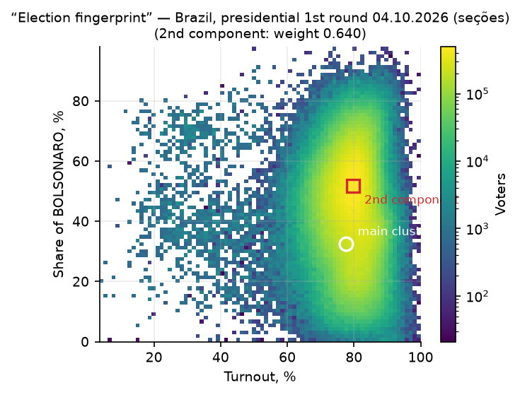

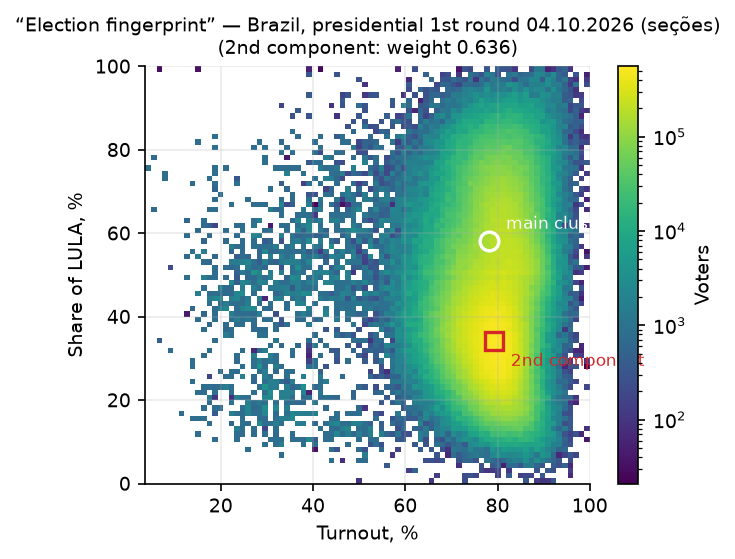

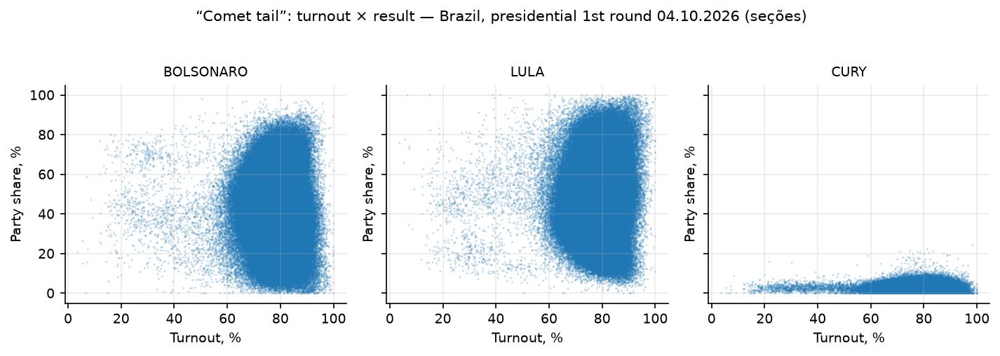

**Verdict: no anomalous cluster; the multi-modality is explained by geography**
(the caveat from section 4 of the review about electorate heterogeneity).

## 3-b. Stratification by macro-regions: Shpilkin and fingerprints within regions

The two conclusions above rest on interpretation: the honest-core boundary is taken from
the national distribution, and the "regionality" of the clusters is shown by a summary
table, not built into the tests (limitation §13.2). There are two checks: stratification
(each of the five macro-regions (+ ZZ) is run on its own, the region's distribution
serves as its own control) and the 2022 control elections on the same sections
(§12: Shpilkin boundary, 2022 fingerprints, turnout jumps). Run:
`scripts/stratified_forensics.py`; tables `shpilkin_by_region.csv`,
`fingerprints_by_region.csv`, `corners_by_region.csv`; metrics — `metrics_stratified.json`.

**Shpilkin within regions.** The honest-decline boundaries (each region's own q99.5)
ranged from 88.9% (Southeast, the lowest-turnout) to 92.8% (North); the Northeast has
**92.7%, above the national 91.6%**: the NE's high-turnout sections lie within the
region's own distribution rather than sticking out above its tail.

| Region | Sections | Turnout | Mode ± σ | Boundary | Turnout tail | Bolsonaro tail | Lula tail |
|---|---|---|---|---|---|---|---|
| North | 43,769 | 80.6% | 82.3 ± 5.2 | 92.8% | 0.50% | 0.30% | 0.75% |
| Northeast | 140,828 | 81.6% | 82.8 ± 4.9 | 92.7% | 0.69% | 0.64% | 0.73% |
| Centre-West | 38,048 | 78.3% | 80.3 ± 5.0 | 89.0% | 0.61% | 0.54% | 0.76% |
| Southeast | 203,237 | 77.3% | 79.3 ± 5.3 | 88.9% | 0.55% | 0.56% | 0.54% |
| South | 72,015 | 79.5% | 80.8 ± 5.0 | 91.3% | 0.50% | 0.56% | 0.40% |
| Abroad* | 1,309 | 37.3% | 48.8 ± 11.7 | 67.8% | 0.52% | 0.18% | 0.85% |

\* ZZ: n=1,309 — the quantile and the mixture are unstable at this size; the row is
for reference.

In no region did either party's tail exceed 0.85% of its votes (the maximum is the
reference ZZ for Lula); recounting the result without the tail shifts the candidates'
shares by at most 0.10 pp in the stable regions (0.15 pp with ZZ). Sum of regional tails:
Bolsonaro 307,851 (0.55%), Lula 339,503 (0.63%) — against the national run's
272,315 / 430,824 (0.49% / 0.80%). For Lula the stratification "returned" ~91 thousand
votes to the honest core: his high-turnout NE electorate was being measured against a
national boundary that is low for him, i.e. the national run conservatively *overstated*
his anomalous zone. There is no "tail in favor of one party" asymmetry within regions
(Lula's tail is larger in the North/CW, Bolsonaro's in the NE and Southeast).

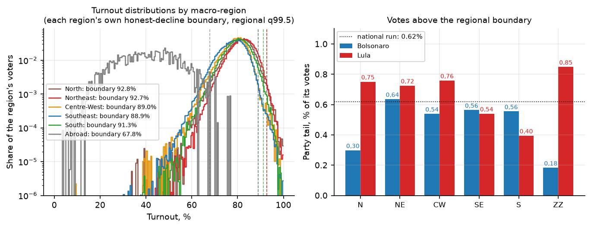

**Fingerprints within regions.** For Lula the two-component mixture does not separate
(the "up-right" criterion) in any region. For Bolsonaro the separation flag fires in
three of the six — North, Northeast, South — but all components lie in the ordinary
turnout band of 75–83%: (81.4; 55.0)/(79.2; 36.5) in the North,
(83.1; 36.8)/(80.2; 21.7) in the NE, (81.2; 63.2)/(77.1; 49.0) in the South. This is
within-region state structure (Rondônia/Roraima vs Pará/Amazonas in the North; the
interior vs the coast in the South) — the same mobilization asymmetry as in the
correlations of §7. The Klimek signature — a compact component at 90–100% turnout and
80–100% share — does not appear in any of the six regions × two candidates (12 runs).

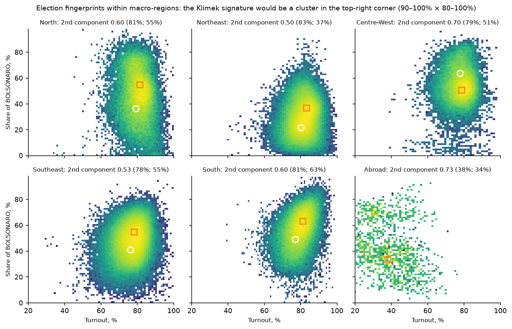

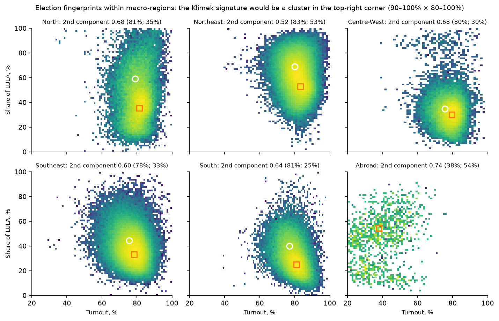

**The "corner" (turnout ≥90% AND share ≥75%) against the regional boundaries.** Of
Lula's 1,481 corner sections, 1,062 are in the NE and 366 in the North, and 68%/62% of
them lie *below* their region's own boundary, i.e. inside its honest core. Bolsonaro's
corner (380 sections) mirrors it in the South (310, of which 47% below the boundary).
The corners distributed strictly along the geography of opposite electorates,
symmetrically to each other, and most of them are not anomalous even by their own
region's standards — a quantitative confirmation of §2's "cultural pattern" thesis.

**Verdict: stratification confirms the conclusions of §2–3 — no anomalies within
regions; the national "tails" and clusters are geography, not fraud.**

## 4. Integer peaks (Kobak et al. 2016)

The null is a binomial Monte Carlo (200 simulations) accounting for section size.

| Metric | Observed | Null | z |
|---|---|---|---|
| Turnout: sections with an integer % | 1.793% | 1.785% | **+0.47** |
| Turnout: integer %s divisible by 5 | — | — | +0.18 |
| Bolsonaro share: integer % | 2.3471% | 2.3477% | **−0.03** |
| Bolsonaro share: divisible by 5 | — | — | +1.27 |


The frequency of integer percentages matches the natural one to within tenths of a
percent (for Russia 2012 z reached tens–hundreds; "Putin peaks" at 60/70/80%).
The turnout histogram is flat, with no protruding teeth at multiples of 5.

**Verdict: clean.** For Brazil this is doubly expected: the ballot machine protocol (BU)
is generated by a machine, not a human — there is nobody at section level to "paint a
round turnout by hand". The self-test (section 9) shows the test would still catch
painting if it were there.

## 5. Benford's law, second digit (Mebane 2006; Deckert et al. 2011)

Tables: `analysis/tables/benford2.csv`, `digit_profiles_benford2.csv`;
extra null — `digit_binomial_null.csv`.

χ² against Benford's law is "significant" for all candidates except Lula (p_MC=0.085).
However, the observed second-digit profiles are **smooth monotone curves without spikes
on individual digits**, and their steepness is fully explained by the narrowness of the
counter range after the ≥10 filter:

| Candidate | n numbers | Profile d0→d9, % |
|---|---|---|
| Bolsonaro | 496,710 | 12.6 → 5.8 |
| Lula | 498,891 | 13.9 → 7.0 |
| Cury | 120,928 | **26.0 → 1.3** |
| Ferreira | 71,875 | **27.1 → 1.6** |
| Caiado | 51,220 | **26.7 → 3.5** |
| Benford (expectation) | — | 12.0 → 8.5 |

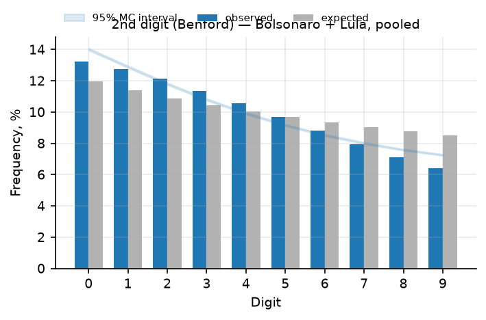

The minor candidates average <10 votes per section: numbers ≥10 lie on a steeply
descending slope of the distribution in the ~10–40 range, where the second digit
mechanically gravitates to small values (a larger number → a larger digit → rarer). The
tool's null model (lognormal fitted to the pool) does not reproduce this steepness —
hence the formal "significance"; the binomial null over sections gives the same verdict
on the inapplicability of the null's shape. Hand-made numbers produce **sample-level**
deviations (spikes on individual digits), not smooth monotonicity — no such spikes for
anyone.

**Verdict: the test is not representative for this data structure (as section 4 of the
review also warns — Benford is a weak instrument); no traces of hand-made numbers.**

## 6. Last digit (Beber–Scacco 2012)

Tables: `analysis/tables/last_digit.csv`, `digit_profiles_last.csv`, `digit_spikes.csv`.

For the **full** set of counters (no threshold) the last digits are perfectly uniform:
Bolsonaro 10.07/9.97/9.95/10.03/10.01/9.98/10.01/9.98/9.99/10.03. After the standard
≥100 filter (for the 2nd and 3rd digit tests) a smooth descending gradient appears
(Bolsonaro 10.65% → 9.49%, max deviation 0.65 pp) — an artifact of truncating the sample
on the descending slope of the distribution (counter modes ~100–110, means 112/108).

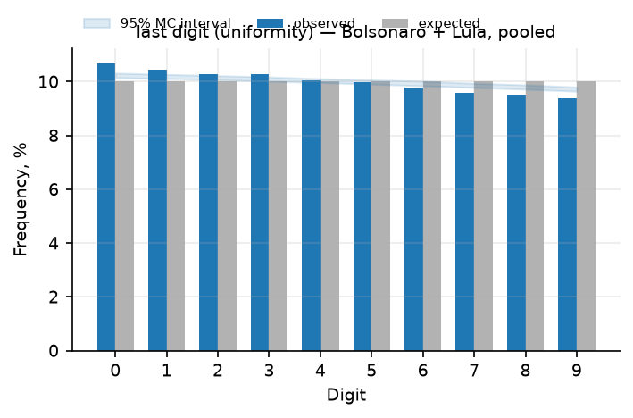

The key quantitative check — the excess of "round" digits over a smooth interpolation of
the profile (the signature of fitting to round numbers):

| Candidate | spike on "0" | spike on "5" |
|---|---|---|
| Bolsonaro | **+0.119 pp** | +0.005 pp |
| Lula | +0.052 pp | +0.111 pp |

The shares are hundredths of a percent (~370 "extra" numbers out of 307 thousand); in
documented painting cases the excess is single-digit percentage points. The uniformity
of the full distribution and the smoothness of the profiles for both candidates are
consistent with machine counting.

**Verdict: clean; the formal χ² "significance" against exact uniformity is an artifact
of the ≥100 filter, not a sign of manipulation.**

## 7. 2D correlations by candidates and states (Kobak et al. 2012)

Tables: `analysis/tables/corr_national.csv`, `corr_uf.csv`.


Nationally: all |r| < 0.12 (Bolsonaro −0.032, Lula +0.052, Zema −0.110).
By state (weighted Pearson, turnout × Bolsonaro share): from −0.30 (PA) to +0.49 (RS);
positive in 21 of 28 (mirrored negative for Lula). This is a moderate within-state
mobilization asymmetry (high-turnout suburbs/rural areas of the South and Northeast vote
more compactly), symmetric with respect to the two candidates; at the federal level it
cancels out against the turnout differences between regions. The vote-transfer signature
("strongly positive for the incumbents, negative for all opponents, growing with
turnout") is not observed.

**Verdict: a heterogeneity pattern, not fraud** (the criticism from section 4 of the
review: the turnout↔result correlation is non-specific — it also occurs in clean cases).

## 8. Outliers vs neighbors (Myagkov–Ordeshook–Shakin 2009) and ML (Zhang et al. 2019)

Tables: `analysis/tables/neighbors_flagged.csv` (all 4,665), `ml_anomalies_top2000.csv`.

- Robust z (against the median of its municipality, |z|>4): **4,665 sections (0.93%)** —
  turnout only 1,967, Bolsonaro share only 2,554, both 144. For a fat-tailed
  distribution this is a normal baseline level (~1%); the profile of a typical outlier is
  a small section in a small municipality (median 277 voters).
  Top outliers: Major Gercino/SC (182 voters), Balbinos/SP (27), Feliz Natal/MT,
  Caroebe/RR, Novo Aripuanã/AM (indigenous/loose territories of the North) — candidates
  for manual verification; no clustering by region/machine model.
- Isolation Forest (1% contamination → 4,993 sections by construction of the ranking):
  the top of the ranking — sections with extreme shares/turnout, mostly small;
  no spatial or machine pattern.
- Duplicate "protocols" (identical vector: electorate, turnout, all votes):
  **1 pair of sections** out of 499 thousand — the level of random coincidence of small
  sections.

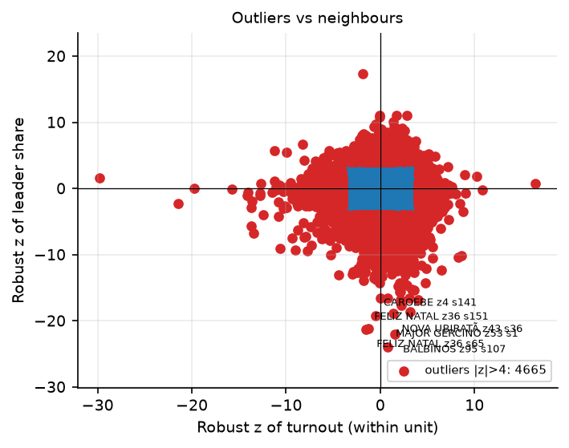

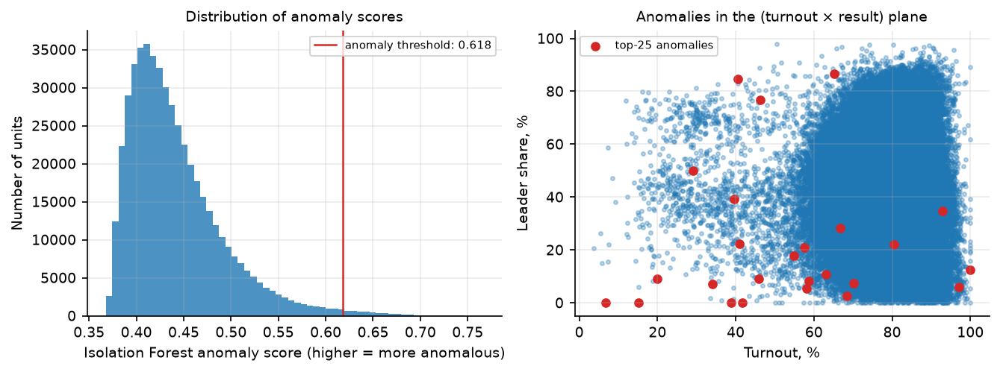

**Verdict: there are individual audit candidates, no systemic pattern.**
The comparison with the past election (method 8-b: turnout/share jumps on the same
sections 2022→2026) is done in
[§12.2](#122-jumps-vs-the-past-election-8-b-on-the-same-sections):
0.73% of sections with |z|>4, no skew in favor of a candidate.

## 9. Self-test of the methods (synthetic injections)

- "Stuffing": +5–35 pp turnout in 10% of sections (1,982,211 added ballots for the
  leader) → the Shpilkin estimate in the anomalous zone grew **22.5×** (272 thousand → 6.12M).
- "Painting": fitting turnout to an integer percent in 5% of sections (24,772 sections)
  → z of the integer peaks **0.35 → 9.89**.

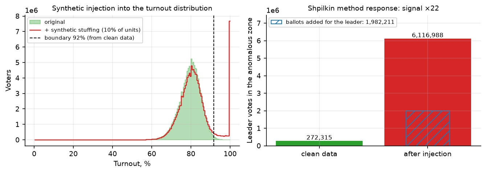

The methods on this data are sensitive enough to notice a ~2M-vote injection and 5%
painted protocols; the observed values stayed at zero (sections 2, 4).

## 10. Brazilian specifics: ballot-machine models

Table: `analysis/tables/urna_models.csv`. A known theme (since 2022) — "old machines paint".

| Model | Sections | Electorate | Turnout | Bolsonaro | Lula |
|---|---|---|---|---|---|
| UE 2013 | 11,920 | 4.13M | 71.6% | 42.93% | 44.96% |
| UE 2015 | 88,064 | 28.42M | 78.5% | 44.58% | 43.12% |
| UE 2020 | 200,466 | 63.23M | 79.0% | 45.07% | 42.84% |
| UE 2022 | 198,756 | 62.98M | 79.4% | 44.70% | 43.02% |

The spread of results between machine generations is ≤1.8 pp; the oldest (UE 2013) has
~7 pp lower turnout, but it is scattered across states (BA, SP, PR, ZZ…) and skewed
toward Lula, not the leader — no "old machines → plus for the incumbents" pattern.
Non-standard result sources (RED-recovery 50 sections, "sistema de apuração" 31,
"totalização" 41) — hundredths of a percent of the electorate, no effect on the result.

## 11. Review methods not applicable to this data

| Review method | Why it was not run |
|---|---|
| №6 Ballot-series statistics + serial-number forensics (Podlazov–Makarov) | Voting is electronic (urnas eletrônicas); there are no paper-ballot serial numbers in the data, no "batches" exist |
| №9 Intraday turnout dynamics | The dataset has only final section results; TSE does not publish intraday per-section snapshots |
| №10 Non-statistical anchors (exit polls, parallel count, cameras) | Outside the downloaded data; the statistical toolkit does not substitute for them |

## 12. 2022 control elections (the same sections)

A control run on the TSE resultados-2022 export (both rounds, dataset — §1):
the honest-decline boundary of Shpilkin taken from the control, the review's method
№8-b "jumps vs the past election", and Klimek fingerprints on the control election.
Run: `scripts/control_forensics.py`; tables `analysis/tables/control_*.csv`,
metrics — `analysis/metrics_control_2022.json`.

Matching 2022↔2026 sections by key (UF — municipality — zone — section):
**461,218 of 499,206 sections-2026 (92.4%; 93.3% of 2026 voters)**.
By region: from 85.8% (North — sections are actively split) to 94.7% (South);
abroad ZZ — 70.9%: embassy sections get renumbered between elections, the jump test for
ZZ is unreliable (see below).

### 12.1. The Shpilkin boundary from the control

The upper percentiles q99.5 of the weighted turnout distribution of the control election
(weighted by electorate, as in §2): 2022 R1 — 91.33%, 2022 R2 — 91.52%;
the boundary (maximum) — **91.52%** against 2026's own 91.60%. The boundaries matched to
within 0.08 pp; recounting against the control boundary changes nothing
(779,412 voters in the tail = 0.62%; result recount ±0.07 pp).
The key check is not the boundary itself but **the level of the 2026 tails against the
own tails of the honest 2022 election**:

| Election | q99.5 boundary | Turnout tail | Bolsonaro tail | Lula tail |
|---|---|---|---|---|
| 2026, 1st round (observation) | 91.60% | 0.62% | **0.49%** | **0.80%** |
| 2022, 1st round (control) | 91.33% | 0.52% | 0.47% | 0.58% |
| 2022, 2nd round (control) | 91.52% | 0.59% | 0.57% | 0.62% |

The 2026 tails are of the same order as the own tail of the honest 2022 control
(Bolsonaro-2026 at 0.49% is even lower than Bolsonaro-2022 in round 2); Lula's excess
(0.80% vs the control's 0.58–0.62%) is entirely his high-turnout Northeast, as the
stratification of §3-b shows (the sum of Lula's regional tails is 0.63% at each region's
own boundary). The 2022 and 2026 turnout distributions are practically indistinguishable
(figure below): unimodal, mode ~80%, no right tail in any round.

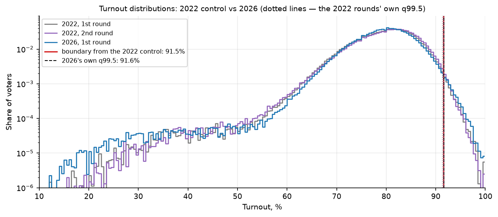

Table: `analysis/tables/control_shpilkin.csv`.

### 12.2. Jumps vs the past election (№8-b) on the same sections

On the 461,218 matched sections (2022-R1 → 2026-R1): a section's turnout stability
across four years — r(turnout-2022, turnout-2026) = **0.77**; overall turnout barely
changed (79.08% → 78.98% on these sections). The political shift — a swing to Bolsonaro
of ±3.5 pp (41.3% → 44.9% against 46.3% → 42.9% for Lula, shares of votes cast).

| Metric | Value |
|---|---|
| Δturnout: median / MAD | −0.38 / 2.46 pp (q01–q99: −9.3…+12.5) |
| Sections with \|z\|>4 (robust, global) | **3,346 (0.73%)**: up 2,631, down 715 |
| r(Δturnout, Δ Bolsonaro share) | **+0.015** |
| r(Δturnout, Δ Lula share) | **−0.007** |
| Bolsonaro swing across Δturnout deciles | +3.5…+3.9 pp in all ten (uniform) |

The stuffing signature "the turnout gain is skewed in favor of the beneficiary" is
absent: the correlations of the turnout gain with the share changes are zero (in
documented cases the beneficiary has +0.3…+0.6), Bolsonaro's swing is the same in all
deciles of the turnout gain (table `control_deciles.csv`; in the top decile, median Δturnout
+7.5 pp, Lula's share even falls: 51.5% → 48.1%). The flagged sections (0.73%)
concentrate where turnout grew — the Northeast (1,475 flags = 1.14%
of the region's sections) and the North (530 = 1.41%) vs 0.2–0.5% in the South/Southeast/CW —
and turn leftier (Lula-2026 in them 53.3% vs 42.9% on average) precisely because
this is the electoral geography of turnout-growth regions, not an anomaly: within their
own regions these sections passed the §3-b check. ZZ contributes 18% of the flags at a
median Δturnout of −5.2 pp — an artifact of embassy-section renumbering, not interpreted.

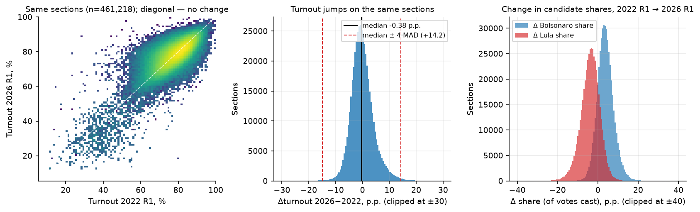

Tables: `analysis/tables/control_jumps_by_region.csv` (by region),
`control_jumps_extreme.csv` (top-200 by |z|), `control_deciles.csv`.

### 12.3. Fingerprints on the 2022 control elections

The two-cluster fingerprint structure of 2026 (§3: Bolsonaro components
(77.6; 32.5)/(79.6; 51.8)) already existed in 2022 — the mixture "separation" flag fires
on the control elections of both rounds, and all components lie in the ordinary turnout
band:

| Election | Candidate | Component 1 (main) | Component 2 | Klimek cluster 90–100%×80–100% |
|---|---|---|---|---|
| 2022, 1st round | Bolsonaro | (77.0; 28.5) | (80.2; 48.3) | no |
| 2022, 2nd round | Bolsonaro | (77.3; 31.7) | (80.5; 54.9) | no |
| 2022, 1st round | Lula | (77.6; 62.6) | (79.9; 37.7) | no |
| 2022, 2nd round | Lula | (77.3; 63.9) | (80.5; 40.5) | no |

I.e. the "split" fingerprint is a stable regional structure of the Brazilian electorate
(NE/North vs South/Southeast), observed in the honest control too, not a cluster that
appeared in 2026; the Klimek signature is absent in every 2022 run.
Table: `analysis/tables/control_fingerprints_2022.csv`.

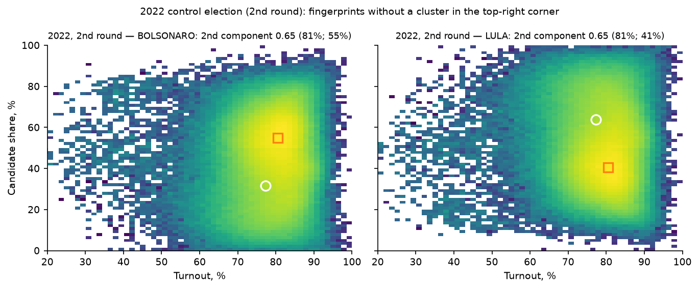

**Verdict: the 2022 control elections confirm the conclusions of §2–3 and close the
limitations of the previous version of the report. The Shpilkin boundary from the
control matches the own one; the 2026 tails are at the level of the own noise of the
honest 2022 election; turnout jumps on the same sections are not skewed toward
candidates; the 2026 fingerprints reproduce the 2022 structure.**

## 13. Limitations

1. **The 2022 control elections are added** ([§12](#12-2022-control-elections-the-same-sections)):
   the Shpilkin boundary is confirmed by the control (91.5% ≈ 91.6%), the №8-b jumps are
   checked, the 2026 fingerprints reproduce the 2022 structure. Residual caveat: the match
   covers 92.4% of the 2026 sections (93.3% of voters; ZZ 71% — renumbering of embassy
   sections); for the uncovered 7.6% (new/renamed sections) the comparison with the
   control is impossible — they are checked only by the runs of §2–8.
2. **Regional heterogeneity is enormous** (Lula 60.5% in the NE vs 30.1% in the South):
   the mixtures and within-state correlations reflect geography; "homogeneity" tests
   without a region correction are weak-powered. For the key methods the correction is
   made by stratification into macro-regions ([§3-b](#3-b-stratification-by-macro-regions-shpilkin-and-fingerprints-within-regions):
   own Shpilkin boundaries, within-region fingerprints and corners), correlations are
   computed by state (§7), outliers — against neighbors within the municipality (§8), plus
   the 2022 control on the same sections (§12). The residual state-level heterogeneity
   within macro-regions is visible in the mixture components of §3-b and §12.3
   (the 75–83% turnout band) and carries no fraud signature.
3. **Electronic counting** changes the baseline meaning of the "protocol" tests (peaks,
   digits): their null is not "a human with a calculator" but a machine; the positive case
   here would be hacking/substitution of results at the transmission level, which would
   leave other traces (BU/BU-archive discrepancies, outside this dataset).
4. Only the **1st round** is analyzed; round 2 (25.10.2026) will appear in the dataset
   later — repeat the run with the commands below.
5. The sections cover 100% of the voting, but section-level forensics cannot see
   manipulation above the section (rewriting during aggregation) — for that one needs
   BU ↔ totalização cross-checks, which the open dataset does not have.

## 14. Files and reproduction

```
brazil-oct-2026-round-1/
  download_votacao_secao.sh               — download the 2026 export (~23 GB of CSV)
  download_votacao_secao_2022.sh          — download the 2022 control, both rounds (~0.5 GB)
  data/votacao_secao/                     — TSE 2026 export (zip + CSV)
  data/votacao_secao_2022/                — TSE 2022 export (zip + CSV, both rounds)
  data/secoes_presidente_2026.csv         — 2026 section dataset (81 MB)
  data/secoes_presidente_2026_checks.json — self-consistency checks
  data/secoes_presidente_2022.csv         — 2022 control dataset, both rounds (149 MB)
  data/secoes_presidente_2022_checks.json — its checks (0 mismatches)
  scripts/build_sections_csv.py           — build the 2026 dataset from the TSE export
  scripts/build_sections_csv_2022.py      — build the 2022 control dataset
  scripts/run_forensics.py                — run of all methods
  scripts/stratified_forensics.py         — stratification by macro-regions (§3-b)
  scripts/control_forensics.py            — 2022 control: boundary, jumps, fingerprints (§12)
  scripts/digit_binomial_null.py          — extra binomial null for the digit tests
  analysis/figures/*.png (18)             — charts of all methods (embedded above)
  analysis/tables/*.csv (21)              — tables (correlations, outliers, machines, digits,
                                              stratification; 2022 control: shpilkin,
                                              deciles, jumps_by_region, jumps_extreme,
                                              fingerprints_2022)
  analysis/metrics.json                   — all metrics of the run
  analysis/metrics_stratified.json        — metrics of the stratified run
  analysis/metrics_control_2022.json      — metrics of the 2022 control run
```

```bash
cd analysis-tool
uv run python ../brazil-oct-2026-round-1/scripts/build_sections_csv.py     # ~2 min
uv run python ../brazil-oct-2026-round-1/scripts/run_forensics.py          # ~2 min
uv run python ../brazil-oct-2026-round-1/scripts/stratified_forensics.py   # ~5 s
uv run python ../brazil-oct-2026-round-1/scripts/digit_binomial_null.py    # ~1 min

bash brazil-oct-2026-round-1/download_votacao_secao_2022.sh                # 2022 control, ~15 min
uv run python ../brazil-oct-2026-round-1/scripts/build_sections_csv_2022.py  # ~3 min
uv run python ../brazil-oct-2026-round-1/scripts/control_forensics.py        # ~1 min
```

After the 2nd-round results are published (25.10.2026) — fetch the dataset
(`brazil-oct-2026-round-1/download_votacao_secao.sh`, curl `-C -`) and repeat the run,
setting `NR_TURNO=2` in the `build_sections_csv.py` filters.
