# Бразилия, президентские выборы 04.10.2026 (1-й тур): статистический анализ фальсификаций

Отчёт по прогонке методов election forensics из обзора
[`методы_выявления_фальсификаций_выборов.md`](../методы_выявления_фальсификаций_выборов.md)
инструментом [`analysis-tool/`](../analysis-tool/) по официальным данным TSE
уровня избирательного участка (seção). Дата анализа: 12.10.2026; контрольные
выборы-2022 на тех же секциях (граница Шпилькина, скачки явки/долей №8-б,
отпечатки) добавлены 12.10.2026 — раздел 12.

**Вывод заранее: систематических статистических следов фальсификаций не обнаружено.**
Ни один из применимых методов (Шпилькин, отпечатки Klimek, целочисленные пики,
2D-корреляции, последняя цифра, соседи, ML, модели урн — национально и в стратификации
по макрорегионам, плюс контроль-2022 на тех же секциях) не дал сигнала того вида,
который эти методы считают признаком манипуляций; самотест подтверждает, что на этих
данных методы чувствительны и «видели бы» вброс/рисовку. Формальные «значимости»
цифровых тестов объясняются структурными особенностями данных (разобрано в разделах 5–6).

## Сводная таблица по методам

| № | Метод | Результат на BR-2026 (1-й тур) | Вердикт | Раздел |
|---|---|---|---|---|
| 2 | Шпилькин (хвост явки) | хвост >91,6% = 0,62% голосов; у лидера 0,49% (у Лулы 0,80%); пересчёт ±0,07 п.п. | **чисто** | [2](#2-метод-шпилькина-распределение-явки-честное-ядро) |
| 1 | Отпечатки Klimek | два региональных кластера с явкой 78–80%; кластера при 90–100%/80–100% нет | **чисто** | [3](#3-электоральные-отпечатки-пальцев--хвост-кометы-klimek-et-al-2012) |
| — | Стратификация по макрорегионам | свои границы 89–93% (у СВ выше нац.); хвосты обеих партий 0,2–0,8% везде; кластера 90–100% ни в одном регионе | **чисто** | [3-б](#3-б-стратификация-по-макрорегионам-шпилькин-и-отпечатки-внутри-регионов) |
| 3 | Целочисленные пики | z(явка)=+0,5; z(доля лидера)=−0,03 | **чисто** | [4](#4-целочисленные-пики-kobak-et-al-2016) |
| 4 | Бенфорд-2 | гладкие монотонные профили; «значимость» = артефакт узких счётчиков | **неприменим/чисто** | [5](#5-закон-бенфорда-вторая-цифра-mebane-2006-deckert-et-al-2011) |
| 5 | Последняя цифра | полное распределение равномерно; шипы 0/5 ≤0,12 п.п. | **чисто** | [6](#6-последняя-цифра-beberscacco-2012) |
| 3-б | 2D-корреляции | нац. r≈0; по штатам −0,30…+0,49, зеркальные у двух лидеров | **неоднородность, не фальсификации** | [7](#7-2d-корреляции-по-кандидатам-и-штатам-kobak-et-al-2012) |
| 8 | Соседи | 0,93% выбросов (базовый уровень), паттерна нет | **кандидаты на аудит** | [8](#8-выбросы-против-соседей-myagkovordeshookshakin-2009-и-ml-zhang-et-al-2019) |
| 7 | ML (Isolation Forest) | 1% по построению; экстремальные малые секции | **кандидаты на аудит** | [8](#8-выбросы-против-соседей-myagkovordeshookshakin-2009-и-ml-zhang-et-al-2019) |
| — | Самотест | вброс 2 млн виден (×22), рисовка 5% видна (z→9,9) | методы чувствительны | [9](#9-самотест-методов-синтетические-инъекции) |
| — | Модели урн | разброс ≤1,8 п.п., старые урны не проправительственные | **чисто** | [10](#10-бразильская-специфика-модели-урн) |
| — | Контроль-2022 (те же секции) | граница Шпилькина по контролю 91,5% ≈ собственной 91,6%; хвосты 2026 (0,49/0,80%) — на уровне собственных хвостов честных 2022 (0,47–0,62%); r(Δявка, Δдоля) ≈ 0; свинг равномерен по децилям явки | **чисто** | [12](#12-контрольные-выборы-2022-те-же-секции) |
| 6, 9, 10 | Серии/динамика дня/якоря | не применимы (электронное голосование, нет данных) | — | [11](#11-методы-обзора-неприменимые-к-этим-данным) |

---

## 1. Данные и самосогласованность

Источник: портал открытых данных TSE, датасет resultados-2026, финальные итоги 1-го
тура (файлы сгенерированы 05–06.10.2026); уровень — отдельная урна/участок.
Подготовка датасета: `scripts/build_sections_csv.py`
(выход `data/secoes_presidente_2026.csv`, 81 МБ; проверки —
`data/secoes_presidente_2026_checks.json`).

| Показатель | Значение |
|---|---|
| Секций всего | **499 248** (+ заграница ZZ 13 509 строк в составе) |
| В анализе (voted > 0) | 499 206 (выброшено 42 секции с нулевой явкой: 41 неустановленная за границей + 1 «Sistema de apuração») |
| Электорат | 158 745 502 |
| Явились | 125 275 835 (явка **78,92%**; неявка 33,5 млн — голосование де-факто обязательное) |
| Белые / нулевые | 2 300 798 (1,84%) / 3 669 003 (2,93%) |
| Болсонару (22) | 56 104 503 — 47,03% действительных |
| Лула (13) | 53 879 538 — 45,16% действительных |
| Кури (70) / Феррейра (14) / Каиаду (55) | 3 448 569 / 2 675 887 / 2 605 148 |
| 2-й тур | 25.10.2026, Болсонаро × Лула (никто не набрал 50%) |

**Проверки самосогласованности (все — 0 расхождений):** сумма номинальных голосов
файла `votacao` = `QT_VOTOS_NOMINAIS` detalhe во всех 499 248 секциях;
номинал + белые + нулевые = явившимся (остаток 0, аннулированных-в-отдельном-подсчёте 0);
белые/нулевые из файла голосов = колонкам detalhe; дубликатов ключей секций нет;
секций с явкой > электората нет; общий итог совпадает с официальным до единого голоса.

Единственная особенность — 42 секции без голосов (41 неустановленная за границей
с «урной» #NULO и флагом `ST_SECAO_INSTALADA=Não`): они исключены из анализа,
их электорат (7 309) учтён в неявке.

**Контрольные выборы-2022** (добавлены 12.10.2026): выгрузка TSE resultados-2022,
оба тура (`download_votacao_secao_2022.sh`), датасет `data/secoes_presidente_2022.csv`
(`scripts/build_sections_csv_2022.py`; 472 075 секций в каждом туре, электорат
156 454 011 — точное официальное число, явка 79,05% / 79,42%; итоги сходятся
с официальными до голоса, все проверки самосогласованности — 0 расхождений).
Используется как контроль в §12: граница Шпилькина, скачки на тех же секциях,
отпечатки.

Явка по секциям: медиана 79,7%, q01–q99 = 63,5–91,0%, взвешенная мода 80,75%
(σ 5,8 п.п.). Заграница (ZZ, 1 351 секция в анализе) — отдельный низкоявочный
кластер (37,3%), оставлен в данных как честная неоднородность.

## 2. Метод Шпилькина (распределение явки, «честное ядро»)

Распределение явки одногорбое и симметричное, тяжёлого правого хвоста нет
(мода 80,75%, σ 5,8 п.п.). Граница честного спада — верхний перцентиль q99,5
контрольных выборов-2022 на тех же секциях (§12.1): max(91,33%; 91,52%) =
**91,5%** — практически совпадает с собственным q99,5-2026 (91,60%), поэтому
прогон ниже идёт по собственной границе 91,6%, а контрольное сравнение хвостов
с уровнем честных выборов-2022 — в §12.1.

| Выше границы 91,6% | Значение |
|---|---|
| Проголосовавших | 779 412 (0,62% явившихся; 3 622 секции) |
| Голосов Болсонару | 272 315 — **0,49%** его голосов |
| Голосов Лулы | 430 824 — **0,80%** его голосов |
| Пересчёт без хвоста | Болсонару 44,85% (набл. 44,78), Лула 42,93% (набл. 43,01) |

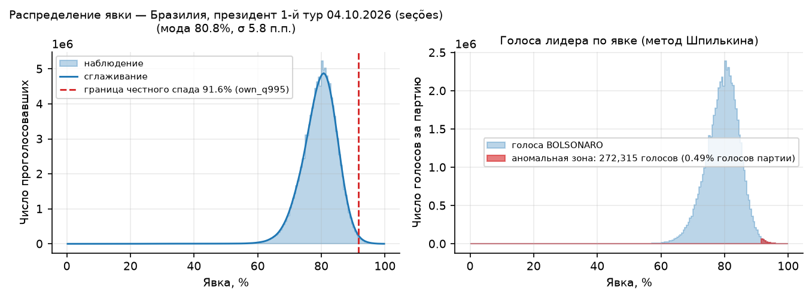

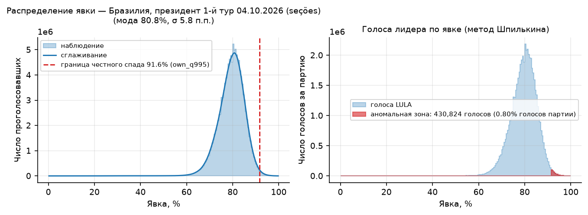

**Интерпретация.** Аномальная зона мизерная и *не смещена в пользу лидера* —
на высокой явке доля Лулы даже чуть выше его общенациональной. Это противоположно
сигнатуре приписок («хвост кометы» вверх-вправо за «партию власти»; в российских
кейсах 2011–2024 аномальная зона — миллионы и 10–30% голосов лидера). Для сравнения:
угол «явка ≥ 90% И доля Болсонару ≥ 75%» — всего 380 секций / 78 930 избирателей /
63 611 голосов (0,11% голосов Болсонару); у Лулы такой же угол больше (1 481 секция —
высокоявочные малые города Северо-Востока, культурный паттерн региона;
внутрирегионная проверка — [§3-б](#3-б-стратификация-по-макрорегионам-шпилькин-и-отпечатки-внутри-регионов)).

**Вердикт: аномалий по Шпилькину нет.**

## 3. Электоральные «отпечатки пальцев» + хвост кометы (Klimek et al. 2012)

- Национальная взвешенная корреляция явка × результат: Болсонару **−0,032**
  (Спирмен −0,056), Лула +0,052 — облако горизонтальное, «кометы» нет
  (у «партии власти» в фальсифицированных кейсах +0,5…+0,9).
- Смесь двух 2D-гауссиан (Болсонару) разделилась на два кластера:
  (явка 77,6%, доля 32,5%, вес 0,36) и (79,6%, 51,8%, вес 0,64). Флаг «разделение»
  сработал, но это **региональная структура электората, а не фальшивый кластер**:
  Северо-Восток — Лула 60,5% против Болсонару 29,3% при явке 81,6%;
  Юг — Болсонару 57,8% против Лулы 30,1% при явке 79,5% (таблица
  `analysis/tables/macroregions.csv`). У обеих компонент обычная явка 78–80%,
  тогда как сигнатура Klimek — компактный кластер при явке ~90–100% и доле ~80–100%.
- Зеркальная картина у Лулы: (78,2%, 58,1%) и (79,3%, 34,2%) — то же региональное
  деление с другой стороны.

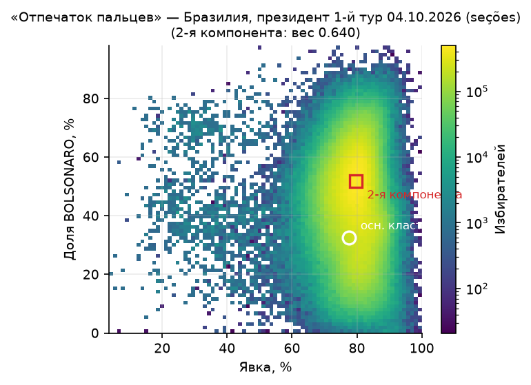


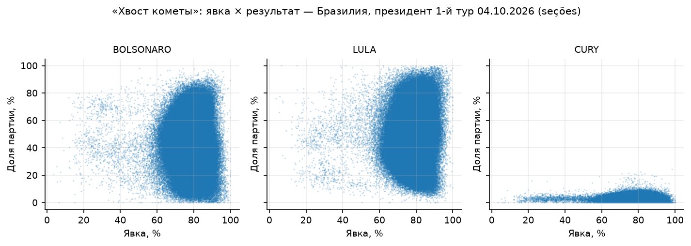

**Вердикт: аномального кластера нет; многокомпонентность объяснима географией**
(оговорка из раздела 4 обзора про неоднородность электората).

## 3-б. Стратификация по макрорегионам: Шпилькин и отпечатки внутри регионов

Два вывода выше опираются на интерпретацию: граница честного ядра взята по
национальному распределению, а «региональность» кластеров показана сводной
таблицей, не встроена в тесты (ограничение §13.2). Проверок две: стратификация
(каждый из пяти макрорегионов (+ ZZ) прогоняется сам по себе, распределение
региона служит контролем самого себя) и контрольные выборы-2022 на тех же
секциях (§12: граница Шпилькина, отпечатки-2022, скачки явки). Прогон:
`scripts/stratified_forensics.py`; таблицы `shpilkin_by_region.csv`,
`fingerprints_by_region.csv`, `corners_by_region.csv`; метрики — `metrics_stratified.json`.

**Шпилькин внутри регионов.** Границы честного спада (собственный q99,5 региона)
разошлись от 88,9% (Юго-Восток, самый низкоявочный) до 92,8% (Север); у
Северо-Востока — **92,7%, выше национальной 91,6%**: высокоявочные секции СВ лежат
в пределах собственного распределения региона, а не торчат над его хвостом.

| Регион | Секций | Явка | Мода ± σ | Граница | Хвост явившихся | Хвост Болсонару | Хвост Лулы |
|---|---|---|---|---|---|---|---|
| Север | 43 769 | 80,6% | 82,3 ± 5,2 | 92,8% | 0,50% | 0,30% | 0,75% |
| Северо-Восток | 140 828 | 81,6% | 82,8 ± 4,9 | 92,7% | 0,69% | 0,64% | 0,73% |
| Центр.-Запад | 38 048 | 78,3% | 80,3 ± 5,0 | 89,0% | 0,61% | 0,54% | 0,76% |
| Юго-Восток | 203 237 | 77,3% | 79,3 ± 5,3 | 88,9% | 0,55% | 0,56% | 0,54% |
| Юг | 72 015 | 79,5% | 80,8 ± 5,0 | 91,3% | 0,50% | 0,56% | 0,40% |
| Заграница* | 1 309 | 37,3% | 48,8 ± 11,7 | 67,8% | 0,52% | 0,18% | 0,85% |

\* ZZ: n=1 309 — квантиль и смесь на таком объёме неустойчивы, строка справочная.

Ни в одном регионе хвост ни одной партии не превысил 0,85% её голосов (максимум —
справочный ZZ у Лулы); пересчёт итога без хвоста сдвигает доли кандидатов не более
чем на 0,10 п.п. в стабильных регионах (0,15 п.п. с ZZ). Сумма региональных хвостов:
Болсонару 307 851 (0,55%), Лула 339 503 (0,63%) — против национального прогона
272 315 / 430 824 (0,49% / 0,80%). У Лулы стратификация «вернула» в честное ядро
~91 тыс. голосов: его высокоявочный электорат СВ измерялся против заниженной для
него общенациональной границы, т.е. национальный прогон консервативно *завышал*
его аномальную зону. Асимметрии «хвост в пользу одной партии» внутри регионов нет
(у Лулы хвост больше на Севере/ЦЗ, у Болсонару — на СВ и Юго-Востоке).

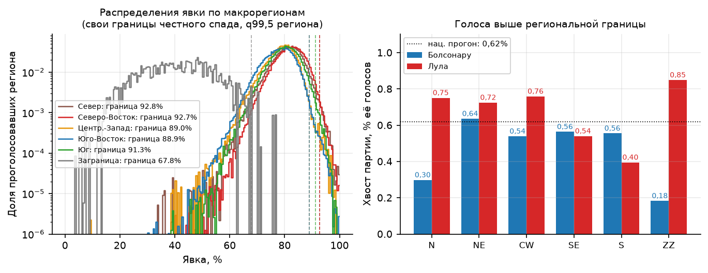

**Отпечатки внутри регионов.** У Лулы смесь двух компонент не разделяется
(критерий «вправо-вверх») ни в одном регионе. У Болсонару флаг разделения
срабатывает в трёх из шести — Север, Северо-Восток, Юг, — но все компоненты лежат
в полосе обычной явки 75–83%: (81,4; 55,0)/(79,2; 36,5) на Севере,
(83,1; 36,8)/(80,2; 21,7) на СВ, (81,2; 63,2)/(77,1; 49,0) на Юге. Это
внутрирегионная структура штатов (Рондония/Рорайма против Парá/Амазонас на Севере;
интериор против побережья на Юге) — та же мобилизационная асимметрия, что в
корреляциях §7. Сигнатура Klimek — компактная компонента при явке 90–100% и доле
80–100%: в шести регионах × двух кандидатах (12 прогонов) такой компоненты нет
ни разу.

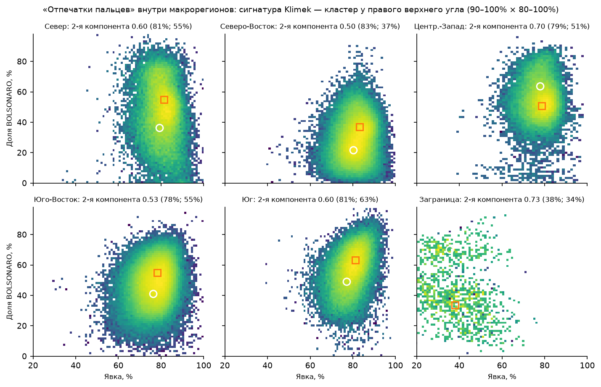

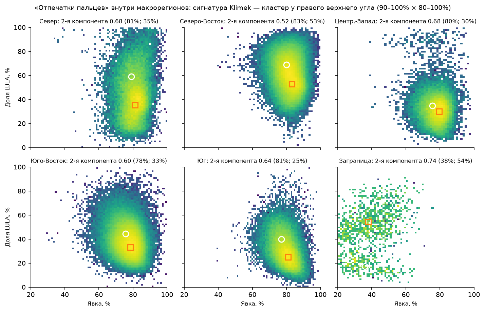

**«Угол» (явка ≥90% И доля ≥75%) относительно региональных границ.** Из 1 481
секции угла Лулы 1 062 — на СВ и 366 на Севере, и 68%/62% из них лежат *ниже*
собственной границы региона, т.е. внутри его честного ядра. У Болсонару угол
(380 секций) зеркально сидит на Юге (310, из них 47% ниже границы). Углы
распределились строго по географии противоположных электоратов, симметрично друг
относительно друга, и большая их часть не является аномалией даже по меркам
своего региона — количественное подтверждение тезиса §2 о «культурном паттерне».

**Вердикт: стратификация подтверждает выводы §2–3 — внутри регионов аномалий нет;
национальные «хвосты» и кластеры — география, а не фальсификации.**

## 4. Целочисленные пики (Kobak et al. 2016)

Нуль — биномиальное Монте-Карло (200 симуляций), учитывающее размер секции.

| Метрика | Наблюдение | Нуль | z |
|---|---|---|---|
| Явка: секций с целым % | 1,793% | 1,785% | **+0,47** |
| Явка: целые %, кратные 5 | — | — | +0,18 |
| Доля Болсонару: целые % | 2,3471% | 2,3477% | **−0,03** |
| Доля Болсонару: кратные 5 | — | — | +1,27 |

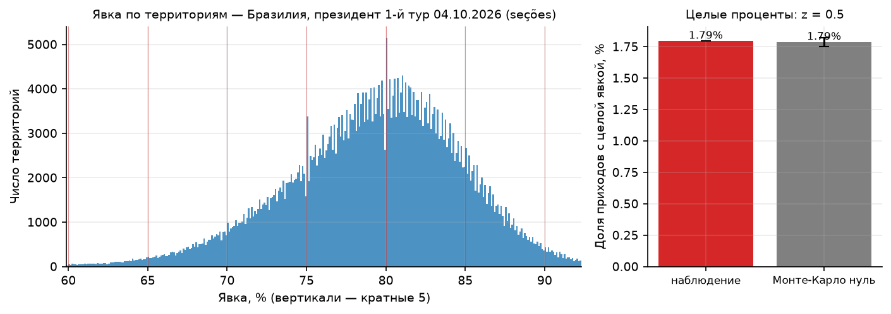

Частота целых процентов совпадает с естественной с точностью до десятых долей
процента (для России 2012 z достигал десятков–сотен; «путинские пики» на 60/70/80%).
Гистограмма явки ровная, выделенных зубцов на кратных 5 нет.

**Вердикт: чисто.** Для Бразилии это ожидаемо вдвойне: протокол урны (BU) формирует
машина, а не человек, — «рисовать круглую явку руками» на уровне секции некому.
Самотест (раздел 9) показывает, что тест всё равно ловил бы рисовку, если бы она была.

## 5. Закон Бенфорда, вторая цифра (Mebane 2006; Deckert et al. 2011)

Таблицы: `analysis/tables/benford2.csv`, `digit_profiles_benford2.csv`;
доп. нуль — `digit_binomial_null.csv`.

χ² против закона Бенфорда «значим» у всех кандидатов, кроме Лулы (p_MC=0,085).
Однако наблюдаемые профили второй цифры — **гладкие монотонные кривые без шипов
на отдельных цифрах**, и их крутизна полностью объясняется узостью диапазона
счётчиков после фильтра ≥10:

| Кандидат | n чисел | Профиль d0→d9, % |
|---|---|---|
| Болсонару | 496 710 | 12,6 → 5,8 |
| Лула | 498 891 | 13,9 → 7,0 |
| Кури | 120 928 | **26,0 → 1,3** |
| Феррейра | 71 875 | **27,1 → 1,6** |
| Каиаду | 51 220 | **26,7 → 3,5** |
| Бенфорд (ожидание) | — | 12,0 → 8,5 |

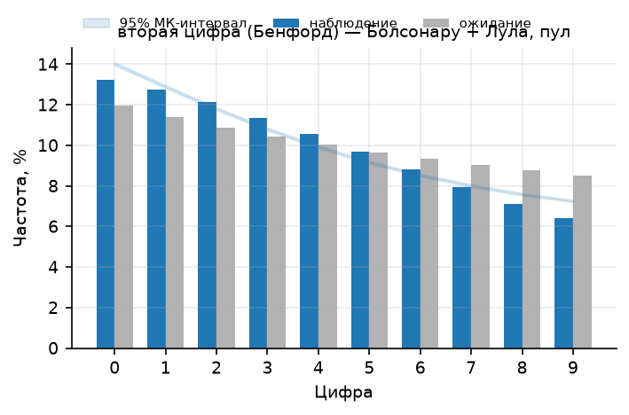

У минорных кандидатов среднее <10 голосов на секцию: числа ≥10 лежат на круто
убывающем склоне распределения в диапазоне ~10–40, где вторая цифра механически
тяготеет к малым значениям (большее число → большая цифра → реже). Нулевая модель
инструмента (логнормаль, подогнанная к пулу) не воспроизводит эту крутизну — отсюда
формальная «значимость»; биномиальный нуль по секциям даёт тот же вывод о
неприменимости формы нуля. Рукодельные числа дают **выборочные** отклонения
(шипы на отдельных цифрах), а не гладкую монотонность — таких шипов нет ни у кого.

**Вердикт: тест нерепрезентативен для этой структуры данных (о чём предупреждает
и раздел 4 обзора — Бенфорд слабый инструмент); следов рукодельных чисел нет.**

## 6. Последняя цифра (Beber–Scacco 2012)

Таблицы: `analysis/tables/last_digit.csv`, `digit_profiles_last.csv`, `digit_spikes.csv`.

У **полного** множества счётчиков (без порога) последние цифры идеально равномерны:
Болсонару 10,07/9,97/9,95/10,03/10,01/9,98/10,01/9,98/9,99/10,03. После штатного
фильтра ≥100 (2-й и 3-й тур цифр) появляется плавный убывающий градиент
(Болсонару 10,65% → 9,49%, максимум отклонения 0,65 п.п.) — артефакт усечения
выборки на убывающем склоне распределения (моды счётчиков ~100–110, средние 112/108).


Ключевая количественная проверка — избыток «круглых» цифр сверх гладкой интерполяции
профиля (сигнатура подгонки под круглые числа):

| Кандидат | шип на «0» | шип на «5» |
|---|---|---|
| Болсонару | **+0,119 п.п.** | +0,005 п.п. |
| Лула | +0,052 п.п. | +0,111 п.п. |

Доли сотые доли процента (~370 «лишних» чисел на 307 тыс.); в задокументированных
кейсах рисовки превышение — единицы процентных пунктов. Равномерность полного
распределения и гладкость профилей у обоих кандидатов согласуются с машинным счётом.

**Вердикт: чисто; формальная χ²-«значимость» против точной равномерности —
артефакт фильтра ≥100, а не признак манипуляций.**

## 7. 2D-корреляции по кандидатам и штатам (Kobak et al. 2012)

Таблицы: `analysis/tables/corr_national.csv`, `corr_uf.csv`.

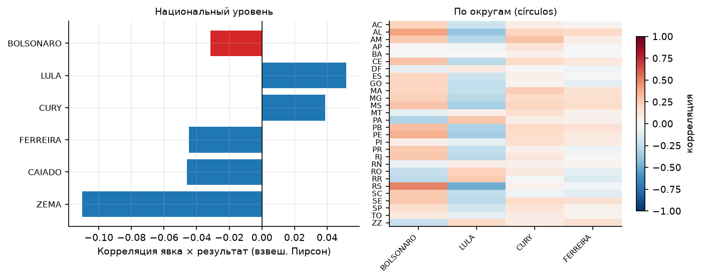

Национально: все |r| < 0,12 (Болсонару −0,032, Лула +0,052, Зема −0,110).
По штатам (взвешенный Пирсон, явка × доля Болсонару): от −0,30 (PA) до +0,49 (RS);
положительна в 21 из 28 (у Лулы — зеркально отрицательная). Это умеренная
внутриштатная мобилизационная асимметрия (высокоявочные пригороды/село Юга и
Северо-Востока голосуют компактнее), симметричная относительно двух кандидатов;
на федеральном уровне она гасится разницей явок между регионами. Сигнатура
перелива голосов («у власти сильно положительно, у всех оппонентов отрицательно,
растёт с явкой») не наблюдается.

**Вердикт: паттерн неоднородности, а не фальсификаций** (критика из раздела 4 обзора:
корреляция явка↔результат неспецифична — встречается и в чистых кейсах).

## 8. Выбросы против соседей (Myagkov–Ordeshook–Shakin 2009) и ML (Zhang et al. 2019)

Таблицы: `analysis/tables/neighbors_flagged.csv` (все 4 665), `ml_anomalies_top2000.csv`.

- Робастный z (против медианы своего муниципалитета, |z|>4): **4 665 секций (0,93%)**
  — только явка 1 967, только доля Болсонару 2 554, оба 144. Для толстостороннего
  распределения это нормальный базовый уровень (~1%); профиль типичного выброса —
  маленькая секция в малом муниципалитете (медиана 277 избирателей).
  Топ-выбросы: Major Gercino/SC (182 изб.), Balbinos/SP (27 изб.), Feliz Natal/MT,
  Caroebe/RR, Novo Aripuanã/AM (индейские/рыхлые территории Севера) — кандидаты
  на ручную проверку, кластеризации по региону/модели урны нет.
- Isolation Forest (1% contamination → 4 993 секций по построению рейтинга):
  верх рейтинга — секции с экстремальными долями/явкой, в основном малые;
  пространственного или машинного паттерна нет.
- Дубликаты «протоколов» (идентичный вектор: электорат, явка, все голоса):
  **1 пара секций** на 499 тыс. — уровень случайного совпадения малых секций.

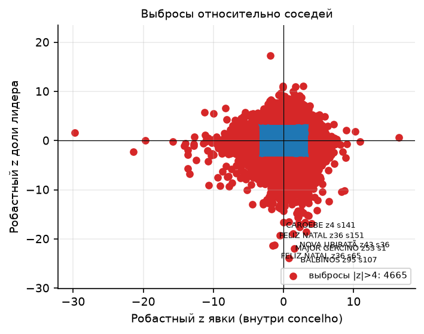

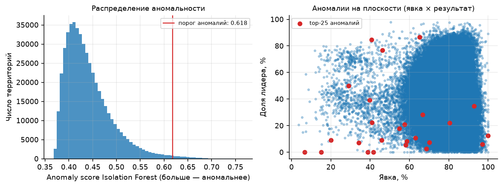

**Вердикт: отдельные кандидаты на аудит есть, системного паттерна нет.**
Сравнение с прошлыми выборами (№8-б: скачки явки/доли на тех же секциях
2022→2026) выполнено в [§12.2](#122-скачки-к-прошлым-выборам-8-б-на-тех-же-секциях):
0,73% секций с |z|>4, смещения в пользу кандидата нет.

## 9. Самотест методов (синтетические инъекции)

- «Вброс»: +5–35 п.п. явки в 10% секций (1 982 211 добавленный бюллетень за лидера)
  → оценка Шпилькина в аномальной зоне выросла **в 22,5 раза** (272 тыс. → 6,12 млн).
- «Рисование»: подгонка явки под целый процент в 5% секций (24 772 секции)
  → z целочисленных пиков **0,35 → 9,89**.

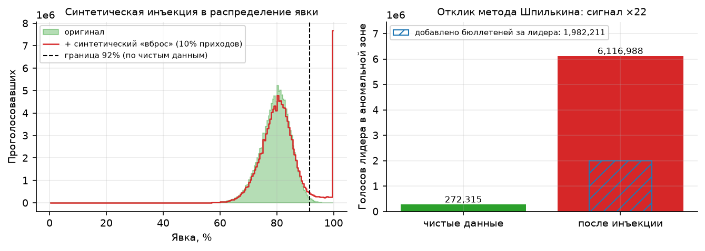

Методы на этих данных обладают достаточной чувствительностью, чтобы заметить
вброс ~2 млн голосов и рисовку 5% протоколов; наблюдаемые значения остались
в нуле (разделы 2, 4).

## 10. Бразильская специфика: модели урн

Таблица: `analysis/tables/urna_models.csv`. Известная тема (с 2022 г.) — «старые урны рисуют».

| Модель | Секций | Электорат | Явка | Болсонару | Лула |
|---|---|---|---|---|---|
| UE 2013 | 11 920 | 4,13 млн | 71,6% | 42,93% | 44,96% |
| UE 2015 | 88 064 | 28,42 млн | 78,5% | 44,58% | 43,12% |
| UE 2020 | 200 466 | 63,23 млн | 79,0% | 45,07% | 42,84% |
| UE 2022 | 198 756 | 62,98 млн | 79,4% | 44,70% | 43,02% |

Разброс результатов между поколениями машин ≤ 1,8 п.п.; у самой старой (UE 2013)
явка ниже на ~7 п.п., но она разбросана по штатам (BA, SP, PR, ZZ…) и смещена
в сторону Лулы, а не лидера — паттерна «старые урны → плюс власти» нет.
Нестандартные источники итогов (RED-восстановление 50 секций, «система апурации»
31, «totalização» 41) — сотые доли процента электората, на итоги не влияют.

## 11. Методы обзора, неприменимые к этим данным

| Метод обзора | Почему не прогонялся |
|---|---|
| №6 Статистика серий бюллетеней + криминалистика серийных номеров (Подлазов–Макаров) | Голосование электронное (urnas eletrônicas); серийных номеров бумажных бюллетеней в данных нет, «серий подачи» не существует |
| №9 Динамика явки в течение дня | В датасете только финальные итоги секций; внутридневных снимков по секциям TSE не публикует |
| №10 Нестатистические якоря (экзит-поллы, параллельный подсчёт, камеры) | Вне скачанных данных; стат. инструментарий их не заменяет |

## 12. Контрольные выборы-2022 (те же секции)

Контрольный прогон по выгрузке TSE resultados-2022 (оба тура, датасет — §1):
граница честного спада Шпилькина из контроля, метод №8-б обзора «скачки
к прошлым выборам» и отпечатки Klimek на контрольных выборах. Прогон:
`scripts/control_forensics.py`; таблицы `analysis/tables/control_*.csv`,
метрики — `analysis/metrics_control_2022.json`.

Матч секций 2022↔2026 по ключу (UF — муниципалитет — зона — секция):
**461 218 из 499 206 секций-2026 (92,4%; 93,3% проголосовавших-2026)**.
По регионам: от 85,8% (Север — секции активно делятся) до 94,7% (Юг);
заграница ZZ — 70,9%: посольские секции между выборами перенумеровываются,
тест скачков для ZZ ненадёжен (см. ниже).

### 12.1. Граница Шпилькина из контроля

Верхние перцентили q99,5 взвешенного распределения явки контрольных выборов
(взвешивание по электорату, как в §2): 1-й тур 2022 — 91,33%, 2-й тур — 91,52%;
граница (максимум) — **91,52%** против собственной 2026 — 91,60%. Границы
совпали с точностью 0,08 п.п., пересчёт по контрольной границе ничего не меняет
(779 412 проголосовавших в хвосте = 0,62%; пересчёт итога ±0,07 п.п.).
Ключевая проверка — не сама граница, а **уровень хвостов 2026 против
собственных хвостов честных выборов-2022**:

| Выборы | Граница q99,5 | Хвост явившихся | Хвост Болсонару | Хвост Лулы |
|---|---|---|---|---|
| 2026, 1-й тур (наблюдение) | 91,60% | 0,62% | **0,49%** | **0,80%** |
| 2022, 1-й тур (контроль) | 91,33% | 0,52% | 0,47% | 0,58% |
| 2022, 2-й тур (контроль) | 91,52% | 0,59% | 0,57% | 0,62% |

Хвосты 2026 — того же порядка, что собственный хвост честного контроля-2022
(у Болсонару-2026 0,49% даже ниже, чем у Болсонару-2022 во 2-м туре); превышение
у Лулы (0,80% против 0,58–0,62% контроля) — целиком его высокоявочный
Северо-Восток, что показывает стратификация §3-б (сумма региональных хвостов
Лулы 0,63% при границах своего региона). Распределения явки 2022 и 2026
практически неразличимы (рисунок ниже): одногорбые, мода ~80%, правого хвоста
нет ни у одного тура.

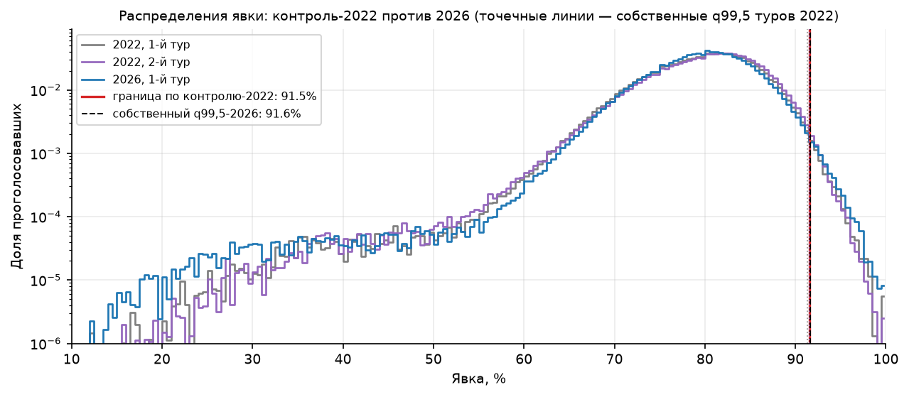

Таблица: `analysis/tables/control_shpilkin.csv`.

### 12.2. Скачки к прошлым выборам (№8-б) на тех же секциях

На 461 218 матч-секциях (2022-1Т → 2026-1Т): стабильность явки секции через
четыре года — r(явка-2022, явка-2026) = **0,77**; общая явка почти не изменилась
(79,08% → 78,98% на этих секциях). Политический сдвиг — свинг к Болсонару
на ±3,5 п.п. (41,3% → 44,9% против 46,3% → 42,9% у Лулы, доли от проголосовавших).

| Метрика | Значение |
|---|---|
| Δявка: медиана / MAD | −0,38 / 2,46 п.п. (q01–q99: −9,3…+12,5) |
| Секций с \|z\|>4 (робастно, глобально) | **3 346 (0,73%)**: вверх 2 631, вниз 715 |
| r(Δявка, Δдоля Болсонару) | **+0,015** |
| r(Δявка, Δдоля Лулы) | **−0,007** |
| Свинг Болсонару по децилям Δявки | +3,5…+3,9 п.п. во всех десяти (равномерно) |

Сигнатура приписок «прирост явки смещён в пользу бенефициара» отсутствует:
корреляции прироста явки с изменением долей — нулевые (в задокументированных
кейсах у бенефициара +0,3…+0,6), свинг Болсонару одинаков во всех децилях
прироста явки (таблица `control_deciles.csv`; в верхнем дециле, медиана Δявки
+7,5 п.п., доля Лулы даже падает: 51,5% → 48,1%). Флаговые секции (0,73%)
концентрируются там же, где рост явки — Северо-Восток (1 475 флагов = 1,14%
секций региона) и Север (530 = 1,41%) против 0,2–0,5% на Юге/Юго-Востоке/ЦЗ —
и левеют (Лула-2026 в них 53,3% против 42,9% в среднем) ровно потому, что
это электоральная география регионов роста явки, а не аномалия: внутри своих
регионов эти секции проходили проверку §3-б. ZZ даёт 18% флагов при медиане
Δявки −5,2 п.п. — артефакт перенумерации посольских секций, не интерпретируется.

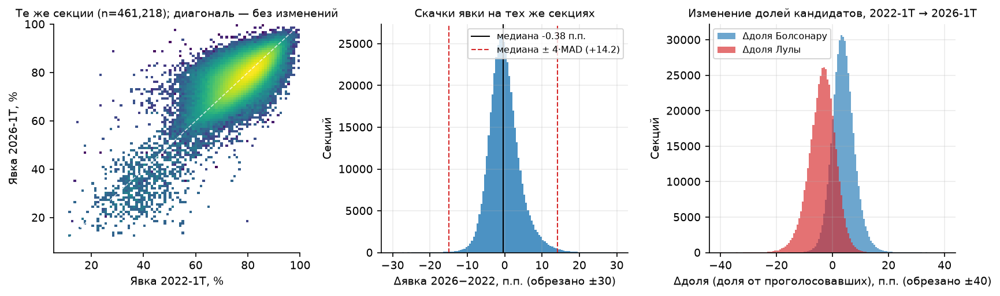

Таблицы: `analysis/tables/control_jumps_by_region.csv` (по регионам),
`control_jumps_extreme.csv` (топ-200 по |z|), `control_deciles.csv`.

### 12.3. Отпечатки на контрольных выборах-2022

Двухкластерная структура отпечатков 2026 (§3: компоненты Болсонару
(77,6; 32,5)/(79,6; 51,8)) существовала ещё в 2022 — флаг «разделения» смеси
срабатывает на контрольных выборах обоих туров, и все компоненты лежат
в полосе обычной явки:

| Выборы | Кандидат | Компонент 1 (главный) | Компонент 2 | Klimek-кластер 90–100%×80–100% |
|---|---|---|---|---|
| 2022, 1-й тур | Болсонару | (77,0; 28,5) | (80,2; 48,3) | нет |
| 2022, 2-й тур | Болсонару | (77,3; 31,7) | (80,5; 54,9) | нет |
| 2022, 1-й тур | Лула | (77,6; 62,6) | (79,9; 37,7) | нет |
| 2022, 2-й тур | Лула | (77,3; 63,9) | (80,5; 40,5) | нет |

То есть «раздвоенность» отпечатка — устойчивая региональная структура
бразильского электората (СВ/Север против Юга/ЮВ), наблюдаемая и в честном
контроле, а не появившийся в 2026 кластер; сигнатуры Klimek нет ни в одном
прогоне 2022. Таблица: `analysis/tables/control_fingerprints_2022.csv`.

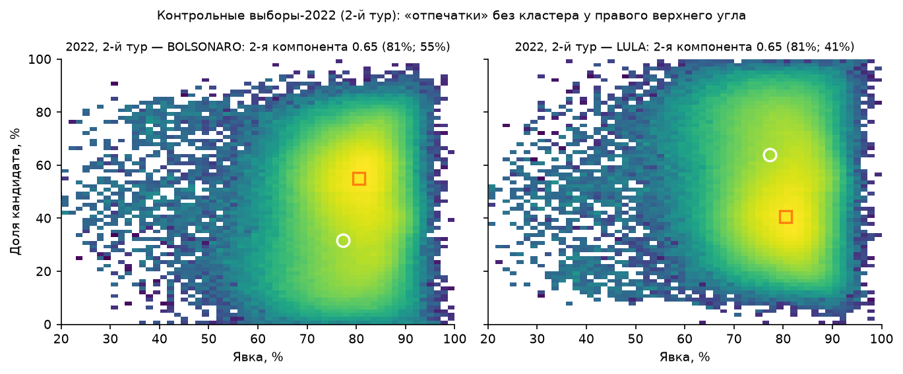

**Вердикт: контрольные выборы-2022 подтверждают выводы §2–3 и закрывают
ограничения предыдущей версии отчёта. Граница Шпилькина по контролю совпадает
с собственной; хвосты 2026 — на уровне собственного шума честных выборов-2022;
скачки явки на тех же секциях не смещены в пользу кандидатов; отпечатки-2026
воспроизводят структуру-2022.**

## 13. Ограничения

1. **Контрольные выборы-2022 добавлены** ([§12](#12-контрольные-выборы-2022-те-же-секции)):
   граница Шпилькина подтверждена контролем (91,5% ≈ 91,6%), скачки №8-б проверены,
   отпечатки-2026 воспроизводят структуру-2022. Остаточная оговорка: матч покрывает
   92,4% секций-2026 (93,3% проголосовавших; ZZ 71% — перенумерация посольских
   секций), для непокрытых 7,6% (новые/переименованные секции) сравнение с контролем
   невозможно — их проверяют только прогоны §2–8.
2. **Региональная неоднородность огромна** (Лула 60,5% на СВ против 30,1% на Юге):
   смеси и внутриштатные корреляции отражают географию; тесты на «однородность»
   без поправки на регион слабомощны. Для ключевых методов поправка сделана
   стратификацией по макрорегионам ([§3-б](#3-б-стратификация-по-макрорегионам-шпилькин-и-отпечатки-внутри-регионов):
   свои границы Шпилькина, внутрирегионные отпечатки и углы), корреляции считаются
   по штатам (§7), выбросы — против соседей внутри муниципалитета (§8), плюс
   контроль-2022 на тех же секциях (§12). Остаточная неоднородность уровня штата
   внутри макрорегионов видна в компонентах смесей §3-б и §12.3
   (полоса явки 75–83%) и не имеет сигнатуры фальсификаций.
3. **Электронный подсчёт** меняет базовый смысл «протокольных» тестов (пики, цифры):
   их ноль — не «человек-с-калькулятором», а машина; positive-кейс здесь — взлом/подмена
   итогов на уровне передачи, что оставляло бы другие следы (расхождения BU/BU-архив,
   вне датасета).
4. Проанализирован **1-й тур**; 2-й тур (25.10.2026) появится в датасете позже —
   прогон повторить командами ниже.
5. Секции покрывают 100% голосования, но форензика уровня секции не видит
   манипуляций выше секции (переписывание при агрегации) — для этого нужны
   сверки BU ↔ totalização, которых в открытом датасете нет.

## 14. Файлы и воспроизведение

```
brazil-oct-2026/
  download_votacao_secao.sh               — скачивание выгрузки 2026 (~23 ГБ CSV)
  download_votacao_secao_2022.sh          — скачивание контроля-2022, оба тура (~0,5 ГБ)
  data/votacao_secao/                     — выгрузка TSE 2026 (zip + CSV)
  data/votacao_secao_2022/                — выгрузка TSE 2022 (zip + CSV, оба тура)
  data/secoes_presidente_2026.csv         — датасет секций 2026 (81 МБ)
  data/secoes_presidente_2026_checks.json — проверки самосогласованности
  data/secoes_presidente_2022.csv         — контрольный датасет 2022, оба тура (149 МБ)
  data/secoes_presidente_2022_checks.json — его проверки (0 расхождений)
  scripts/build_sections_csv.py           — сборка датасета-2026 из выгрузки TSE
  scripts/build_sections_csv_2022.py      — сборка контрольного датасета-2022
  scripts/run_forensics.py                — прогон всех методов
  scripts/stratified_forensics.py         — стратификация по макрорегионам (§3-б)
  scripts/control_forensics.py            — контроль-2022: граница, скачки, отпечатки (§12)
  scripts/digit_binomial_null.py          — доп. биномиальный нуль цифровых тестов
  analysis/figures/*.png (18)             — графики всех методов (встроены выше)
  analysis/tables/*.csv (21)              — таблицы (корреляции, выбросы, урны, цифры,
                                              стратификация; контроль-2022: shpilkin,
                                              deciles, jumps_by_region, jumps_extreme,
                                              fingerprints_2022)
  analysis/metrics.json                   — все метрики прогона
  analysis/metrics_stratified.json        — метрики стратифицированного прогона
  analysis/metrics_control_2022.json      — метрики контрольного прогона-2022
```

```bash
cd analysis-tool
uv run python ../brazil-oct-2026/scripts/build_sections_csv.py     # ~2 мин
uv run python ../brazil-oct-2026/scripts/run_forensics.py          # ~2 мин
uv run python ../brazil-oct-2026/scripts/stratified_forensics.py   # ~5 с
uv run python ../brazil-oct-2026/scripts/digit_binomial_null.py    # ~1 мин

bash brazil-oct-2026/download_votacao_secao_2022.sh                # контроль-2022, ~15 мин
uv run python ../brazil-oct-2026/scripts/build_sections_csv_2022.py  # ~3 мин
uv run python ../brazil-oct-2026/scripts/control_forensics.py        # ~1 мин
```

После публикации итогов 2-го тура (25.10.2026) — докачать датасет
(`brazil-oct-2026/download_votacao_secao.sh`, curl `-C -`) и повторить прогон,
указав `NR_TURNO=2` в фильтрах `build_sections_csv.py`.
