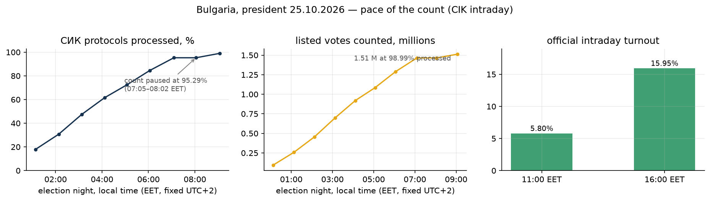
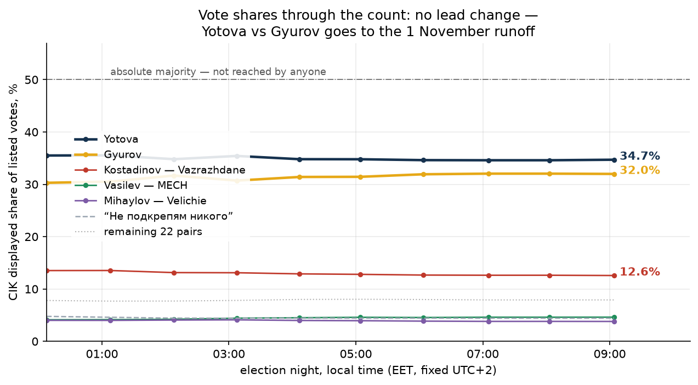
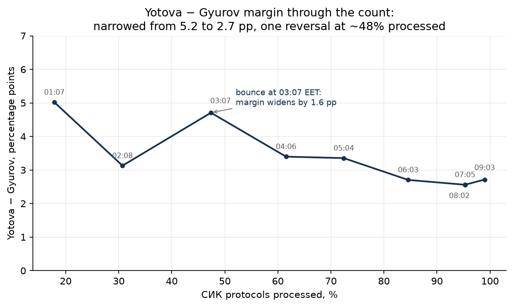
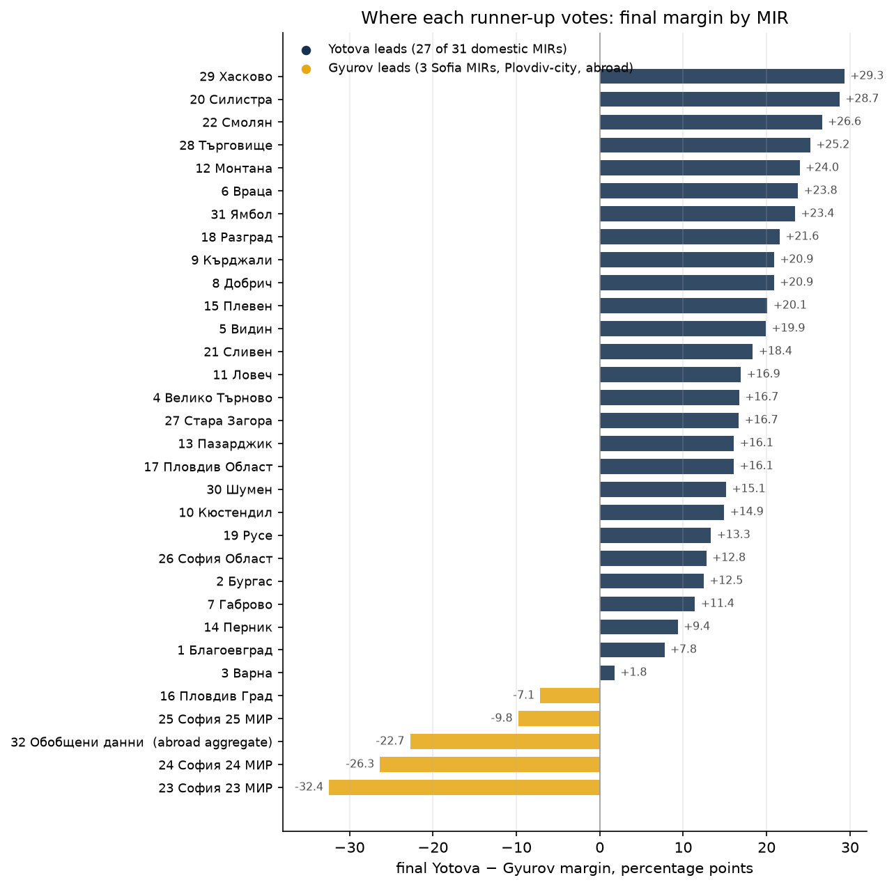
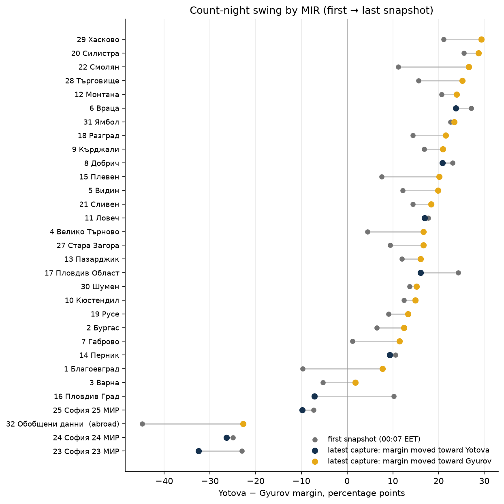
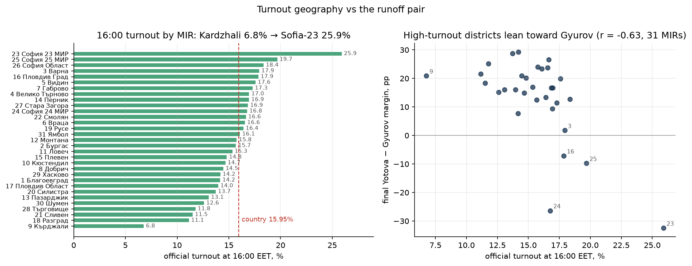

# Bulgaria 2026: trends through the count (president, round 1)

**Historical endpoint: 98.99%, not the later 100% publication.** Updated
national totals and section forensics: [statistical report](../../REPORT_statistical_fraud_analysis.md).

**No lead change all night: Yotova 34.70%, Gyurov 31.98% — a 2.72-point margin
goes to the 1 November runoff.** The published shares were relatively stable from the first partial numbers, the two leading pairs never
swapped places, and the only notable movements were a gradual narrowing of the
top-two gap (5.2 → 2.7 points) and a late surge by the abroad vote toward the
incumbent vice-president.

This analysis uses the **10 night snapshots** of `results.cik.bg/pvr202610`
captured hourly from **22:07 UTC 25 Oct to 07:03 UTC 26 Oct 2026** (the first
capture carries ~95k listed votes; the official "обработени X%" progress line
starts at 17.86% in the second). Figures and `metrics.json` are rebuilt by
`scripts/analyze_trends.py`:

```bash
analysis-tool/.venv/bin/python bulgaria-oct-2026/scripts/analyze_trends.py
```

All captures occurred after the daylight-saving change on 25 October 2026;
local times below use **EET (UTC+2)**.



## 1. The count: steady, with one pause

Protocol processing ran 17.86% (01:07) → 30.71% → 47.39% → 61.55% → 72.43% →
84.57% → **95.29%, where it paused for the whole 07:05–08:02 hour**, then
finished the night at **98.99%** (09:03). Listed votes grew from 95,115 to
**1,512,779**.



All 27 listed candidate pairs plus "Не подкрепям никого" were on the ballot; the
portal’s rounded percentages sum to 99.996–100.005% across captured area-time
rows, consistent with three-decimal rounding. The denominator is listed votes,
including “nobody”, rather than all ballots cast. Final standings: Yotova 34.70,
Gyurov 31.98, Kostadinov (Vazrazhdane) 12.57, Vasilev (MECH) 4.61,
"don't support anyone" 4.42, Mihaylov (Velichie) 3.80, the remaining 22 pairs
7.91 combined. Nobody approaches the 50% absolute-majority line, so the runoff
sends **Yotova vs Gyurov** to 1 November.

## 2. The margin narrowed; one reversal at ~48% processed

The Yotova − Gyurov gap is **not monotonic**: +5.21 points at the first
snapshot, narrowed to +3.13 by 02:08, **back up to +4.71 at 03:07** (+1.6
points on one update), then a steady slide to +2.56 by 07:05 and +2.72 at the
last capture. Hourly snapshots cannot distinguish a real batch effect from a
correction of previously entered protocols, so the 03:07 bounce is described,
not explained. Overall drift: Gyurov gained ~1.7 points across the night,
Yotova lost ~0.8, Kostadinov ~0.9.



## 3. Geography: two Bulgarias for the runoff

Yotova leads in **27 of the 31 domestic MIRs**, everywhere except the three
Sofia districts and Plovdiv-city. Her strongest regions are Haskovo (+29.3),
Silistra (+28.7) and Smolyan (+26.6); Varna is a razor edge (+1.8). Gyurov's
map is the big-city map: **Sofia-23 −32.4 (where he polls 54.4%), Sofia-24
−26.3, Sofia-25 −9.8, Plovdiv-city −7.1** — plus the abroad aggregate, where he
leads by 22.7 points.



The **abroad aggregate (MIR 32, "Обобщени данни")** holds 80,431 listed votes,
5.3% of the national total, split Gyurov 45.61 / Yotova 22.88 / Kostadinov
11.63. It is also the most mobile part of the night: its first partial snapshot
had Gyurov ahead by 44.8 points, converging to −22.7 as more consular sections
entered — early abroad batches are not representative of the final abroad vote,
and the last protocols still moved it Yotova-ward.

## 4. Count-night swing: provinces moved to Yotova, big cities to Gyurov

Between the first and last snapshots **22 of 32 areas moved toward Yotova and
10 toward Gyurov**. Two provincial leads flipped sign during the night:
Blagoevgrad went from Gyurov +9.7 to Yotova +7.8 and Varna from Gyurov +5.3 to
Yotova +1.8; the largest Yotova-ward gains were abroad (+22.1), Blagoevgrad
(+17.5) and Smolyan (+15.5). The Gyurov-ward movers are precisely his
strongholds: **Plovdiv-city (−17.4 points of swing), Sofia-oblast (−10.2),
Sofia-23 (−9.4)**. The count therefore polished an already-formed split rather
than creating it — at the first snapshot (~95k votes) the standings were
already recognizably final (Yotova 35.5, Gyurov 30.3, Kostadinov 13.5).



## 5. Turnout: very low, and low-turnout districts are Yotova's

The official intraday reports put turnout at **5.80% at 11:00 and 15.95% at
16:00 EET**; no 20:00 report was captured. As a rough national bound, the
1,512,779 listed votes at 98.99% processed equal **22.79% of the 6,637,238
register** — a lower bound on real turnout, since invalid ballots are unknown
from this capture.

Regionally, 16:00 turnout runs from **6.77% in Kardzhali to 25.91% in
Sofia-23**. High-turnout districts lean toward Gyurov: the correlation between
16:00 turnout and the final Yotova − Gyurov margin is **r = −0.63**, but it
collapses to **r = −0.32** once the four big-city MIRs (three Sofias,
Plovdiv-city) are excluded — the association is mostly a big-city effect, not a
smooth turnout gradient.



## 6. Data quality and what this analysis cannot say

- **Internal consistency is exact**: the sum of the 32 MIR vote counts equals
  the country total at the final snapshot (1,512,779 = 1,512,779), and displayed
  percentages sum to 100 at every snapshot for every area.
- The first snapshot has no official progress line (the portal's stats row was
  still empty), so its margin (+5.21) cannot be placed on the %-processed axis
  in figure 03; the abroad aggregate is empty in that snapshot.
- The capture stops at **98.99% of СИК protocols** — the residual ~1% (plus any
  re-protocol corrections) is not covered; final certified numbers may shift
  the second decimal.
- **Grain limitation**: everything above is MIR-level (32 units). Precinct-level
  forensics (`analysis-tool` / `ef-analyze`, as done for Serbia, Slovakia and
  Brazil) are **deferred until the CIK publishes `opendata/export.zip`** —
  the capture pipeline intentionally does not fetch it behind Cloudflare; see
  the checklist in the root [REPORT](../../REPORT.md).

`metrics.json` holds every number quoted here, including the full per-MIR table
(first/final margins, leaders, 16:00 turnout) and the margin trajectory.
