# Статистический анализ фальсификаций: Португалия, парламентские выборы AR 2025

*Применение методов election forensics (обзор — [`методы_выявления_фальсификаций_выборов.md`](../методы_выявления_фальсификаций_выборов.md)) к данным выборов в Ассамблею Республики 18.05.2025. Инструмент — [`analysis-tool/`](../analysis-tool/) (uv, pandas/scipy/scikit-learn). Дата анализа: 10.10.2026; обновлено 12.10.2026 — добавлен секционный уровень (раздел 13, [`analysis_seccoes/`](analysis_seccoes/)).*

## Данные

Официальная выгрузка портала MAI (eleicoes.mai.gov.pt), уровень приходов (freguesias) — нижний уровень, который отдаёт сам портал; поучастковых (secções) данных MAI не публикует. Секционные карты при этом выкладывают единичные муниципалитеты: для AR-2025 найдено шесть, они распарсены, сверены с MAI до голоса и прогнаны через статистические тесты (раздел 13, выход — [`analysis_seccoes/`](analysis_seccoes/)). Колонки коалиции AD объединены (на материке `PPD/PSD.CDS-PP`, на Азорах `PPD/PSD.CDS-PP.PPM`). Контрольные выборы — AR 2022 и AR 2024 (те же территории).

| Показатель | Значение |
|---|---|
| Территорий (приходов) | 3 092 (материк + Мадейра + Азорские о-ва; заграница исключена) |
| Зарегистрировано / проголосовало | 9 265 493 / 5 965 446 (явка 64,4%) |
| AD (лидер) / PS / CH | 32,7% / 23,4% / 22,6% |
| Бланковые / недействительные | 1,44% / 0,99% |

## Сводный вердикт

| Метод | Результат | Вердикт |
|---|---|---|
| Шпилькин (аномальные голоса) | 2 980 голосов AD = 0,15% голосов AD; итог 32,71% vs 32,72% | ✅ чисто |
| Отпечатки пальцев (Klimek et al.) | кластера «вправо-вверх» нет | ✅ чисто |
| Целочисленные пики явки | 1,46% при нуле 1,44% (z = 0,1) | ✅ чисто |
| 2D-корреляции явка×результат | у лидера −0,09 (взвеш. Пирсон) | ✅ чисто |
| Бенфорд, вторая цифра | все p ∈ [0,10; 0,79] | ✅ чисто |
| Последняя цифра | все p ≥ 0,20, кроме AD p = 0,02 | ⚠️ погранично* |
| Выбросы против соседей | 81/3 092 (2,6%), малые приходы | ✅ без паттерна |
| Скачки к выборам-2024 | 0 приходов с двойным скачком >15 п.п. | ✅ чисто |
| ML (Isolation Forest) | 31 аномалия (1% по построению), без скоплений | ✅ без паттерна |
| Секции × MAI (6 конселью, 91 участок) | все показатели сходятся до голоса | ✅ чисто |
| Секции: статтесты (91 участок) | явка ≤ 76,9%, выше нац. границы — 0; пики явки z = 0,7, доли всех топ-6 z ≤ +0,2; дубликатов протоколов 0; выбросы соседей/ML — крошечные секции без паттерна; цифры: CH p = 0,006 без профиля 0/5 | ✅ чисто* |

\* два пограничных отклонения цифровых тестов: AD на приходах (p = 0,02 из 12 тестов; Бонферрони-порог 0,004 его снимает) и CH на секциях (p = 0,006, гладкий МК-нуль 0,017, Бонферрони по трём партиям ≈ 0,05). Оба — без избытка круглых 0/5, т.е. без профиля «рукодельных» чисел; детали — разделы 7 и 13.2.

**Вывод: систематических статистических следов фальсификаций не обнаружено.** Все аномалии объясняются территориальной неоднородностью (север/юг, острова, малые приходы) и не поддерживаются более чем одним методом.

---

## 1. Метод Шпилькина: распределение явки и аномальные голоса

Явка (взвешенно по электорату): мода 69,3%, σ = 6,7 п.п., спад до нуля при ~78–83%. Граница аномальной явки — 78,6% — верхний перцентиль q99.5 контрольных выборов (2022: 73,2%; 2024: 78,6%). За границей: 7 779 проголосовавших (0,13%), из них 2 980 за AD. Пересчёт итога без аномальной зоны: AD 32,71% против наблюдаемых 32,72% — ничего не меняет.

Ключевое отличие от фальсифицированных выборов: **хвост на явке 80–100% отсутствует физически** (после 78% распределение пустое), тогда как «вброс» сдвигает массу именно туда.

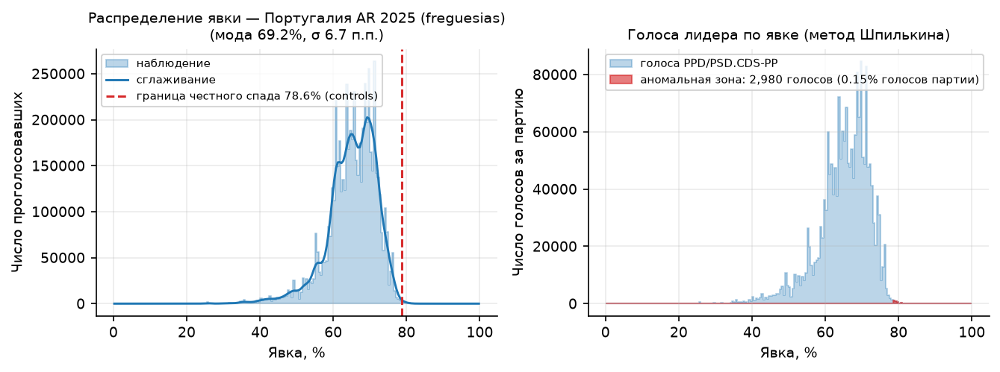

## 2. «Хвост кометы»: явка × результат

Для AD, PS и CH облако вертикально компактное при любой явке — результат не растёт с явкой. При фальсификациях облако вытягивается вверх-вправо (рост явки → рост результата «партии власти» при падении оппонентов) — здесь этого нет.

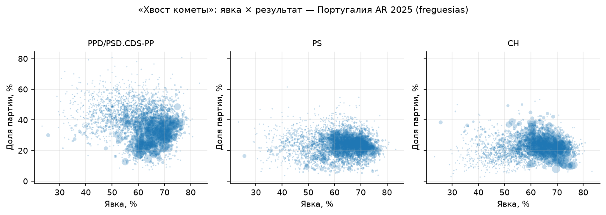

## 3. Электоральные отпечатки пальцев (Klimek et al., PNAS 2012)

2D-плотность (явка × доля AD), взвешенная по избирателям. Смесь двух гауссиан разделяет данные на кластеры (60,0%; 39,7%) и (66,7%; 29,2%) — это северные сельские приходы против юга и городов, т.е. неоднородность электората. «Фальшивого» кластера вправо-вверх (как в России-2011/2012 или Уганде) **нет**: нигде нет компактного скопления на высокой явке И высоком результате.

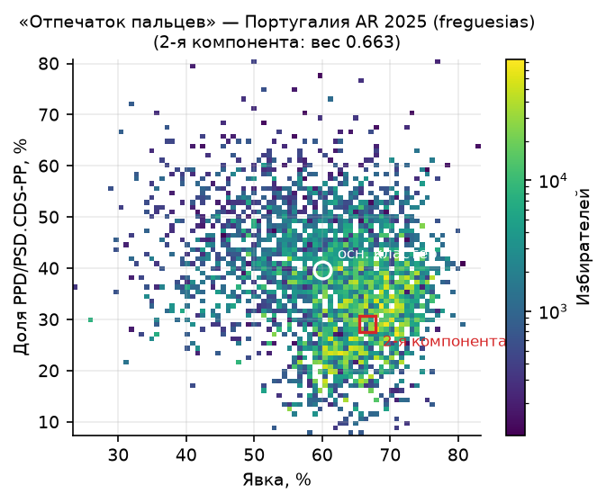

## 4. Целочисленные пики (Kobak et al., 2016)

Доля приходов с ровно целой явкой: **1,46% против 1,44%** ожидаемых при биномиальном Монте-Карло-нуле (z = 0,07); пиков на кратных 5 нет (z = −0,3). Для доли лидера: 6,73% против 6,80% (z = −0,3). «Рисование» протоколов под круглые числа даёт z в десятки и сотни (см. самотест ниже) — здесь нулевое отклонение.

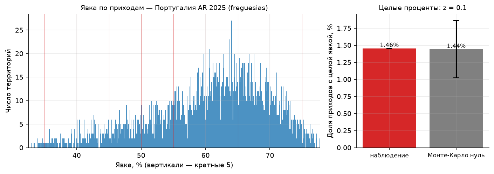

## 5. 2D-корреляционный анализ (Kobak et al., 2012)

Национальные корреляции явка×результат (взвешенный Пирсон / Спирмен):

| AD | PS | CH | IL | L | PCP-PEV |
|---|---|---|---|---|---|
| −0,09 / −0,23 | +0,03 / −0,03 | −0,22 / +0,11 | +0,58 / +0,52 | +0,38 / +0,43 | +0,07 / +0,24 |

У лидера связи нет — «перелива» голосов с ростом явки не наблюдается. Положительные корреляции IL и L — мобилизационный паттерн их городской базы; аналогичная неспецифичность корреляций известна по честным выборам Великобритании (раздел «Ограничения» обзора). По округам картина гетерогенна (AD от −0,49 на Мадейре до +0,58 в Лиссабоне) — целенаправленного однородного сдвига нет.

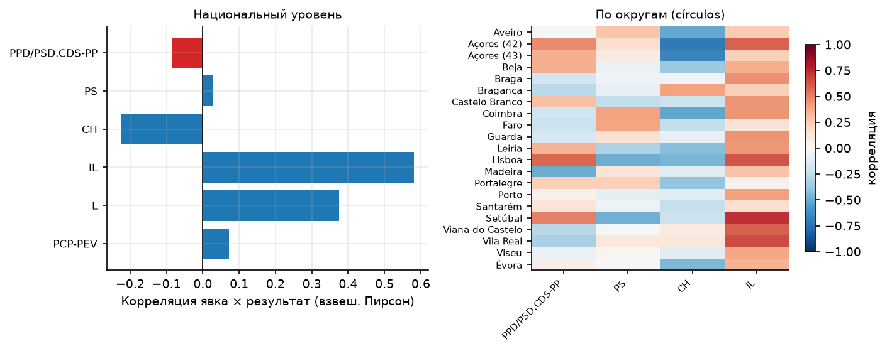

## 6. Закон Бенфорда: вторая цифра

Вторые цифры голосов топ-6 партий против закона Бенфорда, с гладким (логнормальным) Монте-Карло-нулём: все эмпирические p ∈ [0,10; 0,79]. Отклонений нет (с оговоркой из обзора: тест слабый и сам по себе малоинформативен).

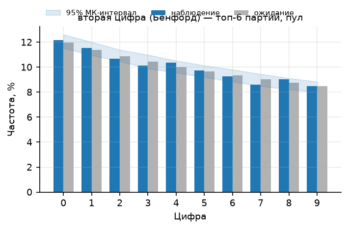

## 7. Последняя цифра (Beber–Scacco)

Тест на счётчиках ≥ 100 (у меньших чисел равномерности нет по естественным причинам): PS p = 0,94; CH 0,67; IL 0,70; L 0,24; PCP-PEV 0,60; **AD p = 0,02** — единственное пограничное значение из 12 тестов: дефицит цифры 4 (8,2% против 10%). Избытка «круглых» 0/5, характерного для выдуманных чисел, нет; после поправки на множественное тестирование отклонение незначимо.

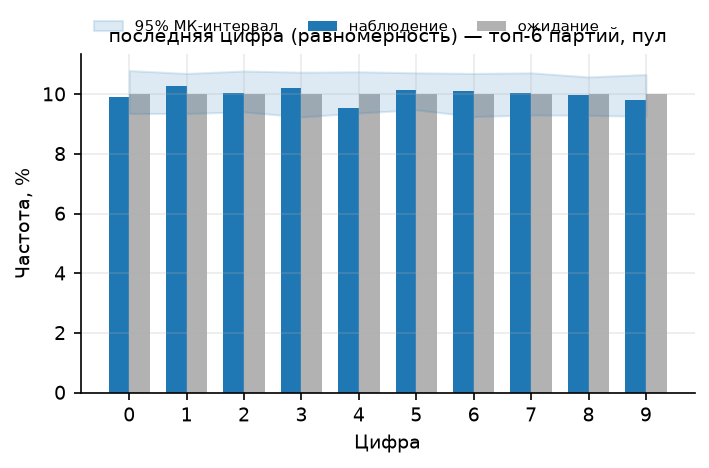

## 8. Сравнение с соседями (Myagkov–Ordeshook–Shakin)

Робастный z-скор каждого прихода против медианы своего муниципалитета (concelho): 81 выброс (2,6%) при пороге |z|>4 — нормальный хвост для 3 092 разнородных территорий. Крупнейшие выбросы — малые приходы (Anobra, 1 101 избиратель, аномально **низкая** доля AD z = −22,6; Furadouro, 173 избирателя) — направление противоположно фальсификации в пользу лидера. Кластеризации выбросов по явке нет.

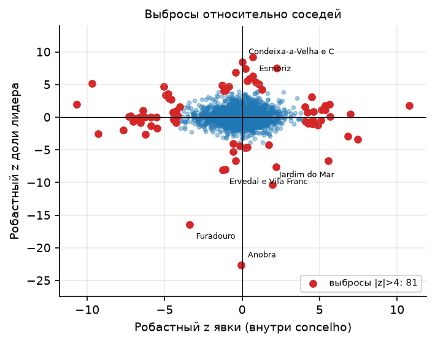

## 9. Скачки относительно выборов-2024

Сравнение тех же 3 092 приходов с AR-2024: ни одного прихода с одновременным скачком явки и доли AD > 15 п.п. (требование метода — совместный скачок «явка↑ + результат↑»). Расхождения объяснимы перегруппировкой коалиций, а не статистикой подсчёта.

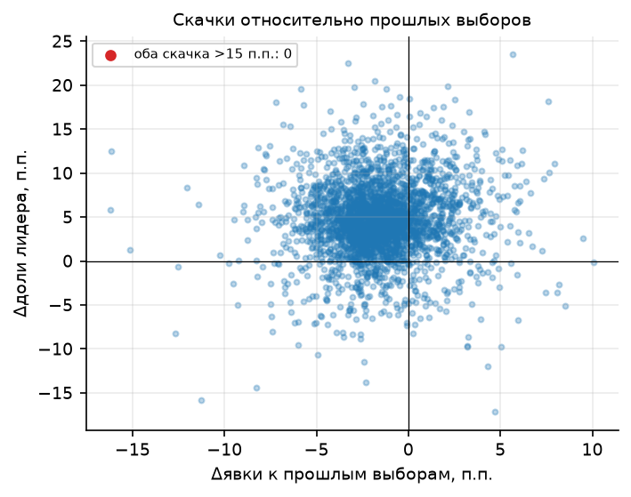

## 10. Машинное обучение: Isolation Forest (Zhang et al., 2019)

31 аномальный приход (top-1% по построению) — малые приходы Азорских островов и горной внутренней части материка с высокой долей бланковых бюллетеней (до 9–10%). Это кандидаты на ручную проверку, но не сигнал фальсификаций: аномалии не скапливаются на высокой явке/результате и не образуют географических кластеров.

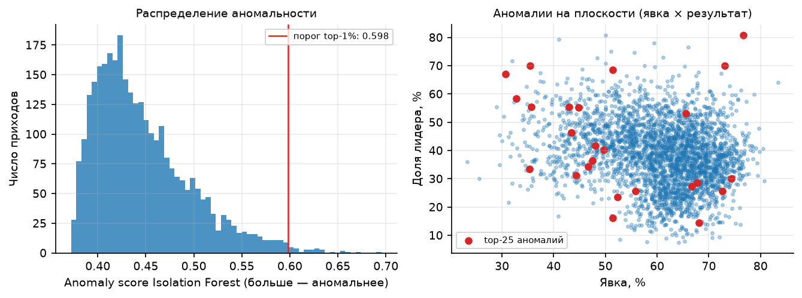

## 11. Самотест инструментов (синтетические фальсификации)

Валидация чувствительности методов на этих же данных:

- **«Вброс»**: +10% приходов, явка +5–35 п.п., 60–95% добавленных бюллетеней за AD (131 629 голосов) → оценка аномальной зоны выросла с 14 589 до 255 496 (×18). Оценка превышает число внесённых бюллетеней, потому что считает и честные голоса, «переехавшие» в хвост вместе с накрученной явкой — это конвенция метода Шпилькина (аномальными считаются все голоса лидера на аномальной явке).
- **«Круглые протоколы»**: подгонка явки под целый процент в 5% приходов → z целочисленных пиков 0,2 → 5,1.

То есть нулевой результат основного анализа — не слепота инструментов: внесённые фальсификации они видят.

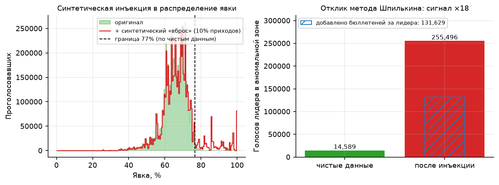

## 12. Контроль: предыдущие выборы

Распределения явки AR-2022 / AR-2024 / AR-2025 по тем же приходам сопоставимы по форме и верхней границе поддержки (~78–80%). Дрейфа формы в сторону высокоявочного хвоста от выбора к выбору нет.

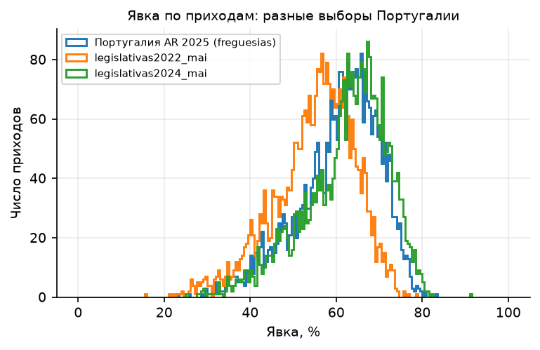

## 13. Секции: сверка с MAI и статистические тесты (91 участок)

Шесть муниципалитетов публикуют итоги AR-2025 по участкам (secções de voto) — подробнее в [`data/seccoes/КАТАЛОГ_публикаторов.md`](data/seccoes/КАТАЛОГ_публикаторов.md). Все карты распарсены в единый датасет [`data/seccoes/ar2025_seccoes.csv`](data/seccoes/ar2025_seccoes.csv) (`scripts/parse_seccoes_ar2025.py`): Benavente 27 секций, Alcácer do Sal 21, Vendas Novas 16, Ferreira do Alentejo 14, Borba 8, Sousel 5 (скан — OCR-транскрипция) — итого **91 участок, 60 711 избирателей (0,66% электората), 38 738 проголосовавших (явка 63,8%)**; плюс Gouveia (16 строк), где секции совпадают с приходами, — независимая транскрипция камары.

### 13.1. Сверка с MAI

Сверка по всем 22 приходам шести конселью: электорат, явка, бланковые, недействительные и голоса **каждого** списка сходятся до единого голоса (журнал — `ar2025_seccoes_validation.txt`). Единственная нестыковка — в самом муниципальном PDF: сводная строка Ferreira do Alentejo («resultados corrigidos») занижает бланковые на 3 (31 против 34; разбивка по месам и MAI дают 34).

### 13.2. Статистические тесты на уровне секций

Прогон `analysis-tool` по 91 секции — `scripts/analyze_seccoes.py`, выход [`analysis_seccoes/`](analysis_seccoes/) (figures/, tables/, metrics.json): Шпилькин, хвост кометы, отпечатки, целые проценты (явка + доли всех топ-6 партий), цифровые тесты, соседи (по конселью и внутри фрегезии), корреляции, ML, дубликаты протоколов, арифметика строк; самотест — в 13.3. На этой территории лидер по голосам — **CH** (30,8%; далее PS 24,4%, AD 23,2%, PCP-PEV 8,3%): все шесть конселью — юг, где расклад отличается от национального. Результаты:

- **Явка (Шпилькин)**: мода 64,8%, σ = 4,1 п.п., диапазон 51,8–76,9%. Выше национальной границы аномалии (78,6%, раздел 1) — **ноль секций**; выше собственной q99.5 (75,3%) — 93 проголосовавших и 44 голоса CH (0,37% голосов CH); пересчёт итога 30,80% против наблюдаемых 30,84%. Высокоявочного хвоста нет и на поучастковом уровне. Разброс секций (51,8–76,9) шире приходского (те же 22 прихода: 56,5–73,7) — дисперсия растёт с уменьшением единицы анализа, но расширяется вниз, не вверх.
- **Отпечатки (Klimek)**: смесь двух компонент разделяется по **результату**, а не по явке — (63,4%; 26,3%) против (64,5%; 37,8%), разница явок 1,1 п.п.: это CH-слабые и CH-сильные приходы. Кластера «вправо-вверх» нет.
- **Целые проценты (Kobak)**: ровно целая явка у 2,20% секций против 1,42% биномиального нуля (z = 0,7); для доли лидера 1,10% против 2,36% (z = −0,8). Дополнительно проверены доли **всех** топ-6 партий: z от −2,5 (IL) до +0,2 (AD) — избытка целых процентов нет ни у одной (у IL и L дефицит, направление противоположно рисовке).
- **Цифровые тесты**: вторая цифра (Бенфорд) — 6 партий, все p ∈ [0,19; 0,98]. Последняя цифра пригодна лишь для CH/PS/AD (нужно ≥30 счётчиков ≥100; у PCP-PEV/IL/L секции мельче): PS p = 0,85, AD p = 0,19, **CH p = 0,006** (против гладкого МК-нуля 0,017) — избыток цифр 6 (23,2%) и 7 (17,9%) при дефиците 0, 1 и 9. Это противоположно профилю выдуманных чисел (у них избыток круглых 0/5); после Бонферрони по трём партиям p ≈ 0,05, а при n = 56 чисел смесь разномасштабных муниципалитетов сама отклоняется от однологнормального нуля. Пограничное отклонение без мошеннического профиля — аналог случая AD p = 0,02 в основном анализе (раздел 7).
- **Соседи (Myagkov–Ordeshook–Shakin)**: секция против медианы секций своего конселью — 4 выброса из 91 (4,4%) при пороге |z|>4: Alcácer do Sal S15 (53 избирателя, доля CH 5,6%, z = −4,7 — **против** лидера), Santo Estêvão S2 (явка 75,3%, z = +4,4), São Martinho S1 (72,1%, z = +4,8), Vendas Novas S15 (83 избирателя, явка 51,8%, z = −4,6). Направления смешанные, экстремумы — крошечные секции; скопления на высокой явке нет.
- **Корреляции явка×результат** (взвеш. Пирсон): CH +0,10; PS −0,24; AD +0,35; PCP-PEV −0,17; IL +0,29. У лидера связи практически нет; корреляция AD — неоднородность южной выборки (в основном анализе по округам AD гуляет от −0,49 до +0,58).
- **ML (Isolation Forest, contamination 5%)**: 5 кандидатов на ручную проверку — все крошечные секции (53–121 избирателей): Alcácer do Sal S15 (53; недействительные 5,6%), Vendas Novas S15 (83; минимальная явка 51,8%), Ferreira do Alentejo S5 (121; максимальная явка 76,9%), Alcácer do Sal S5 (103; явка 53,4%), Ferreira do Alentejo S7 (118; доля CH 47,8%). Это те же экстремумы, что ловит тест соседей, — нового типа аномалий ML не выявляет, скопления на высокой явке/результате нет.
- **Соседи внутри фрегезии** (группы ≥4 секций: 5 фрегезий, 62 секции — внутри прихода секции максимально сопоставимы): 3 выброса |z|>4 — Benavente S9 (явка ниже медианы прихода, z = −6,6 — направление против «вброса»), Alcácer do Sal S15 (доля CH, z = −6,8 — против лидера), Ferreira do Alentejo S5 (явка, z = +5,1; та же максимальная 76,9% < национальной границы). При 9–15 секциях в группе робастный z имеет тяжёлые хвосты — 3 флага на 62 секции согласуются с шумом, направления смешанные.
- **Дубликаты протоколов**: полностью совпадающих векторов (голоса всех списков + бланковые + недействительные) среди 91 секции — **ноль**; признак copy-paste при «рисовании» протоколов отсутствует.
- **Бланковые/недействительные**: медианы 1,19% / 0,81% (национально по приходам 1,44% / 0,99%); максимумы 3,22% (Orada S1) и 5,56% (Alcácer do Sal S15 — 2 бюллетеня из 36). Экстремальных значений нет.
- **Арифметика строк**: во всех 91 секциях Σголоса + бланковые + недействительные = votantes и votantes + abst = eleitores — 0 расхождений до единого бюллетеня (вместе со сверкой сумм с MAI из 13.1 это полная тройка проверок целостности).
- **Скачки к прошлым выборам** на секциях невозможны: секционных данных прошлых лет не существует.

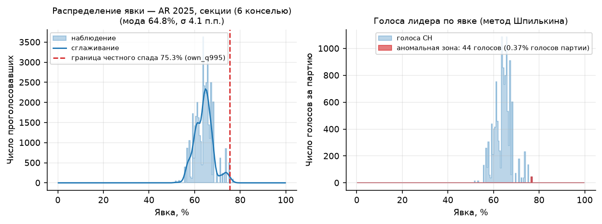

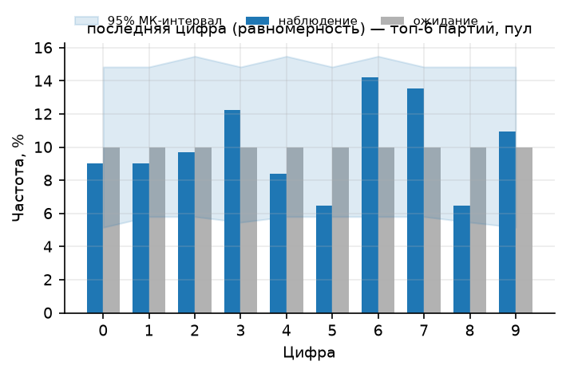

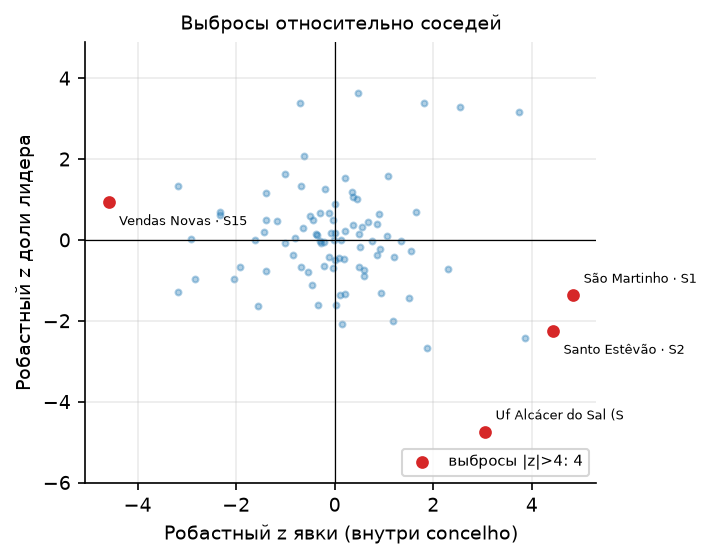

### 13.3. Мощность тестов при n = 91 (самотест)

Синтетические инъекции в те же 91 секцию (аналог раздела 11): «вброс» +831 бюллетеня за CH в 9 секциях поднимает оценку аномальной зоны с 44 до 1 924 голосов (×44) — метод Шпилькина видит добавку и на таком масштабе. «Рисование» протоколов (подгонка явки под целый процент в 8 секциях, ~9%) целочисленный тест **не ловит** (z 1,2 → 1,1): при n = 91 он слеп к подгонке малой доли протоколов.

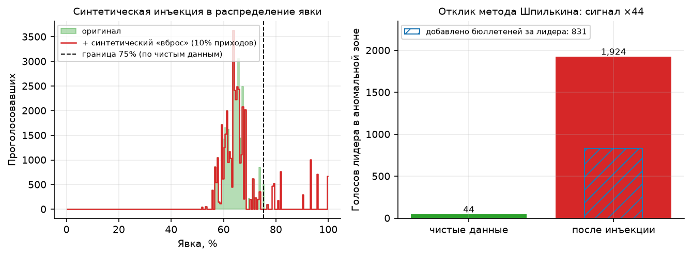

Итог: на всех доступных поучастковых данных MAI-агрегаты сходятся с протоколами секций до голоса, а все применимые статистические тесты следов фальсификаций не находят; единственное пограничное отклонение (последняя цифра CH) не имеет мошеннического профиля. Это проверка 0,66% электората: секционный прогон подтверждает чистоту этих территорий, но микроуровень (цифры, круглые числа) на 91 участке проверяем лишь частично — что и показывает самотест.

---

## Ограничения

- Основной уровень анализа — приходы: MAI секции не отдаёт. Секционные карты шести конселью (0,66% электората) сходятся с MAI до голоса, и все применимые тесты на них чисты (раздел 13), но общенационального секционного покрытия нет. Самотест на 91 участке показывает цену масштаба: целочисленный тест не видит рисовки ~9% протоколов, последняя цифра имеет мощность лишь у трёх партий — точечные фальсификации вне этих шести конселью статистика такого объёма не различает.
- Метод Шпилькина оценивает масштаб при допущениях модели (форма честного ядра, запрет «отрицательных» фальсификаций); граница аномалии здесь задана контрольными выборами, а не только формой распределения.
- Бенфорд и последняя цифра — слабые тесты; пограничное отклонение AD (p = 0,02) не образует паттерна и не подтверждается остальными методами.
- Статистика показывает аномальность, но не механизм: каких-либо документальных свидетельств (расхождения протоколов, экзит-поллы) этот анализ не заменяет.
- Заграничный электорат (~1,6 млн зарегистрированных) исключён: в freguesias-выгрузке MAI его нет.

## Воспроизведение

```bash
cd analysis-tool && uv sync
uv run ef-analyze \
  --data ../portugal-2025/data/legislativas2025_mai \
  --out ../portugal-2025/analysis \
  --title "Португалия AR 2025 (freguesias)" \
  --merge "votes:PPD/PSD.CDS-PP<-votes:PPD/PSD.CDS-PP.PPM" \
  --controls ../portugal-2025/data/legislativas2022_mai,../portugal-2025/data/legislativas2024_mai
```

Секционный уровень (91 участок, раздел 13):

```bash
uv run python ../portugal-2025/scripts/analyze_seccoes.py
```

Выход: `analysis/figures/*.png`, `analysis/tables/*.csv`, `analysis/metrics.json`; для секций — `analysis_seccoes/` в том же формате. Тесты: `uv run pytest`.
