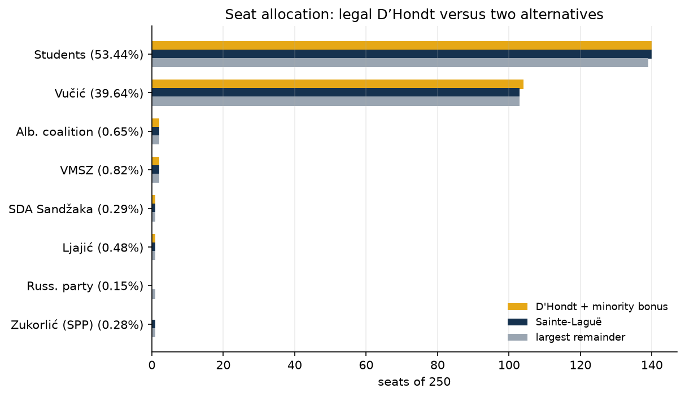

# Serbia 2026: voting paradoxes and electoral-rule sensitivity

**Students' majority survives every tested seat-allocation rule. The largest
observed inversions concern territory and counting order, while the threshold
excludes SPS.** Seat calculations below use the reconciled **26 October,
16:55 CET** national snapshot (97.24% of stations), not certified final
mandates. Count-night comparisons extend to the separate **21:15 CET** check.

Reproduction: `scripts/analyze_paradoxes.py`; outputs:
`analysis/paradoxes/{tables,figures}/`, `PARADOX_LOG.txt`.
[Trends](analysis/trends/README.md) · [Forensics](REPORT_statistical_fraud_analysis.md).

## 1. Rules and corrections to the earlier calculation

Serbia elects 250 MPs in one national constituency. Article 128 sets a 3%
threshold relative to **voters who voted**, not valid votes. Article 140
exempts minority lists and increases their D'Hondt quotients by **35%** when
they are below 3%. The model applies that bonus, national eligibility and
exact rational comparisons of quotients. This is a projection under the
published rules, not an official allocation. Source:
[RIK election law, Articles 128–140](https://www.rik.parlament.gov.rs/extfile/en/1638/Zakon%20o%20izboru%20narodnih%20poslanika_ENGLESKI-ociscen%20final.pdf).

The minority set is **4, 5, 6, 7, 10, 13, 14, 17, 18**. The earlier model
omitted lists 4, 7 and 13 and omitted the bonus. Relevant primary sources:
[RIK session 20: Ljajić](https://www.rik.parlament.gov.rs/vest/680975/20-sednica-republicke-izborne-komisije.php),
[session 23: SPP and Russian Party](https://www.rik.parlament.gov.rs/vest/681383/23-sednica-republicke-izborne-komisije.php),
[session 26: SDA](https://www.rik.parlament.gov.rs/vest/684006/26-sednica-republicke-izborne-komisije.php),
[session 40: Biram pravdu](https://www.rik.parlament.gov.rs/vest/714675/40-sednica-republicke-izborne-komisije.php),
[session 46: Albanian coalition and Majka Srbija](https://www.rik.parlament.gov.rs/vest/716379/46-sednica-republicke-izborne-komisije.php),
and the [municipal official list/decision index, including VMSZ and Russo-Serb Unity](https://kucevo.rs/parlamentarni-izbori-25-10-2026-godine/).

## 2. Threshold exclusion: SPS and 171,010 votes

Non-minority lists below the legal threshold account for **171,010 votes,
4.04% of valid votes**, at the analysed snapshot. The largest is SPS:
**92,761 votes**, 2.19% of valid votes and about 2.16% of reported voters.
It receives no projected mandate. Minority exemptions mean that lists with
fewer votes can nevertheless obtain seats.

This is a threshold effect: exclusion is discontinuous at 3%. It does not
by itself demonstrate a majority preference against the winning list.
“Excluded votes” here counts non-minority threshold failures; some eligible
minority lists also get zero seats through the natural D'Hondt threshold.
Table: `analysis/paradoxes/tables/threshold.csv`.

## 3. Seat sensitivity: include the minority bonus explicitly

All alternatives retain the same national eligibility set. Plain D'Hondt,
Sainte-Laguë and Hare largest remainder use raw votes without the legal
minority bonus. Thus the legal-versus-alternative comparison changes both
the divisor/rounding treatment and, where relevant, minority weighting.
Plain D'Hondt isolates the bonus effect.

| List | % valid | Legal D'Hondt +35% | Plain D'Hondt | Sainte-Laguë | Hare remainder |
|---|---:|---:|---:|---:|---:|
| Students | 53.44 | **140** | 141 | 140 | 139 |
| Vučić | 39.64 | **104** | 105 | 103 | 103 |
| Ljajić | 0.48 | 1 | 1 | 1 | 1 |
| VMSZ | 0.82 | 2 | 2 | 2 | 2 |
| SPP | 0.28 | 0 | 0 | 1 | 1 |
| SDA Sandžaka | 0.29 | 1 | 0 | 1 | 1 |
| Russian Party | 0.15 | 0 | 0 | 0 | 1 |
| Albanian coalition | 0.65 | 2 | 1 | 2 | 2 |
| Other minority lists | 0.20 combined | 0 | 0 | 0 | 0 |
| **Total** | | **250** | **250** | **250** | **250** |

The legal projection is **Students 140, Vučić 104, minorities 6**. Students
hold 56.0% of seats from 53.44% of valid votes: a **2.56-point premium**.
Their smallest majority among the alternatives is 139/250. The bonus awards
one additional seat each to SDA and the Albanian coalition, displacing one
seat from each major list relative to plain D'Hondt.

SPP still receives no seat despite exemption and bonus. Exemption removes
the statutory threshold, not the finite-seat natural threshold. The earlier
142/105 projection and the claim that SDA receives no legal seat are
superseded by this calculation.

## 4. Map versus national vote

Students win a plurality in **90 of 189 territorial municipalities**,
Vučić's list in **94**, other lists in five. Students nevertheless have
**53.37% of territorial valid votes**, versus about 39.70% for Vučić.
An equal-weight municipality tally therefore ranks the two leading lists
oppositely from the voter tally. Neither list wins a majority of municipalities.

This is an aggregation/weighting inversion, not evidence that the legal
national-PR winner lacks a voter majority. Municipalities vary greatly in
population and are not equal-sized electoral districts.

A separate counterfactual allocates the 250 seats to regions proportional
to their counted valid votes, using Hare remainder, then legal-weighted
D'Hondt within each region with national eligibility held fixed. At this
snapshot it produces **exactly the same seat totals** as national allocation:
140 Students, 104 Vučić, six minorities. This specific regional partition
therefore shows no seat-total inversion. It is not a simulation of all
possible district boundaries, population-based apportionment, or a regional
threshold system.

Tables: `district_counterfactual.csv`, `municipality_winners.csv`.

## 5. Consolidation is descriptive; cloning is not causally identified

A broad grouping of seven 2023 non-incumbent lists totals **1,465,586 votes,
39.49% of valid votes**; Vučić's list has 48.07%. In 2026, Students alone
have **2,260,762 votes, 53.44%**; adding NDSS and European Serbia gives
**2,311,286, 54.63%**. The grouped share rises by 15.14 points and the
incumbent share falls by 8.43 points.

These groupings do not establish that seven “clones” merged into one list
or that their voters transferred together. Parties, candidates, preferences,
turnout and the electorate changed. In national PR, splitting a bloc can
cost seats through thresholds and rounding, but the observed result does
not isolate that mechanism from mobilization or persuasion. No individual
transfer matrix, causal consolidation effect, or counterfactual 2026 vote
under the old party structure is identified from these totals.

The figure and `bloc_consolidation.csv` are retained as a descriptive
between-election comparison, not proof that de-cloning decided the election.

## 6. Counting order changes the apparent winner

At 22:04 CET on 25 October, only 9.38% of stations are counted: Vučić leads
48.01 to 41.88. Students first lead at the 00:08 CET capture; the preceding
23:07 capture bounds the crossover to **25.45–41.35%** station coverage.
By the latest checked source stamp (21:15 CET), Students lead **52.71 to
39.17**, or 13.54 points. The peak observed margin is 13.62 points at 16:55.

This is a temporal sample-composition reversal, not an electoral-rule
paradox. Belgrade's late entry is a plausible contributor. Snapshots cannot
locate the exact flip or exclude changes between observations. The full
series is not monotonic: its last observed increment narrows the margin
by 0.08 points.

## 7. Which paradoxes cannot be tested here

Single list votes do not reveal ranked preferences. Condorcet cycles,
center squeeze, later-no-harm, individual strategic desertion and
candidate-level independence-of-irrelevant-alternatives tests are not
identified. The current analysis establishes threshold exclusion,
apportionment sensitivity and geographic/temporal aggregation inversions;
it does not infer unavailable rankings or individual motives.
