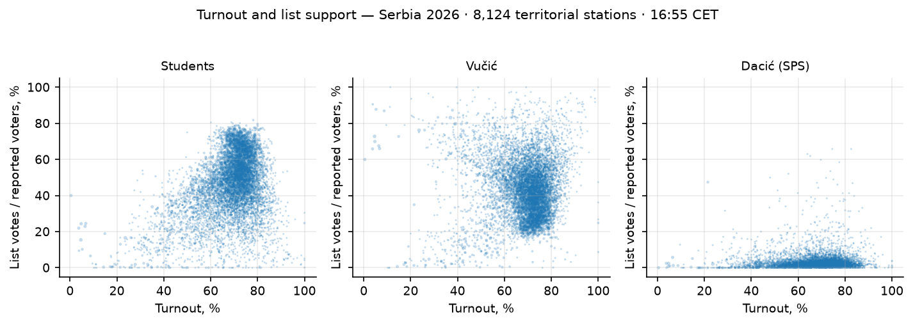

# Serbia 2026: statistical election forensics

**These screening results do not establish ballot stuffing. Accounting gaps,
model-relative digit deviations and unusual stations remain follow-up items.
The analysis does not quantify undetected manipulation or certify election
integrity. Non-rejection by a test is not proof of honest counting.**

Analysis date: 26 October 2026; wording and figures reviewed 27 October.
The review did not refresh the archived results.

 Forensic snapshot: **16:55 CET**, RIK round
680072, 8,160/8,392 stations (**97.24%**). The trend report separately extends
to **21:15 CET**, 97.60%. The 2023 control (round 341140) is complete: all
**8,273 stations**, with exact national per-list reconciliation.

[Counting trends](analysis/trends/README.md) · [Voting paradoxes](PARADOXES.md)
· [Source/capture report](REPORT.md).

## 1. Data, accounting and scope

| Dataset | Units | Registered | Voters | Valid ballots |
|---|---:|---:|---:|---:|
| 2026 territorial municipalities | 189 | 6,340,850 | 4,270,220 | 4,212,522 |
| 2026 processed territorial stations | 8,124 | 6,206,361 | 4,270,220 | 4,212,522 |
| 2023 territorial municipalities | 190 | 6,452,853 | 3,782,235 | 3,673,138 |
| 2023 territorial stations | 8,163 | 6,452,853 | 3,782,235 | 3,673,138 |

Prisons and abroad are excluded from these territorial datasets and analysed
separately (§8). Adding their 36 processed stations brings 2026 to 8,160;
adding their 110 stations brings the 2023 control to 8,273.

For **all 18 lists**, sums at both territorial grains match national totals
minus the latest prison/abroad totals **to the vote**, for both elections.
Every station's list sum equals its valid-ballot count. Keys are unique.
Validation files: `data/ef/serbia{2026,2023}_{mun,stn}/VALIDATION.txt`.

An important remaining discrepancy: national voters (4,288,649) exceed
valid + invalid ballots (4,230,793 + 55,206) by **2,650**. There are nonzero
gaps at **565 stations**. The 2023 national gap is 5,739. Published values
are preserved; no cause is inferred. The 2026 per-station gaps are exported
in `analysis/diagnostics/ballot_accounting_gaps.csv` for protocol follow-up.
Exact list reconciliation does **not** resolve this separate accounting issue.

Definitions used by `ef-analyze`: `voted` = voters reported as having voted;
turnout = voters / registered; party share = party votes / voters. These
shares differ slightly from the portal's votes / (valid + invalid), and
materially from shares of valid votes. All percentages below follow the
forensic definition unless explicitly labelled otherwise.

Municipality registers cover unprocessed stations as well; station registers
cover only processed stations. Thus 2026 territorial turnout is 67.34% at
municipality grain versus 68.80% at station grain. That denominator difference
limits cross-grain turnout comparisons and is not evidence of missing votes.

## 2. High-turnout tails: small at station grain, sensitive to aggregation

Five standard runs are preserved in `analysis/ef/`:

| Run | Boundary | Leader votes in the binned tail | % of leader votes | Leader share before → after tail removal |
|---|---:|---:|---:|---:|
| `mun2026`, 2023 municipality control | 77.96% | 96,390 | 4.29% | 52.65 → 52.73% |
| `stn2026`, own q99.5 | 85.95% | 6,974 | 0.31% | 52.65 → 52.83% |
| `stn2026_controlled`, 2023 station control | 87.97% | 2,762 | 0.12% | 52.65 → 52.77% |
| `mun2023_control`, own q99.5 | 77.96% | 16,173 | 0.92% | 46.58 → 46.42% |
| `stn2023_control`, own q99.5 | 87.97% | 18,028 | 1.02% | 46.58 → 46.48% |

Leader means Students in 2026 and Vučić in 2023. The larger 2026 municipal
tail is sensitive to aggregation and an old turnout boundary after a large
turnout rise. Removing it increases the Students share by only 0.07 points.
Tail mass is a model diagnostic, **not an estimate of proven fraudulent
ballots**. The 2023 control is a historical reference, not a clean-election
benchmark.

The incumbent is tested separately in `analysis/diagnostics/metrics.json`:
with the 2023 station boundary, **8,670 Vučić votes (0.52%)** lie in the
estimated tail; excluding it moves his share **39.16 → 39.09%**. This describes sensitivity to the selected cutoff, not a test with
quantified power to detect large-scale stuffing.



## 3. Turnout/support density: two components specified in advance

The model is instructed to fit **two overlapping Gaussian components** to each
year/list dataset. It does not select the number of components or demonstrate
that two components fit better than one. The fit uses registered-elector-weighted
resampling. Density colour is the sum of **registered electors per cell**, not
the number of votes, stations or suspicious cases; the colour scale is logarithmic.

| Dataset | Lower-turnout centre: turnout / list share | Higher-turnout centre | Higher-turnout fitted weight |
|---|---|---|---:|
| 2026 Students | 59.0% / 34.7% | 72.1% / 57.3% | 0.746 |
| 2026 Vučić list | 57.2% / 45.2% | 72.1% / 37.6% | 0.777 |
| 2023 Vučić list | 51.0% / 56.6% | 59.8% / 44.6% | 0.862 |

List share here is list votes / reported voters. These are separately fitted
datasets, not a shared fit across years or an individual-voter transfer model.
The page now shows all three panels explicitly. The former single 2026 Students
graph misleadingly included “2023 control” in its title although it contained
no 2023 observations and the 2023 data did not calibrate that fit.

The legacy output field `separated` is **not a statistical separation test**.
It is true if the higher-turnout component has weight >1%, its mean turnout
exceeds the other component by >2 percentage points, and its mean list share
is higher. Both 2026 Students fits (station and municipality) meet this
programmed directional rule. The 2026 and 2023 incumbent station fits do not:
their higher-turnout components have **lower** incumbent shares. Thus the
previous phrasing that one mixture “separates” but the others do not was
misleading: two components were fitted in every case.

Component weights do not estimate fraudulent votes, fraudulent stations or
verified political groups. Geographic and electorate differences could
contribute; the fit alone neither identifies their cause nor establishes or
rules out manipulation. Neither year is a verified clean benchmark.

## 4. Integer percentages and synthetic sensitivity

At 2026 stations, integer turnout has **z = +0.90** (multiples of five:
−0.30); 2023 has z = −0.88. There is no detected excess of integer turnout.
Students' integer-share statistic is **z = −3.48**, a deficit rather than
round-number heaping. The incumbent's integer-share z is −1.46. Reporting
all integer tests as “within one sigma” would therefore be incorrect.

The station synthetic injection raises the own-boundary tail signal from
6,974 to 217,414 votes (**31 times**); forced percentage rounding moves
turnout z from +0.90 to +3.23. This checks sensitivity to those particular
simulations, not detection power against every form or size of manipulation.
The additive scenario adds 87,179 synthetic Students votes, while the tail
statistic rises to 217,414 because it includes original votes moved into the
tail. The cutoff is fixed from the original 2026 data (85.95%), not the
historical 87.97% cutoff. “Original” does not mean independently verified
clean. The separate rounding scenario is not shown in the additive figure.

## 5. Digit tests: report the deviations, respect the null model

2026 station results:

| List | Second-digit chi² | Theoretical p | Smooth-null Monte Carlo p | Last-digit p |
|---|---:|---:|---:|---:|
| Students | 16.93 | 0.0498 | 0.0399 | 0.2175 |
| Vučić | 20.58 | 0.0146 | 0.0200 | 0.1317 |
| SPS | 144.52 | ~1.2×10⁻²⁶ | 0.00249 | 0.4832 |

These are not all null results. Across the six station/list/digit tests,
only SPS's theoretical second-digit result survives a 5% Bonferroni check.
Of its 3,844 eligible second-digit counts, 3,811 (99.14%) lie between
10 and 99, and only 33 are at least 100; a universal
Benford distribution is a poor null for such a restricted range. Even the
fitted, thresholded lognormal null rejects, so this deviation remains a
model/data diagnostic to investigate rather than being discarded. SPS's
last-digit test has only 33 eligible counts. Expected counts of 3.3 per
digit make the asymptotic chi-square reference unreliable; its p-value is
retained in the raw output but is not interpreted as a reliable pass/fail.

The 2023 incumbent also deviates in second digits (chi² 23.97,
p = 0.00436; Monte Carlo p = 0.0175), while its last digits are unremarkable
(p = 0.7249). NOS's 2023 second-digit chi² is 56.32, and it has **no** station
counts meeting the last-digit minimum of 100. That test is marked unavailable,
not p = 1. Digit p-values depend on the assumed generating process and
cannot identify fabricated tallies by themselves.

The stated six-test Bonferroni family is exploratory and does not cover all
analyses on this page. It retains the sparse SPS last-digit combination, so
the cutoff is conservative for that family. The SPS second-digit simulation
p-value 0.00249 is the minimum resolution of 400 simulations (1/401).
The page's digit plots now show the three actual tested lists separately;
the former “top-6” label was incorrect. The shaded 95% simulation bands are
per digit, not a simultaneous acceptance region or an integrity probability.

Tables for every run: `analysis/ef/<run>/tables/{benford2,last_digit}.csv`.

## 6. Correlations: national and within-region patterns differ

At stations, register-weighted turnout × share correlation is **+0.497 for
Students**, **−0.090 for Vučić**, versus **+0.126 for Vučić in 2023**.
Municipality correlations are +0.561 and −0.068 in 2026, +0.202 for the
2023 incumbent.

The regional calculation now groups Serbian region paths correctly, rather
than treating all non-Portuguese keys as one district:

| Region | Stations | Students correlation | Vučić correlation |
|---|---:|---:|---:|
| Belgrade | 1,240 | +0.238 | −0.241 |
| Vojvodina | 1,758 | +0.377 | +0.123 |
| Šumadija & western Serbia | 2,728 | +0.583 | +0.149 |
| Southern & eastern Serbia | 2,340 | +0.500 | +0.069 |
| Kosovo & Metohija | 58 | +0.103 | +0.009 |

The incumbent's negative national correlation coexists with positive
correlations in several regions: an aggregation effect. A national
correlation alone cannot rule out local manipulation. Socioeconomic,
ethnic, geographic and station-size differences remain potential confounders.

## 7. Outliers and the matched historical comparison

Station outliers are now compared within their **municipality**; municipality
outliers are compared within their region. **146/8,124 stations (1.80%)**
are flagged at |robust z| > 4 in 2026, versus **136/8,163 (1.67%)** in 2023.
Three 2026 municipalities are flagged. Examples include unusually high
Students shares relative to the local median in Preševo and unusually low
shares/turnout at some Novi Beograd stations. These are investigation leads,
not findings of fraud. Small groups and very small median deviations can
produce large z-scores.

Isolation Forest flags 82 stations in each year, and two municipalities.
Its contamination setting fixes the expected flag fraction near 1%; the
number of flags itself is not an independent measure of election cleanliness.
Tables retain the ranked locations for follow-up.

There are **7,935 matching territorial station keys** between elections;
189 of the 2026 station keys do not match. Within the matched set,
register-weighted turnout rises **58.63 → 68.83%** and the incumbent's valid
share falls **47.92 → 39.83%**. These are descriptive changes, not individual
voter transfers. A matching municipality/station-number key does not prove
unchanged boundaries or electorate. Matched rows are exported in
`analysis/diagnostics/matched_stations.csv`.

All 189 current municipality keys match the control. The incumbent comparison
flags no municipality with both >15-point turnout and >15-point share jumps;
six have >15-point turnout changes. Students have no identically named 2023
list and are not compared against an artificial zero-vote predecessor.

## 8. Prisons, abroad and count-night context

| Register | 2023 final | 2026 at 16:55 |
|---|---|---|
| Prisons | 29 stations; 81.46% turnout; incumbent 60.28% valid share | 28/29; 89.24% covered-register turnout; incumbent 66.97% valid share |
| Abroad | 81 stations; 39,270 registered; 80.35% turnout; incumbent 57.06% valid share | 8/93; 102,147 registered overall; 80.06% covered-register turnout; Students 89.76% valid share |

The counted prison and abroad registers contain 7,023 and 15,192 voters
respectively. Dividing by the full registers instead gives 75.55% and 11.91%
participation. Mixing those denominators previously produced contradictory
claims. The diaspora electorate is 2.60 times its 2023 size, but only eight
stations have results; its final preferences cannot be inferred reliably.

The observed count-night lead changes at 25.45–41.35% station coverage,
when early underrepresentation of Belgrade is being reduced. The margin
later reaches +13.62 points and narrows to +13.54 at 21:15. These snapshots
support a composition explanation but cannot exclude changes between captures.
They are not an audit of counting procedures.

## 9. Scope of the findings and unresolved questions

The captured list totals reconcile across grains, the historical station
control is complete, no excess of integer turnout is detected, and both
leader and incumbent station-tail estimates are small. The pattern does not
establish ballot stuffing in the published totals. This run does not quantify
false-negative rates or the scale of manipulation that could escape its checks.

Open items include the voter/ballot accounting gap, the imposed mixture fit,
second-digit deviations, and individual station outliers. The station-level
protocols, ballot papers, voter register quality, coercion, vote buying,
media/campaign conditions and chain of custody have not been audited.
A numerical consistency analysis cannot settle those questions or estimate
how many votes, if any, were unlawfully influenced.

## 10. Reproduction and validation

From the repository root:

```bash
zsh analysis-tool/run_forensics_serbia.sh
```

The runner adapts both grains, regenerates trends and paradox tables, runs
five forensic configurations plus incumbent/matched-station diagnostics,
and runs the regression tests. Source control capture:
`data/timeline/341140/stations_complete.csv`; the original resumable
`stations.csv` is retained independently. No source records are silently
replaced with synthetic values. Data directories are gitignored; retain the
local source captures when sharing/reproducing these results.
