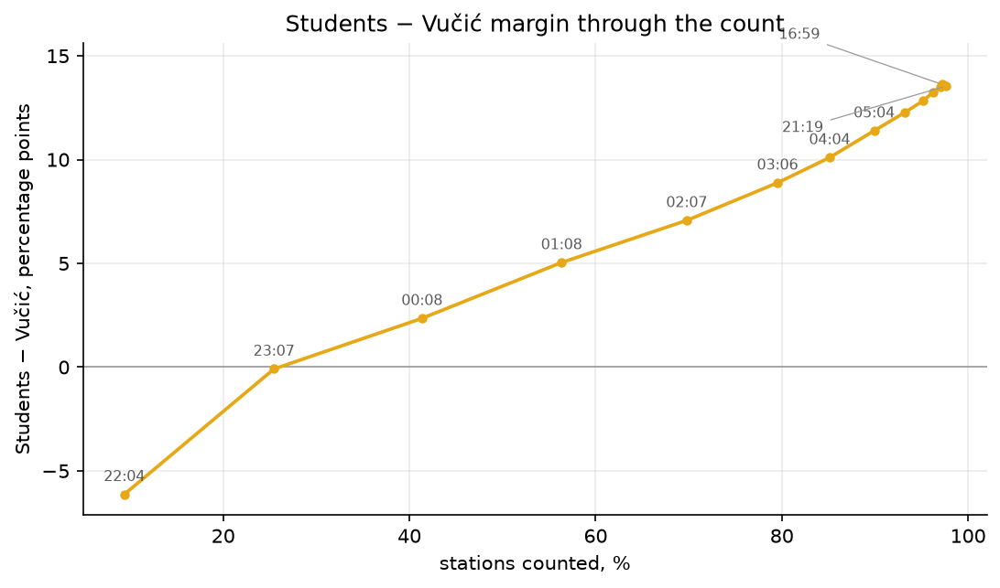

# Serbia 2026: trends through the count

**Students retain a large lead; the late update slightly narrows it.** The
latest checked RIK source timestamp is **26 October 2026, 21:15 CET**
(captured 20:19:23 UTC): 8,191/8,392 stations, **97.60%**. Students have
52.71%, Vučić's list 39.17%, SPS 2.17% on the portal's displayed denominator;
4,248,886 valid and 55,500 invalid ballots are reported. Turnout is 68.83%
of the register covered by processed stations.

This analysis uses **14 snapshots**: 11 hourly night captures, two afternoon
captures, and the latest independent official-API check. Figures and
`metrics.json` are rebuilt by `scripts/analyze_trends.py`. Original afternoon
raws are in `data/raw/680072/`; the independent check is preserved in
`data/checks/680072/20261026_201923/`. The station forensics use the reconciled
**16:55 CET** snapshot, not the later national/region update.

## 1. The lead changed as the counted sample changed

At the first capture, **25 October 22:04 CET** (9.38% of stations), Vučić's
list led 48.01% to 41.88%, a 6.13-point advantage. Students first lead in the
capture at **26 October 00:08 CET**. The crossover is bounded by the previous
capture, **23:07 CET**: **25.45–41.35% of stations counted**. These are bounds,
not a measured exact crossover time.

Belgrade was only about 2.9% counted initially, despite accounting for roughly
24% of the electorate. Its latest vote splits 62.96% Students to 31.63%
Vučić on the displayed denominator. Changing counting coverage is therefore
a plausible explanation for the early lead's reversal. The four main
territorial regions moved toward Students between their first and latest
captures; Kosovo and prisons moved toward Vučić.

The observed national margin rose from −6.13 points to **+13.62 at 16:55**,
then slipped to **+13.54 at 21:15**. It is **not monotonic over the full
capture**. Hourly observations cannot rule out jumps, corrections, or
reversals between captures, nor establish that every increment was a new
batch rather than a correction.



## 2. Turnout and denominators

RIK turnout increases from 67.53% initially to 68.85% at 16:55, then 68.83%
at 21:15. It uses the register of processed stations. Dividing voters by
the *whole* national register instead gives 66.76% at the latest check;
that is a coverage-dependent participation lower bound, not final turnout.

The implied turnout of the increment from the last night capture (08:04 CET)
to the latest check is about **71.12%**, calculated as Δvoters / Δcovered
register. Covered registers are inferred from rounded turnout percentages,
so this is approximate and includes any revisions. It is not a fraud test.

Portal list percentages reproduce votes divided by **valid + invalid
ballots**, up to rounding. Students' latest share of valid votes is about
**53.40%**, versus the displayed 52.71%. Never compare these denominators
without labelling them.

At 21:15, published voters total 4,307,042 while valid + invalid total
4,304,386: **2,656 voters are not accounted for by those ballot fields**.
At the forensic snapshot the gap is 2,650. These discrepancies are retained,
not silently added to invalid ballots or attributed to fraud.

## 3. Special registers remain incomplete

At the latest check, abroad has **8/93** stations processed. Its 12,162
reported voters represent 11.91% of the full abroad register (102,147), but
80.06% of the register of the counted stations. Students have 89.57% of
valid + invalid ballots in that small counted subset. Extrapolation to the
remaining diaspora would require assuming similar turnout and preferences.

Prisons have **28/29** stations processed. Their 6,267 voters represent
75.55% of the full register (8,295), or 89.24% of the covered register.
Vučić's list has 65.61% on the displayed denominator, 66.97% of valid votes.
The 2023 prison control has 81.46% turnout and 60.28% incumbent valid share.
The abroad register increased from 39,270 to 102,147 (**2.60 times**, not
three times). Both registers are excluded from territorial forensic tests.

At 16:55, 232 stations were unprocessed: 85 abroad, one prison and
146 territorial stations. Outstanding stations were therefore **not almost
entirely abroad**. At 21:15, 201 remain unprocessed, including 85 abroad.

## 4. Robustness of the national lead

The 16:55 station records cover 6,228,576 registered voters, leaving 222,716
outside that covered register. Students lead by 583,521 valid votes.
Even assigning every remaining registered voter and all 2,650 unaccounted
ballots to opponents leaves Students at **50.73% of valid votes**.
This is a conditional arithmetic bound: it assumes the register and already
counted votes do not change. It is not certification of a final result.

## Figures and reproduction

| Figure | Content |
|---|---|
| `01_national_dynamics.png` | Coverage, turnout and valid-ballot growth |
| `02_share_race.png` | Displayed list shares through time |
| `03_margin_vs_counted.png` | Margin against station coverage |
| `04_regional_dynamics.png` | Regional list shares and counting progress |
| `05_region_first_final.png` | First versus latest regional margins |
| `06_special_areas.png` | Abroad/prison coverage, turnout and preferences |

Run from the repository root:

```bash
analysis-tool/.venv/bin/python serbia-oct-2026/scripts/analyze_trends.py
```

[Statistical forensics](../../REPORT_statistical_fraud_analysis.md) ·
[Voting paradoxes](../../PARADOXES.md).
