# Статистический анализ фальсификаций: Словения, четыре референдума 11.10.2026

*Применение методов election forensics (обзор — [`методы_выявления_фальсификаций_выборов.md`](../методы_выявления_фальсификаций_выборов.md)) к данным четырёх общенациональных референдумов Словении 11.10.2026. Инструмент — [`analysis-tool/`](../analysis-tool/) (штатный пайплайн `ef-analyze`), данные — поучастковые итоги DVK. Дата анализа: 13.10.2026. Контекст и сбор данных — [`report.md`](report.md), итоги и сверка с Википедией — там же, раздел 8.*

## Данные

Официальные поучастковые итоги Государственной избирательной комиссии (DVK,
`volitve.dvk-rs.si`): на каждый референдум — 3 083 «участка» (файлы
`volisca_XX_YY.json`). Из них **2 984 обычных участка** (номера < 900) плюс
**99 сборных точек досрочного голосования** (Predčasno glasovanje, номера ≥ 900,
собственного электората нет — `upr` = 0). Данные сведены в
[`data/derived/volisca_all.csv`](data/derived/volisca_all.csv)
(`scripts/build_volisca_csv.py`) и адаптированы к формату analysis-tool
(`scripts/build_ef_csv.py` → `data/ef/<референдум>/results_freguesias.csv`,
журнал сверки — `data/ef/ВАЛИДАЦИЯ.txt`).

Уникальность набора: **четыре референдума в один день на одних участках с одним
электоратом** — каждый избиратель получал все четыре бюллетеня. Это даёт
взаимный контроль, которого нет на обычных выборах: явка и электорат участка
должны совпадать между референдумами (раздел 11), а география результатов —
быть общей (r = 0,94–0,96).

| Показатель | Значение |
|---|---|
| Участков в анализе | 2 984 × 4 референдума (+99 досрочных точек отдельно) |
| Электорат / бюллетени на участках | 1 581 696 (93,2%) / 843 250–843 285 (91,0%) |
| Явка | 53,31% на участках; 54,62% по стране |
| Итог preiskava (закон ZPPre-B) | ЗА 48,74% / **ПРОТИ 51,26%** — закон отклонён, кворум 1/5 выполнен |
| Итог socialna_pomoc | **ЗА 60,54%** / ПРОТИ 39,46% — одобрен |
| Итог volilna_pravica | **ЗА 55,30%** / ПРОТИ 44,70% — одобрен |
| Итог rtv_prispevek | ЗА 49,97% / **ПРОТИ 50,03%** — отклонён, разрыв 546 голосов |
| Недействительные (участки) | 0,32–0,58% бюллетеней |

Вне поучасткового покрытия: досрочные точки (75 300 бюллетеней, 8,1% — ЗА всего
29,9–41,3%, поэтому на участках ЗА систематически на 1,5–2 п.п. выше национального
итога), участки OMNIA, почта и диппредставительства (~8 400 бюллетеней, 0,9%).
Метка DVK — 12.10.2026, посчитано 99,98%, `is_final=false` (проверка голосов
из-за рубежа — 19.10.2026). На участках доли считаются от всех бюллетеней
(«glas»), официальные итоги — от действительных; разница — недействительные.

## Сводный вердикт

| Метод | Результат | Вердикт |
|---|---|---|
| Шпилькин (аномальные голоса) | хвост 4 135–4 651 голос ЗА (0,89–1,00%) и 1 297–1 812 ПРОТИ (0,41–0,45%); сдвиг итога ≤ 0,15 п.п. | ✅ чисто |
| Хвост кометы (явка × результат) | ЗА +0,27…+0,38, ПРОТИ зеркально; градиент плавный по всему диапазону явки, выше 80% — 10 малых участков (0,1% бюллетеней) | ✅ без хвоста |
| Отпечатки (Klimek) | два компонента — градиент город/село (+4–5 п.п. явки), оба при явке 51–56%; кластера на 80–100% нет | ✅ чисто* |
| Целочисленные пики | явка z = −0,0…+0,4; доли ЗА z ≤ +1,1, ПРОТИ z ≤ +1,3 | ✅ чисто |
| 2D-корреляции | +0,27…+0,38 у ЗА во всех четырёх, однородно по 8 единицам | ⚠️ структура |
| Бенфорд, вторая цифра | 16 тестов: 13 чисто; socialna/ЗА p = 0,005, volilna/ПРОТИ 0,057, rtv/ЗА 0,122 | ⚠️ погранично* |
| Последняя цифра (участки) | все p ≥ 0,05 (минимумы 0,052 и 0,065), профиль без 0/5 | ✅ чисто |
| Последняя цифра (досрочные точки) | p = 0,37 / 0,19 | ✅ чисто |
| Выбросы против соседей | 22–40 из 2 984 (0,7–1,3%), малые участки, направления смешанные | ✅ без паттерна |
| ML (Isolation Forest) | 30 аномалий (1% по построению) — участки 16–342 избирателей | ✅ без паттерна |
| Кросс-референдумные проверки | явка r ≈ 1,000; расхождение ≤ 2 бюллетеней у 99,6%; доли r ≈ 0,94–0,96 | ✅ чисто |
| Дубликаты протоколов | внутри референдума 38–60 против нуля 37–53; между бюллетенями Δ=0 вдвое реже Δ=1 | ✅ совпадения |
| Арифметика строк | 0 расхождений во всех 12 332 строках | ✅ чисто |
| Самотест | «вброс» виден: сигнал ×12–13; целочисленная рисовка на участках ~460 избирателей — тест маломощен (z → 0,8–1,6) | ⚠️ мощность |

\* три пограничных значения цифровых тестов и «разделение» отпечатков
разобраны в разделах 3 и 6: профиль отклонений противоположен «рукодельному»
(избыток круглых 0/5), порог Бонферрони по 16 тестам — 0,003; разделение
отпечатков — градиент внутри одного облака, общий для всех четырёх референдумов.

**Вывод: систематических статистических следов фальсификаций не обнаружено.**
Распределение явки обрывается в районе 70% (выше 80% — лишь 10 крошечных
участков по 16–371 избирателю, суммарно 808 бюллетеней — 0,1%), итоги
сдвигаются не более чем на 0,15 п.п. при отсечении аномальной зоны, цифровые
тесты чисты, целостность сходится до бюллетеня, а четыре одновременных подсчёта
одних и тех же участков дают взаимно согласованные картину явки и географию
результатов. Наклон «явка ↑ → ЗА ↑» (+0,3) — свойство территориальной структуры
(город/село), одинаковое у всех четырёх референдумов.

---

## 1. Метод Шпилькина: распределение явки и аномальные голоса

Явка участков: мода 55,2%, σ = 7,0 п.п., диапазон 21,3–100% (максимум — участок
в 19 избирателей: 19 из 19). Граница честного спада — **70,06%** — верхний
перцентиль q99.5 трёх других референдумов (контроли штатного пайплайна
`--controls`; все четыре имеют одно и то же распределение явки с точностью до
1–2 бюллетеней на участок). За границей: 5 970 проголосовавших (0,71%
бюллетеней) на 67 участках — малых сельских (медианный размер 98 избирателей,
диапазон 16–468). Аномальная масса голосов:

| Референдум | хвост ЗА | % голосов ЗА | хвост ПРОТИ | % голосов ПРОТИ | итог ЗА: наблюдаемый → «честный» |
|---|---|---|---|---|---|
| preiskava | 4 223 | 1,00% | 1 709 | 0,41% | 50,32% → 50,17% |
| socialna_pomoc | 4 651 | 0,89% | 1 297 | 0,41% | 62,20% → 62,09% |
| volilna_pravica | 4 438 | 0,92% | 1 508 | 0,42% | 56,93% → 56,81% |
| rtv_prispevek | 4 135 | 0,95% | 1 812 | 0,45% | 51,60% → 51,48% |

В хвосте доля ЗА действительно повышена (preiskava: 70,7% против 50,6% в
среднем) — но это не отдельный «вброшенный» кластер, а правый край того же
градиента город/село, который виден по всему диапазону явки и у всех четырёх
референдумов. Доля ЗА по корзинам явки (preiskava / socialna_pomoc):

| Явка, % | 30–40 | 40–45 | 45–50 | 50–55 | 55–60 | 60–65 | 65–70 | >70 |
|---|---|---|---|---|---|---|---|---|
| Участков | 117 | 213 | 481 | 720 | 763 | 456 | 166 | 66 |
| ЗА, % | 41,3 / 53,7 | 43,5 / 56,2 | 45,8 / 58,7 | 49,3 / 61,4 | 52,3 / 64,1 | 55,7 / 66,4 | 62,0 / 71,8 | 71,2 / 78,3 |
| Медианный размер | 517 | 522 | 553 | 518 | 487 | 354 | 212 | 99 |

Рост монотонный, без скачка на границе: участок с 60%-й явкой в среднем на
~4 п.п. «ЗА-нее» участка с 50%-й, и с каждым шагом явки участки мельче —
это сельская периферия. Метод Шпилькина и оценивает вклад правого края сверх
гладкой модели: пересчёт итога без аномальной зоны сдвигает результат лишь на
0,11–0,15 п.п. Принципиальное отличие от фальсифицированных выборок: выше 80%
явки — только 10 участков по 16–371 избирателю (808 бюллетеней, 0,1%), выше
85% — два (19 и 21 избиратель); вброс же оставляет массу именно на 80–100%
крупных участков.

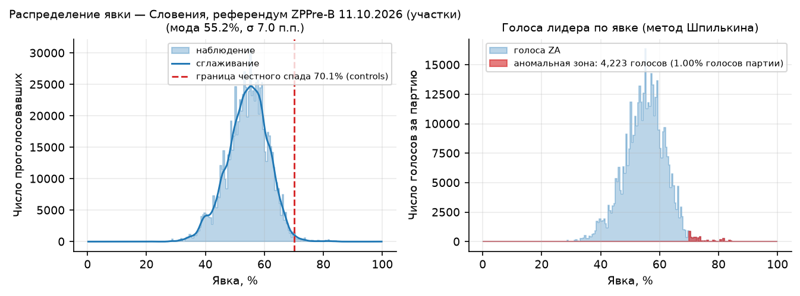

## 2. «Хвост кометы»: явка × результат

Облако (явка × доля ЗА) наклонено вверх-вправо: взвешенная корреляция +0,36
(preiskava), +0,35 (socialna), +0,38 (volilna), +0,27 (rtv); у ПРОТИ зеркально
минус. Но это наклон **всего облака**, плавный по всему диапазону явки
(корзины в разделе 1): участок с 60%-й явкой стабильно «ЗА-нее» участка с 50%-й
на ~4 п.п., без разрыва в правом крае. На фальсифицированных выборках «хвост
кометы» — иной: основная масса при явке 50–60% и отдельное вытянутое облако,
идущее к результатам 80–95% на явке 80–100% крупных участков, при зеркальном
падении оппонента именно в этом хвосте. Здесь выше 80% — 10 участков по 16–371
избирателю (808 бюллетеней), и их завышение ЗА — продолжение того же
демографического градиента, идентичного у всех четырёх референдумов.

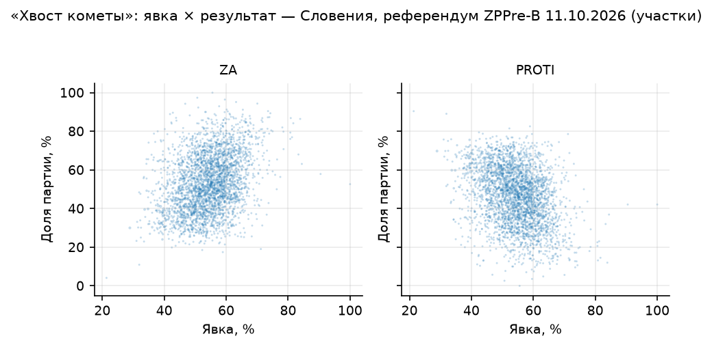

## 3. Электоральные отпечатки пальцев (Klimek et al., PNAS 2012)

Смесь двух 2D-гауссиан делит участки на компоненты (явка 51,0–51,6%; ЗА
41,4–53,5%) и (55,4–55,6%; 61,2–70,2%) с весами 0,42–0,49. Формально критерий
«вправо-вверх» срабатывает (вторая компонента выше по обеим осям), но это
**градиент внутри одного непрерывного облака**, а не отдельный кластер: разница
средних явок — 4–5 п.п. при моде 55%, обе компоненты лежат в середине диапазона.
Классический «фальшивый» кластер — компактный остров на явке 80–100% с
результатом 60–95% (Россия-2011/2012, Уганда) — на плотности отсутствует:
выше 85% явки отмечаются лишь два участка по 19 и 21 избирателю. Та же
двухвершинная структура у всех четырёх референдумов
с корреляцией долей 0,94–0,96 (раздел 11) — это поляризация электората
(сельские муниципалитеты ЗА, городские ПРОТИ), известное ограничение метода
(раздел 4 обзора).

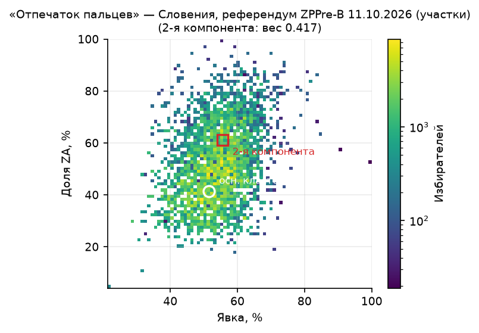

## 4. Целочисленные пики (Kobak et al., 2016)

| Метрика | preiskava | socialna_pomoc | volilna_pravica | rtv_prispevek |
|---|---|---|---|---|
| Целая явка, наблюдение / нуль | 2,25 / 2,24% | 2,35 / 2,26% | 2,25 / 2,26% | 2,31 / 2,26% |
| z (явка) | +0,0 | +0,4 | −0,0 | +0,2 |
| z (кратные 5) | −0,1 | +0,2 | −0,2 | +0,2 |
| z (доля ЗА) | +1,1 | +0,4 | +0,2 | +0,2 |
| z (доля ПРОТИ) | +1,0 | +1,2 | +1,2 | +1,3 |

Все z в пределах ±1,3 — «рисования» протоколов под круглые значения нет ни по
явке, ни по долям вариантов. О мощности теста на участках такого размера —
раздел 10 (самотест).

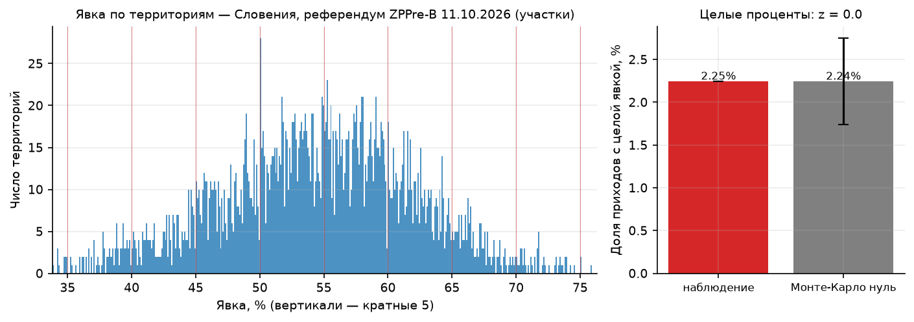

## 5. 2D-корреляционный анализ (Kobak et al., 2012)

Национальные корреляции явка × доля (взвешенный Пирсон / Спирмен):

| | ЗА | ПРОТИ |
|---|---|---|
| preiskava | +0,36 / +0,31 | −0,36 / −0,32 |
| socialna_pomoc | +0,35 / +0,30 | −0,35 / −0,30 |
| volilna_pravica | +0,38 / +0,33 | −0,38 / −0,33 |
| rtv_prispevek | +0,27 / +0,26 | −0,27 / −0,26 |

Зеркальность ЗА/ПРОТИ механическая (две доли одного набора бюллетеней).
Существенно другое: **положительная связь одинакова у всех четырёх вопросов** —
включая национальных победителей-«ПРОТИ» (preiskava, rtv_prispevek), у которых
связь с явкой отрицательная. Если бы счёт по одному бюллетеню подправлялся, его
корреляция выбивалась бы из трёх остальных; вместо этого все четыре лежат в
полосе +0,27…+0,38 с одним и тем же порядком по единицам (KRANJ +0,60…+0,69,
PTUJ +0,16…+0,19). Такая неспецифическая корреляция известна на честных
выборах (Великобритания; раздел «Ограничения» обзора) и отражает
распределение явки город/село, а не перелив голосов.

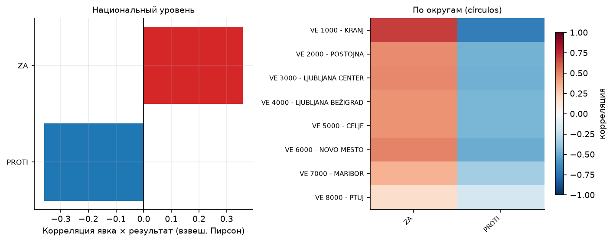

## 6. Закон Бенфорда: вторая цифра

Вторые цифры счётов ЗА и ПРОТИ (по ~2 900 чисел на вариант) против закона
Бенфорда и гладкого логнормального Монте-Карло-нуля — 16 тестов:

| Референдум | ЗА p (теор / МК) | ПРОТИ p (теор / МК) |
|---|---|---|
| preiskava | 0,67 / 0,80 | 0,83 / 0,84 |
| socialna_pomoc | **0,001 / 0,005** | 0,96 / 0,97 |
| volilna_pravica | 0,81 / 0,88 | 0,04 / 0,057 |
| rtv_prispevek | 0,05 / 0,12 | 0,44 / 0,47 |

Тринадцать тестов чисты. Единственное значение ниже 0,05 по МК-нулю —
socialna_pomoc/ЗА (p = 0,005). Профиль отклонения: избыток цифры 4 (12,1%
против 10,0% ожидания, верх нулевой полосы 11,1%) и дефицит 0 (10,3% против
12,0%, низ полосы 11,1%); цифра 5 — в норме. Это **противоположно** профилю
выдуманных чисел (избыток круглых 0/5 — Beber–Scacco). После поправки на
множественное тестирование (Бонферрони по 16 цифровым тестам, порог 0,003)
отклонение незначимо; кроме того, смесь 3 000 разномасштабных участков
(от 16 до 2 908 избирателей) сама по себе отклоняется от однологнормального
нуля — аналог случая CH p = 0,006 в португальском секционном анализе.

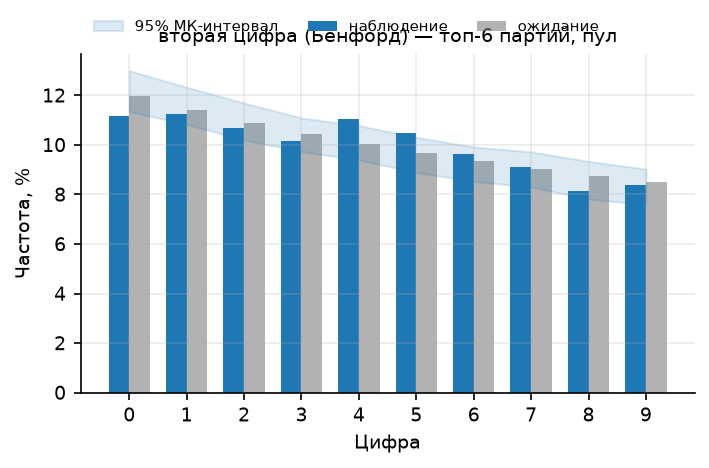

## 7. Последняя цифра (Beber–Scacco)

Последние цифры счётов ≥ 100 по участкам (1 263–2 033 числа на вариант) — все
16 тестов на уровне p ≥ 0,05: минимумы — rtv/ПРОТИ p = 0,052 (отклонения ±1,7
п.п. на цифрах 3 и 9, 0/5 в норме) и preiskava/ЗА p = 0,065 (избыток 2, дефицит
4 — тоже без круглого профиля); остальные p ≥ 0,14. На **досрочных точках**
(99 точек × 4 референдума, пул 372–387 чисел ≥ 100) — p = 0,37 (ЗА) и 0,19
(ПРОТИ). Досрочное голосование (отдельные комиссии, отдельные протоколы)
цифровых следов не несёт.

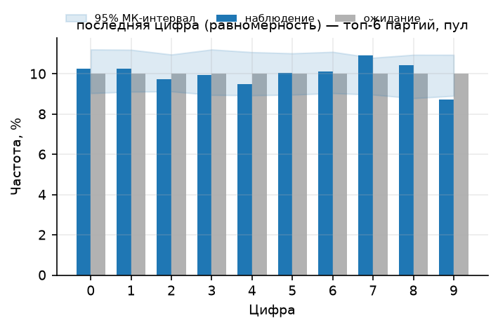
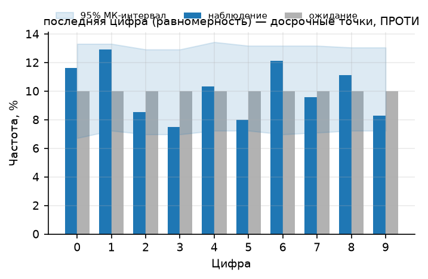

## 8. Сравнение с соседями (Myagkov–Ordeshook–Shakin)

Робастный z-скор каждого участка против медианы своего округа (okraj, 88 групп
по ~34 участка): 40 выбросов (preiskava), 29 (rtv), 25 (socialna), 22 (volilna)
при пороге |z|>4 — 0,7–1,3%, нормальный хвост. Направления по явке
симметричны (+7/−9 у всех четырёх); по доле ЗА больше высоких (+22/−2 в
preiskava) — следствие скошенного вправо распределения доли ЗА (сельские
участки с ЗА 70–90%), а не односторонней добавки: у национальных
победителей-«ПРОТИ» картина зеркальна. Крупнейшие отклонения — малые участки:
KOPER 2 (66 избирателей, ЗА z = +7,8), RUŠE (173, доля ЗА z ±5–7 в трёх
референдумах), NOVO MESTO 2 (342, явка z = −8,9 — одинаково во всех четырёх
бюллетенях, то есть свойство места, а не подсчёта). Скоплений на высокой явке
нет.

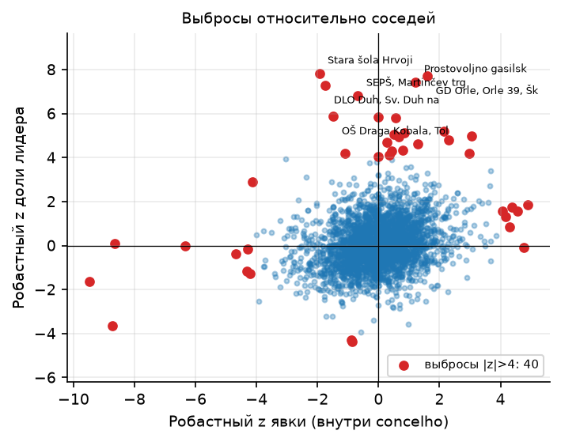

## 9. Машинное обучение: Isolation Forest (Zhang et al., 2019)

30 аномальных участков на референдум (1% по построению, признаки: явка, доля
лидера, недействительные, размер). Это одни и те же экстремумы во всех четырёх
прогонах: Stavba Makuc (16 избирателей, явка 81%), Janeževo Brdo (19, явка 100% —
19 из 19), Stavba Rejc (26, недействительные 10%), Mlekarna Potoki (44,
недействительные 11,5%), Vrtec Žabjak (342, явка 21%). Аномальность — размер и
крайние значения крошечных участков, кандидаты на ручную проверку, но не сигнал
фальсификаций: скопления на высокой явке/результате нет.

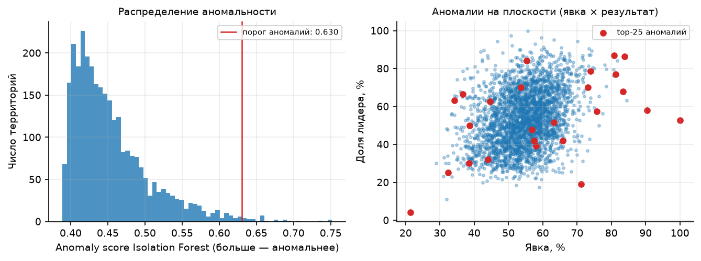

## 10. Самотест инструментов (синтетические фальсификации)

- **«Вброс»**: +10% участков, явка +5–35 п.п., 60–95% добавленных бюллетеней за
  лидера → оценка аномальной зоны растёт с 4,1–4,7 тыс. до 52–59 тыс. голосов
  (**×12–13**): на этом наборе метод Шпилькина видит инъекцию такого масштаба с
  большим запасом.
- **«Круглые протоколы»**: подгонка явки под целый процент в 146 участках (5%) →
  z целочисленных пиков растёт лишь с −0,2…+0,3 до **+0,8…+1,6**. Причина —
  размер единицы: при медианном участке в 464 избирателя «целый процент» явки
  достижим точно лишь в ~1% подгонок (464 × 0,6 = 278,4 голоса), тогда как на
  приходах Португалии (медиана ~3 000 избирателей) тот же тест давал z = 5,1.
  То есть нулевые z раздела 4 означают отсутствие *грубой* круглой рисовки, но
  против рисовки малой доли поучастковых протоколов целочисленный тест на
  участках такого размера маломощен.

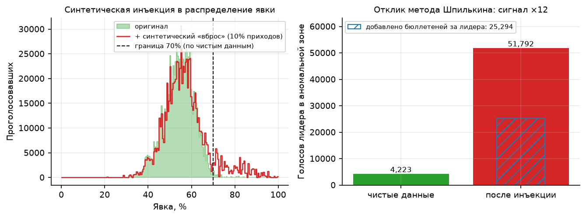

## 11. Взаимный контроль четырёх референдумов

Одновременность и общий бюллетень избирателя дают проверки, недоступные на
обычных выборах (`scripts/analyze_extra.py`, выход `analysis/cross/`):

- **Явка одного события, четыре записи.** Взвешенные корреляции явки между
  референдумами 0,9988–1,0000. Абсолютные расхождения: у 2 774 участков (93%)
  число выданных бюллетеней идентично во всех четырёх, у 198 (6,6%) — 1–2
  (избиратель не взял часть бюллетеней), у 6 — 3–5, у 6 — больше 5. Максимум —
  7005_003 (volilna_pravica: 760 против 670 в остальных, станция на момент
  съёма досчитана лишь на 87%); 6007_005 (preiskava: 74 против 44, посчитано
  59%) — обе строки ещё досчитывались. Массовых расхождений нет.
- **Электорат**: у единственного участка 5007_005 `upr` = 999 против 1001
  (rtv_prispevek) — расхождение файлa DVK на 2 записи.
- **Общая география результатов**: корреляции доли ЗА между референдумами
  0,935–0,962. «Нарисованный» референдум выпадал бы из общей картины —
  ни один не выпадает.
- **Наложение распределений явки** четырёх референдумов совпадает по форме
  (фигура `controls_turnout.png`) — общий контроль штатного пайплайна.

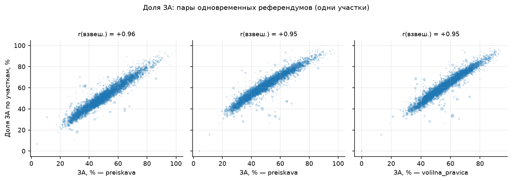

## 12. Целостность данных

- **Арифметика**: во всех 12 332 строках (4 × 3 083) ЗА + ПРОТИ =
  действительные и действительные + недействительные = бюллетени —
  **0 расхождений до единого бюллетеня** (журнал — `data/ef/ВАЛИДАЦИЯ.txt`).
- **Дубликаты протоколов**: внутри каждого референдума 38–60 повторов вектора
  (ЗА, ПРОТИ, недействительные) при действительных ≥ 50 — параметрический
  бутстрап-нуль даёт 37–53 ± 5–7: естественные коллизии похожих участков
  (37 из 38 пар preiskava — участки из разных округов); признака copy-paste нет.
  Между бюллетенями одного участка 230 пар совпавших векторов, но контроль
  копирования их снимает: в распределении |ΔЗА| между референдумами значение 0
  встречается **вдвое реже** значения 1 (412 против 798) — спад к нулю, а не пик;
  векторов, совпадающих во всех четырёх бюллетенях, — 2.
- **Границы файла**: у 2 строк «посчитано» больше выданного на 1 бюллетень
  (6005_044, два референдума — рассинхронизация файлов явки/итогов DVK);
  у 188 участков хотя бы в одном бюллетене доля посчитанного < 1 (99,98% по
  стране; минимум 59% — 6007_005).
- **Недействительные**: медиана 0,00–0,43% по референдумам (законодательный
  бюллетень сложнее), максимум 10–11,5% на участках из 10–26 бюллетеней —
  экстремальных значений нет.

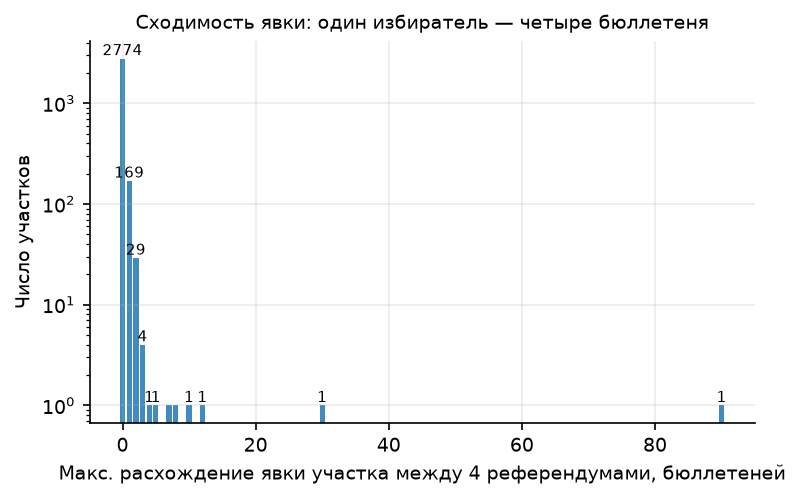

---

## Ограничения

- **Покрытие 93,2% электората / 91% бюллетеней.** Досрочные точки (8,1%),
  OMNIA, почта и диппредставительства (~0,9%) не имеют поучастковой разбивки и
  проверены лишь цифровыми тестами (раздел 7) и суммовой сверкой.
- **`is_final=false`** (посчитано 99,98%, проверка заграницы 19.10.2026):
  финальные итоги могут сдвинуться на десятки голосов — на выводы такой масштаб
  не влияет.
- **Мощность цифровых тестов на участках ~460 избирателей**: целочисленный тест
  не увидел бы рисовку малой доли протоколов (самотест, раздел 10); тесты
  последней/второй цифры имеют ~2 000–3 000 чисел на вариант — чувствительны
  лишь к массовым искажениям.
- **Корреляция явка × ЗА неспецифична**: мягкая манипуляция, размазанная по
  всем участкам (административная мобилизация), статистикой от структуры
  город/село не отделяется — это ограничение метода, а не особенность данных.
- **Статистика показывает аномальность, но не механизм**: протоколов, экзит-поллов
  и параллельного подсчёта в наборе нет. Дополнительный якорь здесь — взаимное
  согласие четырёх независимых бюллетеней (раздел 11) и сходство с честным
  профилем прошлых словенских голосований (см. раздел 8 отчёта
  [`report.md`](report.md)).

## Воспроизведение

```bash
# данные (если ещё не собраны)
cd sloveniya-referendum-2026
uv run sloref fetch --volisca                          # съём файлов DVK
PYTHONPATH=src uv run python scripts/build_volisca_csv.py   # сводный CSV участков

# полный цикл forensics одной командой
cd ../analysis-tool
./run_forensics_slovenia.sh
```

Эквивалент по шагам:

```bash
cd analysis-tool && uv sync
uv run python ../sloveniya-referendum-2026/scripts/build_ef_csv.py   # адаптация + валидация
uv run ef-analyze \
  --data ../sloveniya-referendum-2026/data/ef/preiskava \
  --out ../sloveniya-referendum-2026/analysis/preiskava \
  --title "Словения, референдум ZPPre-B 11.10.2026 (участки)" \
  --controls ../sloveniya-referendum-2026/data/ef/socialna_pomoc,../sloveniya-referendum-2026/data/ef/volilna_pravica,../sloveniya-referendum-2026/data/ef/rtv_prispevek
# ×4 референдума (socialna_pomoc, volilna_pravica, rtv_prispevek аналогично)
uv run python ../sloveniya-referendum-2026/scripts/analyze_extra.py  # кросс-проверки и второй вариант
```

Выход: `analysis/<референдум>/{figures,tables,metrics.json}` (штатный пайплайн)
и `analysis/cross/` (кросс-проверки); адаптированные данные —
`data/ef/<референдум>/results_freguesias.csv` с журналом
`data/ef/ВАЛИДАЦИЯ.txt`. Тесты analysis-tool: `uv run pytest` (в `analysis-tool/`).
