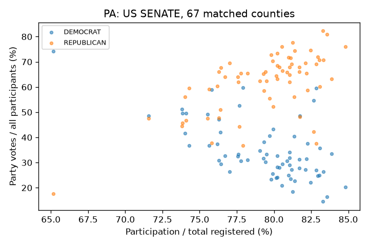

<!-- PRECINCT REPORT NOTICE -->
**Update, 17 October 2026:** [Precinct analysis](PRECINCT_REPORT.md) supersedes the county-only coverage and seven-race bound below: 25,682 eligible 2024 units, 276 new digit tests, Minnesota hand-review evidence and ten official-source bounds. The following is the retained earlier baseline.
<!-- END PRECINCT REPORT NOTICE -->

# U.S. Senate and House 2024: statistical diagnostic report

Run: 17 October 2026. **These screens do not establish election fraud.** The
strongest recurring signal is a failure of the theoretical Benford distribution,
which is an unreliable fraud discriminator in heterogeneous U.S. returns.

## Data and actual coverage

Downloaded all 51 MEDSL state/D.C. archives, pinned to commit
`df531089c78e6d0098db1a6bfb3849a066a06995`, plus EAC's 2024 EAVS version 2 and
its codebook. The archives contain **2,066,681 congressional source rows**;
normalization produces **1,596,352 candidate–reported-unit–contest records**.
19,825 source counts are suppressed or invalid and remain unknown. All archived
congressional rows are dated 5 November 2024. Special contests are retained in
the dataset and omitted from diagnostic pools.

- Digit screening: **284 tests**, 142 each for last digits and Benford second digits.
  State × office × major-party pools; candidate counts, not simulated ballots.
- County turnout join: **3,048 county–office records**, 2,877 pass arithmetic
  eligibility checks. Requiring at least 20 counties leaves **37 state–office
  combinations across 19 states**, comprising 2,768 county–office observations.
- Race screens: **323 House and 26 regular Senate contests** pass the documented
  screening criteria. This is a subset, not a reconstruction of all 435 House
  and 33 regular Senate elections. Uncontested/single-record races, suppressed
  totals and excluded sources limit coverage; omitted races are not negative findings.

See [README](README.md) for sources, exact exclusions, method coverage, and commands.
[Coverage](analysis/coverage.csv), [office inventory](analysis/office_inventory.csv),
and [county join audit](analysis/county_turnout_join_audit.csv) retain the details.

## Digit results

At BH q < 0.05 across all 284 theoretical tests, **22 tests flag**:
**21 Benford and one last-digit**. The last-digit case is Missouri Senate,
Democratic candidate counts (q ≈ 0.0352; fitted-lognormal Monte Carlo p ≈ 0.00498).
It is a review lead, not a finding of manipulation. The Monte Carlo resolution
with 200 simulations is 1/201; those Monte Carlo p-values are not BH-adjusted.

The smallest theoretical q-values are:

| State | Office | Party | Test | BH q |
|---|---|---|---|---|
| MA | US HOUSE | DEMOCRAT | benford2 | 2.56e-18 |
| NY | US SENATE | DEMOCRAT | benford2 | 1.64e-15 |
| OH | US SENATE | REPUBLICAN | benford2 | 8.94e-12 |
| MA | US SENATE | DEMOCRAT | benford2 | 4.68e-11 |
| MI | US HOUSE | REPUBLICAN | benford2 | 9.25e-07 |
| OH | US HOUSE | REPUBLICAN | benford2 | 6.13e-05 |
| NY | US HOUSE | DEMOCRAT | benford2 | 0.000344 |
| IL | US HOUSE | REPUBLICAN | benford2 | 0.0012 |

[All digit tests](analysis/digit_tests.csv) include counts and both null models.
Benford deviations can reflect precinct sizes, candidate support, aggregation,
centralized absentee pools, election rules and data preparation. No prior-election
control has been fitted, and these flags cannot distinguish those mechanisms.

## Turnout, integer peaks, mixtures and outliers

County turnout uses all participants / total registered (EAVS F1a/A1a), not valid
congressional votes / population. Party result share uses party votes / all
participants. Neither contest nonvoting nor unreported invalid ballots is imputed
as an observed blank or invalid ballot. Total registration includes inactive
registrants; active-registration sensitivity has not been run.

Republican turnout–share correlations vary substantially: Washington House
weighted r ≈ −0.524, Pennsylvania Senate ≈ +0.685, Tennessee House ≈ +0.778.
This variation is consistent with substantial geographic heterogeneity; it is
not evidence identifying fraud. House county pools combine different district
races and include uncontested districts, an additional confounder.

The largest unadjusted integer-share z is Wyoming Senate (≈ 3.55, 23 counties).
The largest turnout z is only about 1.04. There are 74 metric screens with small,
discrete samples; no adjusted significance or fraud claim follows from the
maximum. [Integer results](analysis/county_integer_peaks.csv).

Two-component Gaussian mixtures and own-data upper-tail mass estimates are in
[county metrics](analysis/county_metrics.json). The existing analysis tool labels
some fields `anom` or `honest`; those names do **not** validate that interpretation
here. The Shpilkin output measures votes above an internally chosen 99.5th
percentile boundary; it is not an estimate of stuffed votes. Removing that tail
is not a defensible correction of a U.S. election result without external evidence.

State-median/MAD screening flags **86 county–office observations**; Isolation
Forest flags **43**. The latter imposes 1% contamination within each state-office
sample and rounds in small samples; it does not estimate the prevalence of fraud.
The comparisons are within-state, not geographic-neighbor or socioeconomic matches.
[Outlier rankings](analysis/county_within_state_outliers.csv).

Example plot, visually checked:

## Quality checks and limits

The mode-collapsing self-check passes: TOTAL overrides subtotals, disjoint modes
sum, and an unknown TOTAL stays unknown. Input sizes match the pinned tree.
Derived table invariants and Python/shell syntax checks were also run.

[Senate reconciliation](analysis/senate_reference_reconciliation.csv) compares
candidate sums with MEDSL's separate statewide table, retaining its `unofficial`
flag. These are not independent certified anchors. Differences include candidate
naming, write-in grouping, suppressed data, source updates and coverage gaps;
several states do not reconcile. Unknown statewide sums remain unknown, not zero.
A screen-eligible flag means only that the documented mechanical criteria pass;
it does not imply certification or complete reconciliation.

No nationwide official House candidate-level reconciliation, matched earlier
election baseline, census covariates, precinct geography, ballot serial/batch
records, election-night time series, audit or recount evidence was acquired.
Those gaps prevent a reliable fraud-rate estimate or a conclusion that flagged
units were manipulated. They also prevent claiming that unflagged units were
verified clean. No website deployment or publication was performed.

## Supplement: county duplicate vectors and a synthetic sensitivity check

Added for the website’s method-by-method presentation. The figure builder
(`scripts/build_site_figures.py`) reproduces both checks and writes
`analysis/county_duplicate_vectors.csv` and `analysis/site_diagnostics.json`.

Within each of the 37 state–office samples, compare the exact vector of total
registered voters, participants, Democratic votes, Republican votes and other
votes. There are **zero repeated vectors among 2,768 county–office records**.
No chance model was fitted. Large county aggregates rarely match; this cannot
exclude copied precinct protocols and does not check duplicate ballots.

On the Pennsylvania Senate county sample, reuse the toolkit’s additive-ballot
injection with seed 7. It adds **68,137 synthetic Republican votes**. Holding the
original turnout boundary at **83.8869%**, the Shpilkin histogram tail rises from
**9,251 to 276,409 votes**. Existing votes in counties moved past the boundary
also enter the tail, explaining why it exceeds the injected amount. This checks
sensitivity to one synthetic scenario; it does not accurately recover the added
count, validate every method, or establish that the original sample was honest.
The observed data and original analysis outputs are unchanged. No rounded-turnout
synthetic test was performed.
