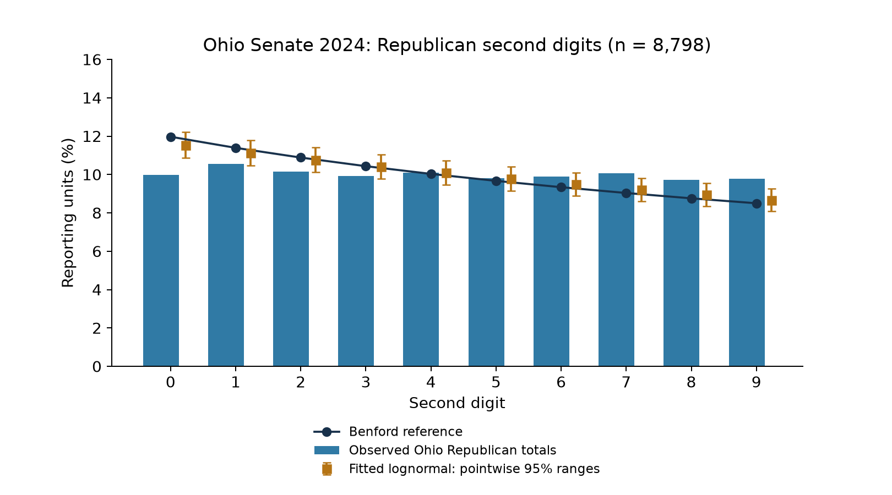
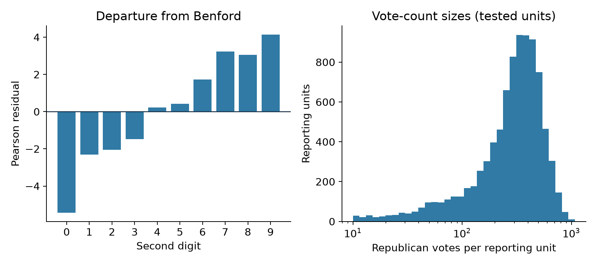

# Ohio Senate 2024: a second-digit anomaly

Independent statistical screening note | 18 October 2026

For discussion with statisticians, data researchers and journalists. Author: Renat Yuldashev (renatyv.org). Election: 5 November 2024, United States Senate, Ohio.

## Abstract

Republican vote totals in 8,798 Ohio reporting units depart from the Benford second-digit reference: Pearson chi-square = 81.174, 9 degrees of freedom, p = 9.443e-14. After Benjamini-Hochberg adjustment across the study's 694 digit tests, q = 2.184e-11. A fitted-lognormal comparison with 20,000 simulations produces zero statistics at least as large as observed: corrected Monte Carlo p = 1/20,001 = 0.000049998 and family-adjusted q = 0.004957. This is the only 2024 test flagged under both references in this study; seven historical tests also flag under both.

The finding is a departure from two specified reference models, not evidence establishing fraud. Both comparisons use the same counts and statistic. Neither fully models reporting-unit size, voter composition or geographic dependence. No affected-vote estimate or changed winner follows. The immediate research question is whether source validation and better conditional models explain the pattern.

## Main result



Figure 1. Each reporting unit contributes one Republican vote total, regardless of its size. The bars are observed frequencies; the line is the Benford reference. Markers and ranges come from 20,000 fitted-lognormal simulations. Ranges are pointwise central 95% ranges for each digit, not simultaneous confidence bands or a separate ten-test decision rule.

<!-- pagebreak -->

## 1. What was counted

The source contains 8,878 Senate reporting-unit rows across all 88 Ohio counties. The published analysis marks all of them eligible. Eighty Republican totals below 10 are excluded from the second-digit test, leaving 8,798. Identifiers combine county and source precinct code; duplicate identifiers are rejected.

A second digit is the second decimal digit from the left: 12, 123 and 1,234 all contribute digit 2. A total of 9 has no second digit and is excluded. This is a distribution of precinct-level totals, not of individual ballots. The test is unweighted: a total of 12 and a total of 1,234 each count once.

Statewide candidate totals in the exported data are 2,857,383 Republican votes (Bernie Moreno), 2,650,949 Democratic votes (Sherrod Brown) and 195,648 votes for other named candidates. The Republican-Democratic margin is 206,434. These totals contextualize the data; the digit test does not estimate an error in that margin.

## 2. What the charts show

Ohio's observed distribution is flatter than the Benford second-digit curve. Digit 0 occurs about 10% of the time, versus about 12% in the reference; digits 7, 8 and 9 occur more often than the reference predicts. The maximum absolute frequency difference is about 2.00 percentage points. Exact counts, expected counts, percentages, simulation ranges and Pearson residuals are in data/second_digit_frequencies.csv.



Figure 2. Left: signed Pearson residuals, (observed - expected) / sqrt(expected). Squared residuals sum to the overall chi-square statistic. These bars are descriptive contributions, not separately adjusted significance tests. Right: count-size distribution using logarithmic bins and a logarithmic horizontal scale; only the 8,798 tested units are shown. A fitted distribution is a simplifying reference, not a validated model of honest voting.

<!-- pagebreak -->

## 3. Methods and numerical results

### Theoretical reference

For digit d from 0 to 9, the reference probability is the sum over first digits a = 1,...,9 of log10(1 + 1/(10a + d)). Expected counts equal these probabilities multiplied by 8,798. The statistic sums (observed - expected)^2 / expected over all ten digits. Its conventional chi-square reference has nine degrees of freedom.

Observed statistic: 81.174074. Theoretical p: 9.442923e-14. Benjamini-Hochberg q: 2.184463e-11. This calculation assumes the reference distribution is appropriate; a small p-value can instead indicate a poor reference for these data.

### Fitted-lognormal reference

Fit the mean and population standard deviation of log(votes) to the observed Republican counts of at least 10. For each simulation, draw twice the observed sample size from that lognormal distribution, round to integer counts, remove values below 10 and take the first 8,798 retained values. The script checks that enough values remain. Recompute the same Benford chi-square statistic for each simulated sample.

The generator is NumPy default_rng with seed 314159. The 20,000 simulations use batches of 32, matching the published refinement script. Monte Carlo p is (exceedances + 1)/(simulations + 1), with exceedances counting statistics greater than or equal to the observed statistic. Zero exceedances yields p = 1/20,001, the simulation resolution limit. It does not establish that the underlying tail probability equals that number.

This is a plug-in parametric simulation: fitted parameters are held fixed and the simulation does not refit them in each replicate. Rounding and truncation are part of the reference. Neither spatial dependence nor separate county, size or demographic distributions are represented.

### Multiple comparisons and selection

The parent study contains 694 second-digit and last-digit tests across parties, contests and current/historical samples. It reports separate BH adjustments for theoretical and fitted-model p-values. The initial fitted-model screen used 400 simulations. The refinement selected all theoretical BH flags plus all initial minimum-p Monte Carlo hits (12 tests), reran them with 20,000 simulations, assigned p = 1 to unselected tests and applied BH across all 694 entries. An unselected p = 1 is a conservative bookkeeping value, not a measured 20,000-simulation p-value.

The included full_digit_test_family.csv preserves every row. build_plots.py recalculates both BH vectors and checks the published Ohio result. This verifies the arithmetic and reproduces the Ohio simulation; it does not rerun the other 693 tests or prove BH false-discovery guarantees under arbitrary dependence. The two references are sensitivity checks on the same signal, not independent replications.

<!-- pagebreak -->

## 4. Data origin and preparation

### Source chain

The intended publisher is the Ohio Secretary of State. The recorded official XLSX request failed with HTTP 403 on 18 October 2026 at 11:13:34 UTC. Five seconds later, the project downloaded a pinned GitHub mirror from Camreyn/civicresultmaps, commit 5195a57d913c839106ce1d2de32e3510d9ef3d3a. The source manifest records 23,053,730 bytes and SHA-256:

60505e339d47b98c9e2797c62fef68b38b4f271cb37921c5283b0dfd19343653

The hash was rechecked when preparing this package. Pinning identifies the exact file; it does not authenticate the mirror against a successfully retrieved state original. No fresh official-source retrieval was performed for this package.

- [Recorded official XLSX endpoint](https://www.ohiosos.gov/globalassets/elections/2024/gen/official/statewide-races-precinct-level.xlsx)
- [Exact pinned mirror XLSX](https://raw.githubusercontent.com/Camreyn/civicresultmaps/5195a57d913c839106ce1d2de32e3510d9ef3d3a/data/oh-2024-statewide-races-precinct-level.xlsx)
- [Official House Clerk 2024 election statistics PDF](https://clerk.house.gov/member_info/electionInfo/2024/statistics2024.pdf)

Full URLs, retrieval timestamps, file size, commit and checksum are preserved in data/source_provenance.json.

### Extraction and verification

The original parser reads cached XML values from xl/worksheets/sheet5.xml inside the XLSX, resolving shared strings. It uses the first two rows for contest and candidate headers and starts data after four header rows. Column A supplies county, B precinct name, C precinct code, F registered voters and G ballots cast. Contest columns are grouped under the U.S. Senator header. Candidate labels ending in (R) or (D) supply the corresponding party totals; remaining candidate columns form OTHER. Only rows with positive contest vote sums are retained.

For this package, the existing ohio() parser was rerun against the checksum-verified XLSX. All 8,878 identifiers and all five numeric fields (REP, DEM, OTHER, registered voters and ballots cast) were compared with the published join audit and matched. The XLSX is not duplicated in this package; the pinned download and hash allow retrieval. Reference copies of the extraction and refinement scripts are included as audit material, with their original repository imports intact.

### Known reconciliation limit

The mirror's Senate OTHER total is 640 votes below the House Clerk total: 195,648 versus 196,288. The discrepancy is missing write-in votes. Republican and Democratic candidate totals reconcile in the existing project comparison. The absent write-ins have not been imputed to precincts. They do not enter the Republican second-digit sample, but the discrepancy remains a source limitation. Statewide agreement does not independently validate every precinct entry.

<!-- pagebreak -->

## 5. Interpretation and next research steps

The supported conclusion is narrow: this set of Republican totals is atypical under two particular references. It is not a probability that fraud occurred. It identifies neither erroneous records nor a perpetrator, mechanism, number of altered ballots or counterfactual winner. Summing the negative chart residuals would not estimate missing votes.

Seven historical cases also pass both screens, including Democratic totals in California and Washington. This context makes clear that the signal is not specific to one party or to the 2024 Ohio election. Ohio's Democratic second-digit theoretical p is 0.01817, but adjusted q is 0.4122; it does not pass the family-adjusted threshold. Neither Ohio Senate last-digit test passes that threshold.

A useful review should proceed in this order:

1. Independently obtain the official workbook or county certified statements; verify candidate headers, precinct codes, totals and reporting-unit definitions against the mirror.
2. Identify which counties and count-size ranges contribute to the statistic. Run leave-one-county-out checks and examine whether mixtures or reporting conventions explain the departures.
3. Construct conditional references that preserve precinct size and plausible voter heterogeneity. Explain their assumptions and calibrate them with simulations and genuinely comparable historical Ohio precincts.
4. Declare additional tests and their multiplicity treatment before interpreting follow-up significance. Ohio was selected after a broad screen, rather than from a prespecified Ohio-only hypothesis.
5. Where the records warrant it, compare relevant official audits, recounts or paper-ballot checks. Those would supply a different type of evidence; this packet contains no Ohio ballot-level audit.

### Questions for reviewers

- Is a single fitted lognormal a credible count-size reference for this sample?
- Can ordinary mixtures of precinct size and Republican support reproduce the flattening?
- Are any reported units composite, split or otherwise noncomparable?
- What conditional model would provide a calibrated screen without assuming uniform support?
- Does the pattern persist in independently sourced records and matched historical Ohio data?

### Suggested description for journalists

An independent analysis found an unusual digit distribution in precinct-level Republican totals for Ohio's 2024 Senate election. The pattern remained unusual under two reference models after multiple-testing adjustments, but neither model captures all ordinary differences between precincts. The analysis does not establish fraud or a changed outcome. Its author is seeking source verification and methodological review.

<!-- pagebreak -->

## 6. Package contents and reproduction

- REPORT.md: this report, including the principal result and figures.
- output/pdf/ohio_senate_discussion.pdf: PDF compiled from this Markdown.
- data/ohio_senate_precincts.csv: all 8,878 Senate rows, one per source reporting unit. These are aggregated election returns; there are no individual voter records.
- data/second_digit_frequencies.csv: ten rows, one per second digit, including observed counts and reference frequencies/ranges.
- data/full_digit_test_family.csv: all 694 published test results needed to check the two BH adjustments.
- data/result.json: recomputed Ohio statistic, simulation result, fitted parameters and sample sizes.
- data/source_provenance.json: recorded download provenance and checksum.
- data/reference_expanded_analysis.py and data/reference_refine_digit_nulls.py: original project scripts, included for inspection rather than standalone execution.
- build_plots.py: standalone plot and Ohio test reproduction; reads only bundled CSV files.
- build_pdf.py: compiles REPORT.md with the two generated figures using ReportLab.

### Precinct CSV field definitions

sample and district identify the Ohio Senate statewide contest. key is county plus source precinct code; county and name preserve source labels. registered_voters and voted are source registration and ballot totals. votes:REP and votes:DEM are candidate vote totals; votes:OTHER pools remaining available candidates and excludes the missing write-ins. incomplete_writeins is true for all exported rows. included_second_digit is true exactly when votes:REP is at least 10. rep_second_digit is the tested digit, blank for excluded rows. Counts are integers; flags are booleans. Registration and ballot totals are context, not denominators used by the second-digit statistic.

### Commands

Run from this folder with Python 3 and numpy, pandas, scipy, matplotlib installed:

```
python build_plots.py
```

The script regenerates both PNG figures, the frequency CSV and result.json. Assert-based checks verify row identifiers, sample sizes, the published statistic, the Ohio Monte Carlo result and both full-family BH vectors. Simulation bands use 20,000 replicates here; the website illustration used 2,000, so its plotted ranges can differ slightly.

With reportlab installed, compile the PDF from the Markdown:

```
python build_pdf.py
```

Original project context: ../EXPANDED_REPORT.md, ../RECONCILIATION.md and ../scripts/build_ohio_figures.py. This standalone discussion packet preserves the published finding and adds a portable reproduction; it does not claim independent external validation.
